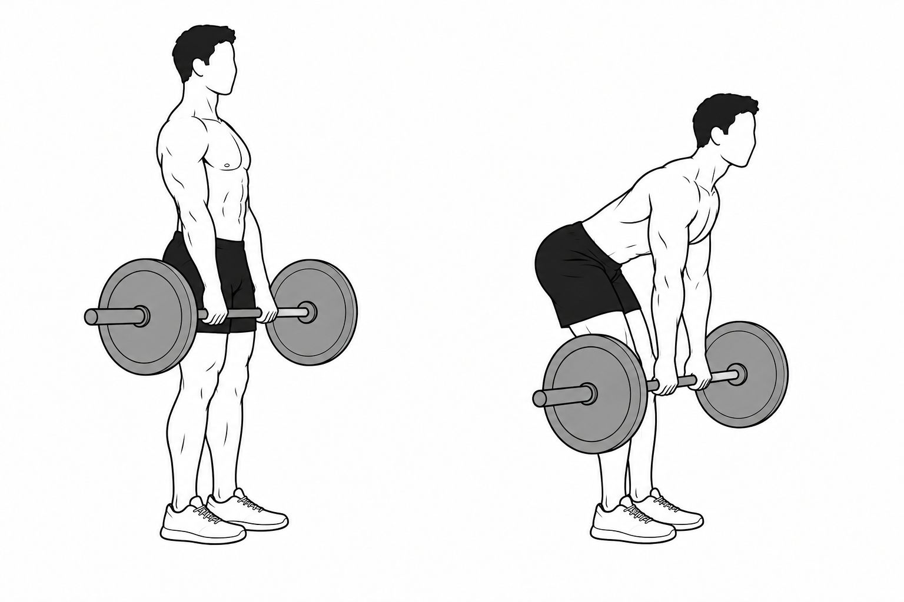

# Exercise Atlas

Exercise Atlas is a community exercise catalog. Anyone can use, adapt, and share it for noncommercial projects, and everyone is welcome to contribute. Each entry has English and Danish names, setup and movement cues, muscle roles, and a pair of black-and-white drawings showing the start and finish.

**[Create an exercise with the authoring skill](.agents/skills/exercise-atlas-authoring/SKILL.md)** · [Browse the 79 illustrated drafts](docs/examples.md)

## ✍️ Create your first exercise

If you'd like to add a movement, start with the **Exercise Atlas Authoring** skill. It brings together the entry template, five original illustration references, and a guide to checking both poses. The workflow has been tested successfully with both **OpenAI** and **Google Gemini**. The exact models used are unknown.

Open a checkout of this repo in Codex and try this prompt:

> Use $exercise-atlas-authoring to add a dumbbell floor press with a neutral grip. Show the start and finish from the side, explain how to log the weight per dumbbell, and save it as a draft for review.

With Gemini, point it to the [skill instructions](.agents/skills/exercise-atlas-authoring/SKILL.md) in your checkout and give it the same exercise brief. Use a session with image generation available to create the paired illustration.

**Before submitting**, read the [contribution policy](CONTRIBUTING.md) and compare the drawings with the written setup, grip, and equipment. Run `npm run docs:generate` to refresh the preview and `npm run verify` to check the entry and image. Keep new entries in draft until their technique and equipment details have been reviewed. See the [authoring and revision guide](docs/authoring.md).

<details>
<summary>Use the skill in another Codex project</summary>

From this checkout, run `npm run skill:install`. This copies the skill and its references to `$CODEX_HOME/skills` (default `~/.codex/skills`). The installer stops if a copy already exists. Reload skill discovery if needed, then invoke `$exercise-atlas-authoring` in your project.

</details>

## 🖼️ Inside a catalog entry



The [barbell Romanian deadlift entry](catalog/exercises/barbell-romanian-deadlift.json) pairs these drawings with setup instructions, muscle roles, a load-logging example, sources, and illustration provenance. Every entry also records assumptions about the equipment or movement variant. The [illustrated catalog](docs/examples.md) shows which details still need review.

## 🔎 Browse locally

Requires Node 24.12+ within Node 24.x and npm. TypeScript runs using Node's built-in type stripping; type checking is a separate verification step.

```sh
npm ci
npm run verify
npm start
```

Open [the exercise viewer](http://127.0.0.1:4317/ui) to browse the catalog. The API listens at `http://127.0.0.1:4317`. `HOST` and `PORT` override the address. Binding to a non-loopback address exposes this unauthenticated API on that network; the default is local only. It needs no database, account, image-generation key or live provider connection to serve the saved catalog.

```sh
curl 'http://127.0.0.1:4317/v1/exercises?limit=100'
curl 'http://127.0.0.1:4317/v1/exercises?q=cuffs'
curl 'http://127.0.0.1:4317/v1/exercises?status=reviewed'
curl http://127.0.0.1:4317/v1/exercises/barbell-romanian-deadlift
```

In Windows PowerShell, use `curl.exe` or `Invoke-RestMethod`.

## API

All endpoints accept GET and HEAD. Other methods receive 405. No endpoint modifies data.

| Path | Response |
| --- | --- |
| `/` | Service version and endpoint links |
| `/health` | Readiness and loaded exercise count |
| `/v1/catalog` | Dataset version, licensing state and review counts |
| `/v1/exercises` | Searchable, filtered, paginated exercises |
| `/v1/exercises/{id}` | One entry with its revision |
| `/v1/taxonomy` | Available muscles, equipment, body parts and labels |
| `/v1/schema` | JSON Schema for one exercise |
| `/media/{sha256}.png` | Original illustration with immutable caching |

Search parameters: `q` searches names, aliases, Danish names, descriptions, muscle names, body parts and equipment; `muscle` and `equipment` are exact taxonomy values, case-insensitive; `difficulty` is Beginner, Intermediate or Advanced; `status` is draft, reviewed or retired. `limit` defaults to 20 and accepts 1-100; `offset` defaults to 0. Results are ordered by English name. Filters combine with AND. Unknown/repeated parameters and invalid pagination return 400. A valid filter with no matches returns an empty list.

List responses contain `catalogVersion`, `total`, `limit`, `offset`, `nextOffset` and `data`. Details return `catalogVersion` and `data`. Errors use `{ "error": { "code": "...", "message": "..." } }`. Drafts are included by default so the initial examples are inspectable; consumers can request `status=reviewed` (initially empty). Muscle roles are qualitative, not activation scores. JSON responses support ETag revalidation; checksum-named PNGs can be cached immutably. Media URLs are relative to this API's origin.

## Repository layout

```text
catalog/exercises/                 One JSON file per stable exercise ID
catalog/media/                     PNGs named by SHA-256
catalog/styles/line-art-v1/         Frozen style manifest and generation prompts
.agents/skills/exercise-atlas-authoring/  Portable authoring workflow
src/                               Shared schemas, catalog loader and HTTP API
test/                              API and catalog integrity checks
```

## Publication and licensing

The catalog, illustrations, and documentation use [CC BY-NC 4.0](https://creativecommons.org/licenses/by-nc/4.0/). When sharing an entry, credit Exercise Atlas and its credited creators, link the license, and identify any changes.

The code and skills are source-available under the [Exercise Atlas Noncommercial Software and Skills License](LICENSE). You can use the skill to build and share a free hobby catalog. The public licenses exclude commercial use, such as selling exercise packs or incorporating the catalog into a paid fitness app. To add your own work, [open a pull request](CONTRIBUTING.md).
