# Illustrated exercise catalog

58 original draft entries in the line-art-v1 visual style. Technique review is pending; cuff and machine details need confirmation. These are catalog entries, not prescribed workout programs.

## Index

- [Barbell Back Squat](../catalog/exercises/barbell-back-squat.json)
- [Barbell Bench Press](../catalog/exercises/barbell-bench-press.json)
- [Barbell Deadlift](../catalog/exercises/barbell-deadlift.json)
- [Barbell Incline Bench Press](../catalog/exercises/barbell-incline-bench-press.json)
- [Barbell Romanian Deadlift](../catalog/exercises/barbell-romanian-deadlift.json)
- [Bayesian Curl](../catalog/exercises/bayesian-curl.json)
- [Bent-Over Barbell Row](../catalog/exercises/bent-over-barbell-row.json)
- [Cable High Fly](../catalog/exercises/cable-high-fly.json)
- [Cable Low Fly](../catalog/exercises/cable-low-fly.json)
- [Cable Rope Triceps Pushdown](../catalog/exercises/cable-rope-triceps-pushdown.json)
- [Cable Triceps Pushdown](../catalog/exercises/cable-triceps-pushdown.json)
- [Decline Dumbbell Bench Press](../catalog/exercises/decline-dumbbell-bench-press.json)
- [Dumbbell Bench Press](../catalog/exercises/dumbbell-bench-press.json)
- [Dumbbell Biceps Curl](../catalog/exercises/dumbbell-biceps-curl.json)
- [Dumbbell Hammer Curl](../catalog/exercises/dumbbell-hammer-curl.json)
- [Dumbbell Lateral Raise](../catalog/exercises/dumbbell-lateral-raise.json)
- [Dumbbell Romanian Deadlift](../catalog/exercises/dumbbell-romanian-deadlift.json)
- [Dumbbell Single-Leg Calf Raise](../catalog/exercises/dumbbell-single-leg-calf-raise.json)
- [Dumbbell Spider Curl](../catalog/exercises/dumbbell-spider-curl.json)
- [Face Pulls with Wrist Cuffs](../catalog/exercises/face-pull-wrist-cuffs.json)
- [Flat Dumbbell Fly](../catalog/exercises/flat-dumbbell-fly.json)
- [Incline Chest Press Machine](../catalog/exercises/incline-chest-press-machine.json)
- [Incline Dumbbell Biceps Curl](../catalog/exercises/incline-dumbbell-biceps-curl.json)
- [Incline Smith Machine Press](../catalog/exercises/incline-smith-machine-press.json)
- [Leg Press Calf Press](../catalog/exercises/leg-press-calf-press.json)
- [Lying Leg Curl](../catalog/exercises/lying-leg-curl.json)
- [Machine Chest Press](../catalog/exercises/machine-chest-press.json)
- [Machine Hip Thrust](../catalog/exercises/machine-hip-thrust.json)
- [Machine Inner Chest Press](../catalog/exercises/machine-inner-chest-press.json)
- [Machine Preacher Curl](../catalog/exercises/machine-preacher-curl.json)
- [Overhead Rope Cable Triceps Extension](../catalog/exercises/overhead-rope-cable-triceps-extension.json)
- [Pec Deck](../catalog/exercises/pec-deck.json)
- [Pendlay Row](../catalog/exercises/pendlay-row.json)
- [Pendulum Squat](../catalog/exercises/pendulum-squat.json)
- [Plate Loaded Lat Pulldown](../catalog/exercises/plate-loaded-lat-pulldown.json)
- [Reverse Pec Deck](../catalog/exercises/reverse-pec-deck.json)
- [Seated Cable Row](../catalog/exercises/seated-cable-row.json)
- [Seated Cable Row with Wrist Cuffs](../catalog/exercises/seated-cable-row-wrist-cuffs.json)
- [Seated Hip Abduction Machine](../catalog/exercises/seated-hip-abduction-machine.json)
- [Seated Hip Adduction Machine](../catalog/exercises/seated-hip-adduction-machine.json)
- [Seated Lat Pulldown Machine](../catalog/exercises/seated-lat-pulldown-machine.json)
- [Seated Leg Press](../catalog/exercises/seated-leg-press.json)
- [Seated Machine Lateral Raise](../catalog/exercises/seated-machine-lateral-raise.json)
- [Single-Arm Plate Loaded Lat Pulldown](../catalog/exercises/single-arm-plate-loaded-lat-pulldown.json)
- [Single-Arm Rear-Delt Cable Fly](../catalog/exercises/single-arm-rear-delt-cable-fly.json)
- [Single-Arm Seated Row (Plate Loaded)](../catalog/exercises/single-arm-seated-plate-loaded-row.json)
- [Single-Arm Supinated Pulldown](../catalog/exercises/single-arm-supinated-pulldown.json)
- [Standing Barbell Curl](../catalog/exercises/standing-barbell-curl.json)
- [Standing Barbell Strict Press](../catalog/exercises/standing-barbell-strict-press.json)
- [Standing Calf Raise](../catalog/exercises/standing-calf-raise.json)
- [Standing Dumbbell Strict Press](../catalog/exercises/standing-dumbbell-strict-press.json)
- [Standing Single-Arm Cable Biceps Curl](../catalog/exercises/standing-single-arm-cable-biceps-curl.json)
- [Straight-Arm Cable Pullover](../catalog/exercises/straight-arm-cable-pullover.json)
- [Supinated Barbell Bent-Over Row](../catalog/exercises/supinated-barbell-bent-over-row.json)
- [T-Bar Row](../catalog/exercises/t-bar-row.json)
- [Trap-Bar Deadlift](../catalog/exercises/trap-bar-deadlift.json)
- [Weighted Dips](../catalog/exercises/weighted-dip.json)
- [Wide-Grip Upright Row](../catalog/exercises/wide-grip-upright-row.json)

## Barbell Back Squat

Standing under bar / Lowered squat

Squat with a barbell supported on the upper back, bending the knees and hips while keeping the feet planted.

- **Danish:** Squat med vægtstang på ryggen
- **Aliases:** Back squat, Barbell squat
- **Primary muscles:** Quadriceps, Gluteus maximus
- **Assisting muscles:** Adductor magnus
- **Stabilizers:** Spinal erectors, Abdominal wall, Upper back, Gluteus medius, Calf muscles
- **Equipment:** Barbell, Weight plates, Squat rack with safety supports
- **Movement:** Squat; Bilateral
- **Grip:** Closed grip outside the shoulders to secure the bar on the upper back; the hands do not carry the bar overhead.
- **Difficulty:** Intermediate (editorial label)
- **Review:** draft; revision 1

### Setup

- Set the rack and safety supports to suit your height and planned depth.
- Place the bar across the upper trapezius below the neck, grasp it securely and stand clear of the hooks.
- Choose a stable stance around shoulder-width, with the toes turned out as comfortable.

### Execution

1. Brace the trunk and lower by bending the knees and hips together.
2. Keep the whole foot loaded and knees tracking in the direction of the toes.
3. Descend to a depth you can control; the drawing shows thighs around parallel.
4. Drive through the feet to stand, then rerack securely after the set.

### Cues

- Keep the whole foot planted.
- Let knees follow the toes.
- Stand with chest and hips rising together.

### Common mistakes

- Lifting the heels or collapsing the knees inward.
- Losing trunk control to force extra depth.

### Logging convention

A 20 kg bar plus two 15 kg plates: record 50 kg total.

Include the bar and both sides' plates; preserve the original load convention in existing logs.

### Variants and alternatives

Illustrated as a high-bar back squat with approximately parallel depth. Low-bar placement, stance and individual depth can differ and need explicit notes.

- Goblet Squat
- Front Squat

### Review notes

- Rack setup and spotting are not illustrated; use the equipment's safety arrangements.
- Trainer review of bar position, depth and illustrations pending.

### References

- [ACE - Back Squat](https://www.acefitness.org/resources/everyone/exercise-library/11/back-squat/): Barbell back-squat setup and squat mechanics; chosen high-bar appearance and depth are editorial assumptions.

[Editable JSON](../catalog/exercises/barbell-back-squat.json)

## Barbell Bench Press

Bar lowered toward chest / Bar pressed upward

Press a barbell above the chest while lying on a flat bench with the feet planted.

- **Danish:** Bænkpres med vægtstang
- **Aliases:** Flat barbell bench press, Barbell chest press
- **Primary muscles:** Pectoralis major
- **Assisting muscles:** Anterior deltoid, Triceps brachii
- **Stabilizers:** Rotator cuff, Upper back, Abdominal wall
- **Equipment:** Barbell, Weight plates, Flat bench, Rack with safety supports or a competent spotter
- **Movement:** Horizontal push; Bilateral
- **Grip:** Closed overhand grip slightly wider than shoulders, with the bar secure over the forearms.
- **Difficulty:** Intermediate (editorial label)
- **Review:** draft; revision 1

### Setup

- Set rack hooks and safety supports for your body and range; use suitable spotting arrangements.
- Lie with head, shoulders and hips supported and feet firmly on the floor.
- Take a closed overhand grip and unrack the bar above the chest with the upper back stable.

### Execution

1. Lower the bar under control toward the middle or lower chest.
2. Keep wrists above the forearms and elbows at a comfortable angle to the torso.
3. Press back above the chest and shoulders without lifting the hips.
4. Finish the set by guiding the bar securely into both rack hooks.

### Cues

- Keep the feet planted.
- Control the bar above the chest.
- Maintain contact with the bench.

### Common mistakes

- Bouncing the bar off the chest or lowering toward the throat.
- Lifting the hips or losing control of the bar while reracking.

### Logging convention

A 20 kg bar plus two 15 kg plates: record 50 kg total.

Include the bar and both sides' plates; preserve the original load convention in existing logs.

### Variants and alternatives

Flat bench, moderate grip and controlled chestward lowering. Incline, decline and close-grip presses remain distinct.

- Flat Dumbbell Bench Press
- Decline Dumbbell Bench Press

### Review notes

- The illustration shows two positions, not unracking, spotting or the full bar path.
- Confirm rack support arrangement; trainer review of technique and bar position pending.

### References

- [Muscle & Strength - Barbell Bench Press](https://www.muscleandstrength.com/exercises/barbell-bench-press.html): Flat barbell press, chest targeting, supported setup and controlled lowering toward the sternum.

[Editable JSON](../catalog/exercises/barbell-bench-press.json)

## Barbell Deadlift

Bar settled on floor / Standing with bar

Lift a barbell from a settled floor position by extending the hips and knees, keeping the bar close to the legs.

- **Danish:** Konventionelt dødløft med vægtstang
- **Aliases:** Deadlift, Conventional barbell deadlift
- **Primary muscles:** Gluteus maximus, Quadriceps
- **Assisting muscles:** Hamstrings, Adductor magnus
- **Stabilizers:** Spinal erectors, Abdominal wall, Latissimus dorsi, Trapezius, Forearm flexors
- **Equipment:** Barbell, Weight plates, Level lifting surface
- **Movement:** Hip and knee extension - floor pull; Bilateral
- **Grip:** Double overhand, hands outside the legs. Mixed and hook grips are not illustrated.
- **Difficulty:** Intermediate (editorial label)
- **Review:** draft; revision 1

### Setup

- Position the bar over the midfoot with feet about hip-width apart.
- Hinge down and bend the knees to grasp the bar outside the legs.
- Set a stable trunk, keep the arms long and take up tension against the bar before lifting.

### Execution

1. Push through the floor and extend the hips and knees together while keeping the bar close.
2. Guide the bar past the knees without bending the elbows.
3. Stand tall with the bar at the thighs, without leaning backward.
4. Hinge back and bend the knees as needed to lower the bar, settle the plates and reset.

### Cues

- Keep the bar near the legs.
- Push the floor away.
- Finish tall.

### Common mistakes

- Jerking the bar from the floor with a rounded trunk.
- Letting the hips rise far ahead of the shoulders or leaning back at lockout.

### Logging convention

A 20 kg bar plus two 15 kg plates: record 50 kg total.

Include the bar and both sides' plates; preserve the original load convention in existing logs.

### Variants and alternatives

Conventional floor-start stance, resetting each repetition. Sumo, trap-bar and Romanian deadlifts are separate variants.

- Trap-Bar Deadlift
- Barbell Romanian Deadlift

### Review notes

- Plate diameter determines starting bar height; smaller plates may require a raised starting surface.
- Trainer review of setup and illustration pending.

### References

- [ACE - Deadlift](https://www.acefitness.org/resources/everyone/exercise-library/6/deadlift/): General conventional barbell deadlift setup and controlled floor-to-standing movement.

[Editable JSON](../catalog/exercises/barbell-deadlift.json)

## Barbell Incline Bench Press

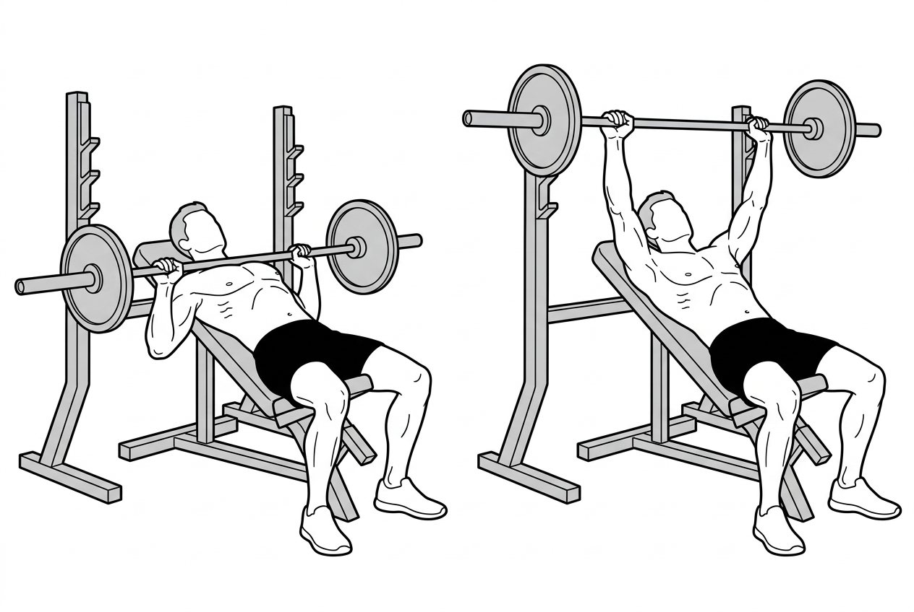

Starting position / Peak contraction position

Press a barbell from the upper chest while lying on an incline bench angled between 30 and 45 degrees, developing upper pectoral thickness and anterior deltoid strength.

- **Danish:** Skrå bænkpres med vægtstang
- **Aliases:** Barbell Incline Bench Press, Incline barbell bench press, Incline bench press, Incline barbell press
- **Primary muscles:** Pectoralis major (clavicular head)
- **Assisting muscles:** Anterior deltoid, Triceps brachii, Pectoralis major (sternal head)
- **Stabilizers:** Rotator cuff, Abdominal wall, Rhomboids, Lower trapezius
- **Equipment:** Barbell, Weight plates, Adjustable incline bench, Rack with safety supports or a competent spotter
- **Movement:** Incline chest press - free weight; Bilateral
- **Grip:** Overhand pronated grip slightly wider than shoulder width with thumbs wrapped securely around the bar.
- **Difficulty:** Intermediate (editorial label)
- **Review:** draft; revision 1

### Setup

- Set an incline bench between 30 and 45 degrees inside a power rack or designated incline bench station.
- Lie on the bench with eyes positioned directly under the racked barbell, feet flat and firmly pressed into the floor.
- Retract and depress your scapulae, planting your shoulder blades firmly into the bench pad.
- Grasp the bar with a full overhand grip slightly wider than shoulder width, wrists straight.
- Unrack the barbell and settle it directly over the upper chest with arms straight and elbows softly unlocked.

### Execution

1. Lower the bar smoothly toward your upper chest (at or slightly below the clavicles), keeping elbows tucked at approximately a 45 to 60-degree angle to the torso.
2. Touch the barbell lightly to the chest without bouncing off the sternum.
3. Press the bar upward and slightly backward along an efficient diagonal pressing path until arms are fully extended over the shoulders.
4. Maintain leg drive and tight upper back tension throughout the entire repetition.

### Cues

- Pull the bar down to the upper chest.
- Tuck elbows to 45 degrees.
- Drive feet into the floor.

### Common mistakes

- Setting bench angle excessively steep (e.g. 60+ degrees), transforming the exercise into a shoulder press.
- Bouncing the barbell violently off the chest.
- Flaring elbows straight out to 90 degrees, stressing the anterior shoulder capsule.

### Logging convention

Standard 20 kg barbell loaded with two 20 kg plates (one per side): record 60 kg total barbell mass.

Record the total system mass of the barbell plus all loaded plates.

### Variants and alternatives

Free-weight incline pressing movement angled at 30 to 45 degrees, providing unrestricted barbell path and demanding significant shoulder stabilizer engagement.

- Barbell Bench Press
- Incline Smith Machine Press
- Incline Chest Press Machine
- Dumbbell Bench Press

### Review notes

- Drafted from FitTrack ID 49 (Barbell Incline Bench Press).
- Illustration depicts 30-45 degree incline bench with barbell lowered to upper chest / clavicular contact in panel A and full overhead lockout in panel B.

### References

- [ExRx.net - Barbell Incline Bench Press](https://exrx.net/WeightExercises/PectoralClavicular/BBInclineBenchPress): Incline barbell pressing mechanics, clavicular pectoralis recruitment, bench incline angle optimization, and safety protocols.

[Editable JSON](../catalog/exercises/barbell-incline-bench-press.json)

## Barbell Romanian Deadlift

Standing position / Lowered hinge

A standing hip hinge that loads the back of the thighs and glutes. The hips move backward as the bar descends close to the legs.

- **Danish:** Rumænsk dødløft med vægtstang
- **Aliases:** Romanian deadlift, Barbell RDL
- **Primary muscles:** Hamstrings, Gluteus maximus
- **Assisting muscles:** Adductor magnus
- **Stabilizers:** Spinal erectors, Abdominal wall, Upper back, Forearm flexors
- **Equipment:** Barbell, Weight plates, Rack for setup, optional
- **Movement:** Hip hinge; Bilateral
- **Grip:** Double overhand, hands approximately shoulder-width apart.
- **Difficulty:** Intermediate (editorial label)
- **Review:** draft; revision 1

### Setup

- Stand with feet around hip-width and hold the bar in front of the thighs.
- Soften the knees, brace the trunk and keep the neck aligned with the spine.

### Execution

1. Push the hips backward while keeping the bar close and arms straight.
2. Lower only while you can maintain the hinge and a stable trunk; the plates need not reach the floor.
3. Keep roughly the same small knee bend rather than dropping into a squat.
4. Drive the hips forward to stand tall without leaning backward.

### Cues

- Hips back, bar close.
- Let the gaze follow the torso.
- Stand tall at the top.

### Common mistakes

- Rounding the back to force extra depth.
- Bending the knees into a squat or letting the bar drift forward.

### Logging convention

A 20 kg bar plus two 15 kg plates: record 50 kg total.

Include the bar; keep equipment and load convention consistent.

### Variants and alternatives

Starts upright and reverses at your controlled hinge depth; a conventional deadlift from the floor is separate.

- Dumbbell Romanian Deadlift
- B-Stance Romanian Deadlift

### Review notes

- Use a range of motion appropriate to your own hinge.
- Trainer review of technique and illustrations pending.

### References

- [ACE - Romanian Deadlift Technique Guide](https://www.acefitness.org/continuing-education/prosource/january-2016/5767/ace-technique-series-romanian-deadlift/): Hip hinge, setup, execution and involved muscle groups.

[Editable JSON](../catalog/exercises/barbell-romanian-deadlift.json)

## Bayesian Curl

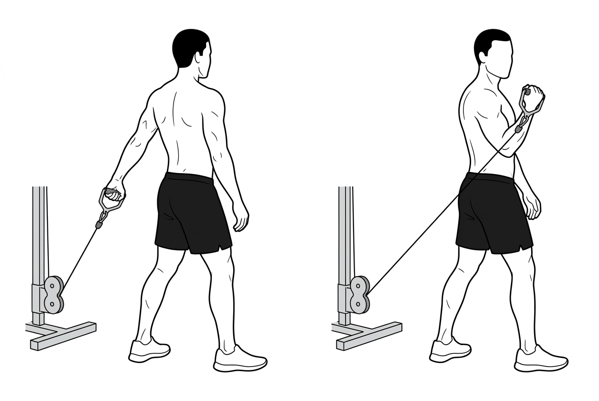

Starting position / Peak contraction position

Perform a standing cable biceps curl facing away from a low pulley with the shoulder extended behind the torso, maximizing tension on the biceps in the fully lengthened stretch position.

- **Danish:** Bayesian kabel-bicepscurl
- **Aliases:** Bayesian Curl, Facing-away cable curl, Incline cable biceps curl, Lengthened-position cable curl, Behind-the-back cable curl
- **Primary muscles:** Biceps brachii
- **Assisting muscles:** Brachialis, Brachioradialis
- **Stabilizers:** Anterior deltoid, Abdominal wall, Rotator cuff
- **Equipment:** Low cable pulley, Single D-handle
- **Movement:** Elbow flexion - shoulder extended cable stretch; Unilateral
- **Grip:** Underhand supinated grip on single D-handle, palm facing forward and upward.
- **Difficulty:** Intermediate (editorial label)
- **Review:** draft; revision 1

### Setup

- Set an adjustable cable pulley to the lowest position and attach a single D-handle.
- Grasp the handle with a supinated grip and take one to two paces forward, facing directly away from the cable stack.
- Adopt a stable staggered stance with the working arm extended behind your torso into shoulder extension, feeling a deep stretch across the biceps.

### Execution

1. Curl the handle forward and upward toward your shoulder by flexing your elbow.
2. Keep your upper arm relatively stationary behind or beside your ribcage to maintain stretch on the long head.
3. Contract your biceps forcefully at the top position with wrist supinated.
4. Slowly extend your elbow back under control, allowing the cable to pull your arm back into full shoulder extension and loaded biceps stretch.
5. Complete all repetitions before switching to the opposite arm.

### Cues

- Feel the stretch behind you at the bottom.
- Curl forward with elbow pinned.
- Control the backward negative stretch.

### Common mistakes

- Swinging the shoulder forward during the curl, turning the exercise into a front raise.
- Standing too close to the pulley, losing tension in the lengthened stretch.
- Leaning the torso forward and backward with each rep.

### Logging convention

Weight pin set to 12.5 kg on low pulley: record 12.5 kg on that cable station.

Unilateral cable movement facing away from stack; record selected pin load and note pulley position.

### Variants and alternatives

Facing-away unilateral low-cable curl with shoulder in passive extension, creating peak passive and active stretch tension on the biceps brachii long head.

- Incline Dumbbell Biceps Curl
- Standing Single-Arm Cable Biceps Curl
- Dumbbell Biceps Curl

### Review notes

- Drafted from FitTrack ID 61 (Bayesian Curl).
- FitTrack description notes: 'Cable biceps curl hvor du står et skridt foran kablet for at få stræk i biceps i bundpositionen.'
- Prompt specifies standing facing away from low pulley with working arm trailing behind torso in loaded stretch in panel A, curled to shoulder in panel B.

### References

- [Menno Henselmans - The Bayesian Curl](https://mennohenselmans.com/bayesian-curl/): Biomechanics of the facing-away cable curl, biceps long head stretch-mediated hypertrophy, and resistance curve alignment.

[Editable JSON](../catalog/exercises/bayesian-curl.json)

## Bent-Over Barbell Row

Arms extended below knees / Bar drawn toward torso

Row a barbell toward the lower ribs from a stable hip hinge using an overhand grip.

- **Danish:** Foroverbøjet roning med vægtstang
- **Aliases:** Bent Over Barbell Row, Pronated barbell row
- **Primary muscles:** Latissimus dorsi, Rhomboids, Middle trapezius
- **Assisting muscles:** Posterior deltoid, Biceps brachii, Brachialis
- **Stabilizers:** Spinal erectors, Abdominal wall, Hamstrings, Gluteus maximus, Forearm flexors
- **Equipment:** Barbell, Weight plates
- **Movement:** Horizontal pull - unsupported hip hinge; Bilateral
- **Grip:** Overhand, slightly outside shoulder width; palms face toward the legs at the bottom.
- **Difficulty:** Intermediate (editorial label)
- **Review:** draft; revision 1

### Setup

- Pick up the bar with a controlled hinge, then establish a balanced stance.
- Soften the knees and hinge the hips back until the torso is inclined, keeping the back stable.

### Execution

1. Let the bar hang below the knees with the arms extended.
2. Draw the elbows back to bring the bar toward the lower ribs or upper abdomen.
3. Keep the torso angle and knee bend steady as the shoulder blades move naturally.
4. Lower under control to extended arms without dropping the bar or rounding the back.

### Cues

- Hold the hinge.
- Pull with the elbows.
- Lower without swinging.

### Common mistakes

- Standing up on each pull to move the load.
- Jerking the bar or rounding the trunk.

### Logging convention

A 20 kg bar plus two 15 kg plates: record 50 kg total.

Include the bar and both sides' plates; preserve the original load convention in existing logs.

### Variants and alternatives

Pronated overhand grip with the bar suspended between repetitions. A floor-reset Pendlay row and underhand row require separate variants.

- Supinated Barbell Bent-Over Row
- Seated Cable Row

### Review notes

- Torso angle and grip width may vary; keep the selected setup consistent.
- Trainer review of technique and illustrations pending.

### References

- [Muscle & Strength - Bent Over Barbell Row](https://www.muscleandstrength.com/exercises/bent-over-barbell-row.html): Overhand bent-over row, fixed hip hinge and controlled pull toward the torso.

[Editable JSON](../catalog/exercises/bent-over-barbell-row.json)

## Cable High Fly

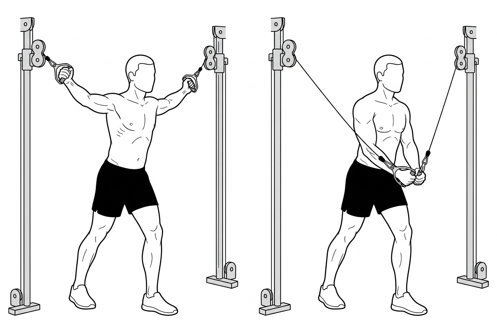

Starting position / Peak contraction position

Sweep dual high-cable handles downward and inward along a hugging arc toward the waist while standing in a staggered stance, isolating the lower and sternal sternocostal pectoralis fibers.

- **Danish:** Kabel-flyes fra høj talje
- **Aliases:** Cable High Fly, High-to-low cable fly, Standing cable high fly, Cable chest fly from high pulley, High cable fly
- **Primary muscles:** Pectoralis major (sternal head), Pectoralis major (costal head)
- **Assisting muscles:** Anterior deltoid, Pectoralis minor, Biceps brachii (short head)
- **Stabilizers:** Abdominal wall, Rotator cuff, Quadriceps
- **Equipment:** Two high cable pulleys, Two single D-handles
- **Movement:** Shoulder horizontal adduction - high-to-low arc; Bilateral, dual cables
- **Grip:** Neutral or semi-pronated grip holding single D-handles with wrists straight.
- **Difficulty:** Beginner (editorial label)
- **Review:** draft; revision 1

### Setup

- Attach single D-handles to two high cable pulleys positioned at or above head height.
- Grasp a handle in each hand and step forward between the towers into an athletic staggered stance.
- Lean your torso forward approximately 15 to 20 degrees with a flat spine, holding arms wide at chest level with elbows softly bent.

### Execution

1. Sweep both handles downward and forward in a wide hugging arc until your hands meet or cross slightly in front of your hips.
2. Maintain a fixed, soft bend in your elbows throughout the entire arc (avoid pressing or straightening into a pushdown).
3. Pause for a brief count at the bottom peak contraction, squeezing the lower and inner chest firmly.
4. Slowly allow your arms to open back out and upward along the same arc until you feel a comfortable stretch across the chest.

### Cues

- Lead with the elbows in a wide hugging arc.
- Keep torso angle constant.
- Squeeze hands down to the hips.

### Common mistakes

- Pressing the handles forward like a chest press instead of sweeping in an arc.
- Swinging the torso backward and forward to generate momentum.
- Straightening elbows into a triceps pushdown at the finish.

### Logging convention

Weight pins set to 15 kg on each tower: record 15 kg per cable stack.

Dual cable stations use independent weight stacks; record the selected stack pin load per side.

### Variants and alternatives

Standing high-to-low cable chest fly performed from dual high pulleys. Emphasizes sternal and costal fibers of the pectoralis major through downward horizontal adduction.

- Flat Dumbbell Fly
- Pec Deck
- Decline Dumbbell Bench Press

### Review notes

- Drafted from FitTrack ID 73 (Cable High Fly).
- FitTrack description notes 'targets upper chest', but downward high-to-low trajectory biomechanically recruits sternocostal (lower/sternal) fibers; low-to-high recruits clavicular (upper) fibers. Documented explicitly.

### References

- [ExRx.net - Cable Standing Fly](https://exrx.net/WeightExercises/PectoralSternal/CBStandingFly): Standing cable fly biomechanics, sternal pectoralis major activation, and shoulder kinematics.

[Editable JSON](../catalog/exercises/cable-high-fly.json)

## Cable Low Fly

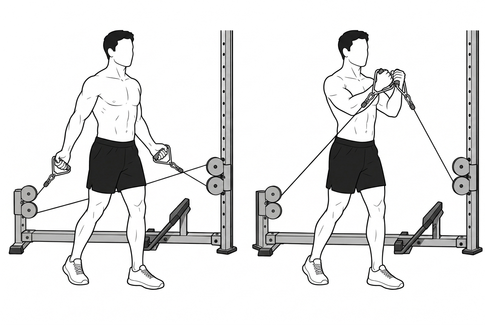

Starting position / Peak contraction position

Sweep dual low-cable handles upward and inward along a diagonal lifting arc toward upper-chest or chin height in a standing staggered stance, emphasizing the clavicular fibers of the pectoralis major.

- **Danish:** Kabel-flyes fra lav talje
- **Aliases:** Cable Low Fly, Low-to-high cable fly, Standing low cable fly, Low cable chest fly, Incline cable fly
- **Primary muscles:** Pectoralis major (clavicular head)
- **Assisting muscles:** Anterior deltoid, Biceps brachii (short head), Pectoralis major (sternal head)
- **Stabilizers:** Abdominal wall, Rotator cuff, Quadriceps
- **Equipment:** Two low cable pulleys, Two single D-handles
- **Movement:** Shoulder flexion and horizontal adduction - low-to-high arc; Bilateral, dual cables
- **Grip:** Supinated or semi-supinated grip holding single D-handles, palms facing forward and upward.
- **Difficulty:** Beginner (editorial label)
- **Review:** draft; revision 1

### Setup

- Set two cable pulleys to their lowest positions and attach a single D-handle to each.
- Grasp a handle in each hand with palms facing forward/upward and step forward into an athletic staggered stance.
- Stand tall with chest lifted, slight forward torso angle, and arms down and slightly back at your sides with elbows softly bent.

### Execution

1. Sweep both handles upward and inward in an arc toward the center line until your hands meet in front of your upper chest or chin level.
2. Maintain a fixed, soft bend in your elbows throughout the movement (do not curl or press).
3. Squeeze your upper pectorals firmly for a moment at peak contraction.
4. Lower your arms slowly under control along the same diagonal path back to the starting stretch.

### Cues

- Scoop upward and inward with elbows soft.
- Squeeze upper chest at chin level.
- Keep torso tall and motionless.

### Common mistakes

- Bending elbows into a biceps curl instead of maintaining a wide fly arc.
- Leaning the torso backward to swing the cables upward.
- Using excessive shoulder shrugging at the top.

### Logging convention

Weight pins set to 10 kg on each low pulley: record 10 kg per cable stack.

Dual cable stations use independent weight stacks; record selected stack pin load per side.

### Variants and alternatives

Low-to-high standing cable chest fly originating from floor-level pulleys, aligning the diagonal resistance line with the clavicular pectoral fiber orientation.

- Cable High Fly
- Flat Dumbbell Fly
- Incline Chest Press Machine

### Review notes

- Drafted from FitTrack ID 52 (Cable Low Fly).
- Direct counterpart to Cable High Fly; accurately pairs low-to-high line of action with clavicular chest recruitment.

### References

- [ExRx.net - Cable Standing Incline Fly](https://exrx.net/WeightExercises/PectoralClavicular/CBStandingInclineFly): Standing low-to-high cable fly mechanics, clavicular pectoralis major recruitment, and glenohumeral kinematics.

[Editable JSON](../catalog/exercises/cable-low-fly.json)

## Cable Rope Triceps Pushdown

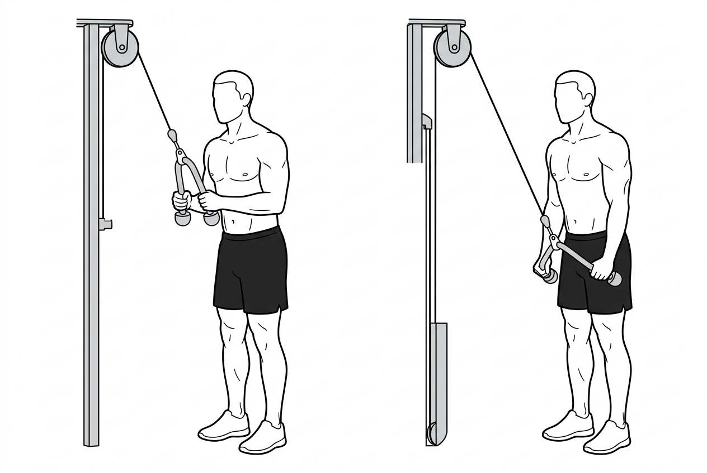

Starting position / Peak contraction position

Push a cable rope downward by straightening the elbows, spreading the rope ends slightly outward at the bottom to maximize triceps peak contraction.

- **Danish:** Tricepspres ned i kabel med reb
- **Aliases:** Cable Triceps Pushdown (Rope), Rope pushdown, Tricep rope pushdown, Cable rope pushdown
- **Primary muscles:** Triceps brachii
- **Assisting muscles:** Anconeus
- **Stabilizers:** Forearm flexors, Rotator cuff, Abdominal wall
- **Equipment:** High cable pulley, Rope attachment
- **Movement:** Elbow extension - upper arms at sides; Bilateral
- **Grip:** Neutral grip with one rope knot in each hand, palms facing each other.
- **Difficulty:** Beginner (editorial label)
- **Review:** draft; revision 1

### Setup

- Attach a two-strand flexible rope to a high cable pulley and select the appropriate pin setting.
- Face the pulley and grasp the rope ends with a neutral grip (palms facing inward).
- Step back slightly, establish a stable hip-width stance with a subtle forward torso hinge.
- Tuck elbows tight to your ribs with forearms angled upward around 90 degrees.

### Execution

1. Straighten your elbows to push the rope downward toward your thighs, keeping your upper arms stationary at your sides.
2. As you approach full extension, spread the rope ends outward beside your hips and actively squeeze the triceps.
3. Pause under control at the bottom lockout without locking joints forcefully.
4. Allow the elbows to flex smoothly to return the rope to the 90-degree starting position, resisting the cable pull.

### Cues

- Keep elbows pinned at your sides.
- Spread the rope at the bottom.
- Control the eccentric return.

### Common mistakes

- Allowing the elbows to drift forward and backward, using shoulder momentum.
- Rounding the upper back or leaning excessively over the rope.
- Failing to spread the rope at the bottom, reducing lateral head recruitment.

### Logging convention

Cable stack pin set to 22.5 kg: record 22.5 kg on that machine.

Record selected stack weight, rope attachment, and pulley station. Pulley ratios and cable friction vary across manufacturers.

### Variants and alternatives

Standing cable pushdown using a flexible rope attachment, allowing forearm pronation and rope flare at peak contraction.

- Cable Triceps Pushdown
- Overhead Rope Cable Triceps Extension
- Standing Barbell Strict Press

### Review notes

- Drafted from FitTrack ID 103 (Cable Triceps Pushdown (Rope)).
- Illustration depicts standing high pulley pushdown with neutral grip at start and flared rope ends at bottom lockout.

### References

- [ExRx.net - Cable Pushdown (Rope)](https://exrx.net/WeightExercises/Triceps/CBPushdownRope): Cable rope pushdown biomechanics, lateral and medial head triceps recruitment, and execution cues.

[Editable JSON](../catalog/exercises/cable-rope-triceps-pushdown.json)

## Cable Triceps Pushdown

Elbows bent beside torso / Bar at upper thighs

Push a short cable bar downward by straightening the elbows while the upper arms stay beside the torso.

- **Danish:** Tricepspres ned i kabel med stang
- **Aliases:** Cable Triceps Pushdown, Straight-bar triceps pushdown, Tricep pushdown, Cable Triceps Pushdown (Straight Bar), Cable Triceps Pushdown (V-Bar)
- **Primary muscles:** Triceps brachii
- **Assisting muscles:** Anconeus
- **Stabilizers:** Forearm flexors, Rotator cuff, Abdominal wall
- **Equipment:** High cable pulley, Short straight-bar attachment
- **Movement:** Elbow extension - upper arms at sides; Bilateral
- **Grip:** Overhand, palms down, with both hands holding a short straight bar.
- **Difficulty:** Beginner (editorial label)
- **Review:** draft; revision 1

### Setup

- Attach a short straight bar to a high pulley and select the stack setting.
- Face the machine with a stable stance and grasp the bar overhand.
- Bring the elbows beside the ribs, beginning with a comfortable bend and cable tension.

### Execution

1. Straighten the elbows to move the bar toward the upper thighs.
2. Keep the upper arms near the sides and the torso steady.
3. Finish without forcing the elbows backward into hyperextension.
4. Allow the elbows to bend slowly as the bar returns, without the stack crashing.

### Cues

- Keep the elbows quiet.
- Press through the forearms.
- Control the return.

### Common mistakes

- Rocking the torso or driving the shoulders forward.
- Letting the elbows rise to turn the movement into a whole-arm press.

### Logging convention

A single stack selected at 20 kg: record 20 kg on that machine.

Record the selected stack value, attachment and pulley setup. Pulley ratios and machine calibration make stack values unsuitable for direct comparisons across machines.

### Variants and alternatives

Short straight-bar pushdown is the illustrated equipment assumption. A rope, V-bar or one-arm version changes the setup; this is separate from overhead rope extension.

- Rope Triceps Pushdown
- Overhead Rope Cable Triceps Extension

### Review notes

- Confirm the pushdown attachment; only the overhead exercise's rope attachment has been specified.
- Trainer review of technique and illustrations pending.

### References

- [Muscle & Strength - Straight Bar Tricep Extension](https://www.muscleandstrength.com/exercises/tricep-extension.html): High-pulley straight-bar pushdown with overhand grip and elbow extension.

[Editable JSON](../catalog/exercises/cable-triceps-pushdown.json)

## Decline Dumbbell Bench Press

Lowered position / Pressed position

A supported dumbbell press performed with your head lower than your hips. The chest drives the press while the triceps and front shoulders assist.

- **Danish:** Decline brystpres med håndvægte
- **Aliases:** Decline dumbbell press, Decline DB bench press
- **Primary muscles:** Pectoralis major
- **Assisting muscles:** Triceps brachii, Anterior deltoid
- **Stabilizers:** Rotator cuff, Abdominal wall
- **Equipment:** Two dumbbells, Decline bench with leg supports
- **Movement:** Horizontal push - decline bench; Bilateral
- **Grip:** Pronated or slightly angled; wrists stacked above forearms.
- **Difficulty:** Intermediate (editorial label)
- **Review:** draft; revision 1

### Setup

- Set a shallow decline and secure your legs using the bench supports.
- Bring both dumbbells into position with a controlled entry; use assistance if needed.

### Execution

1. Begin with dumbbells beside the lower chest, forearms near vertical and elbows moderately tucked.
2. Press upward until the weights are above the chest and arms are comfortably extended.
3. Lower slowly along the same path to a controlled, comfortable depth.
4. Finish by securing both weights before sitting up or leaving the bench.

### Cues

- Keep wrists above elbows.
- Keep head and upper back supported.
- Move both weights under control.

### Common mistakes

- Flaring elbows widely or bending wrists back.
- Bouncing at the bottom or twisting while getting out.

### Logging convention

Two 20 kg dumbbells: record 20 kg per dumbbell, not 40 kg.

Proposed convention; check the existing exercise's history before applying.

### Variants and alternatives

An incline press is a separate exercise; bench direction matters.

- Flat Dumbbell Bench Press
- Decline Machine Chest Press

### Review notes

- Confirm your bench's supports and preferred grip.
- Trainer review of technique and illustrations pending.

### References

- [Muscle & Strength - Decline Dumbbell Bench Press](https://www.muscleandstrength.com/exercises/decline-dumbbell-bench-press.html): General decline press technique and involved muscle groups.

[Editable JSON](../catalog/exercises/decline-dumbbell-bench-press.json)

## Dumbbell Bench Press

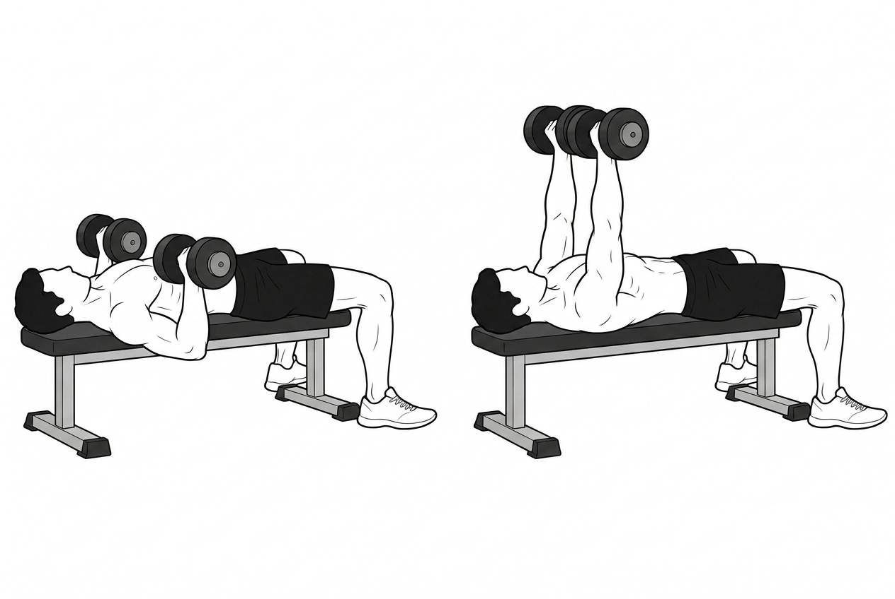

Lying flat on bench with dumbbells lowered at chest sides / Dumbbells pressed vertically over chest with extended arms

Lie supine on a flat bench and press two dumbbells vertically from chest level to full arm extension, controlling the descent to a comfortable stretch.

- **Danish:** Bænkpres med håndvægte
- **Aliases:** Flat dumbbell bench press, Flat dumbbell press, Dumbbell chest press, DB bench press
- **Primary muscles:** Pectoralis major (sternal head)
- **Assisting muscles:** Anterior deltoid, Triceps brachii, Pectoralis major (clavicular head)
- **Stabilizers:** Rotator cuff, Serratus anterior
- **Equipment:** Two dumbbells, Flat bench
- **Movement:** Horizontal press - flat torso; Bilateral
- **Grip:** Pronated to slightly semi-neutral (angled approx. 45 degrees).
- **Difficulty:** Beginner (editorial label)
- **Review:** draft; revision 1

### Setup

- Sit on the edge of a flat horizontal bench with a dumbbell resting upright on each knee.
- Lie back smoothly while guiding the dumbbells to the sides of the lower chest with forearms vertical.
- Plant feet firmly flat on the floor, retract shoulder blades, and brace the core.

### Execution

1. Press both dumbbells upward vertically until the arms are fully extended over the mid-chest without locking the elbows.
2. Keep wrists stacked directly over elbows throughout the press.
3. Pause under control at the top, then slowly lower the dumbbells back toward the chest.
4. Stop when a gentle stretch is felt across the chest, maintaining shoulder blade contact with the bench.

### Cues

- Drive straight up over the chest.
- Keep feet planted and shoulder blades pinched.
- Control the descent without bouncing.

### Common mistakes

- Flaring elbows straight out to 90 degrees, increasing shoulder stress.
- Arching the lower back excessively or lifting hips off the bench.
- Clanging the dumbbells together at the top of the repetition.

### Logging convention

Two 32 kg dumbbells: record 32 kg per dumbbell.

Record the mass of an individual dumbbell rather than the combined total weight of both dumbbells.

### Variants and alternatives

Flat horizontal bench variation. Allows independent arm movement and natural wrist rotation compared to a straight barbell.

- Barbell Bench Press
- Decline Dumbbell Bench Press
- Incline Chest Press Machine

### Review notes

- Drafted from FitTrack ID 101 (Dumbbell Bench Press).
- Illustration confirms flat horizontal bench setup and vertical pressing path over mid-chest.

### References

- [ExRx.net - Dumbbell Bench Press](https://exrx.net/WeightExercises/PectoralSternal/DBBenchPress): Flat dumbbell chest press mechanics, muscle recruitment, and joint motion.

[Editable JSON](../catalog/exercises/dumbbell-bench-press.json)

## Dumbbell Biceps Curl

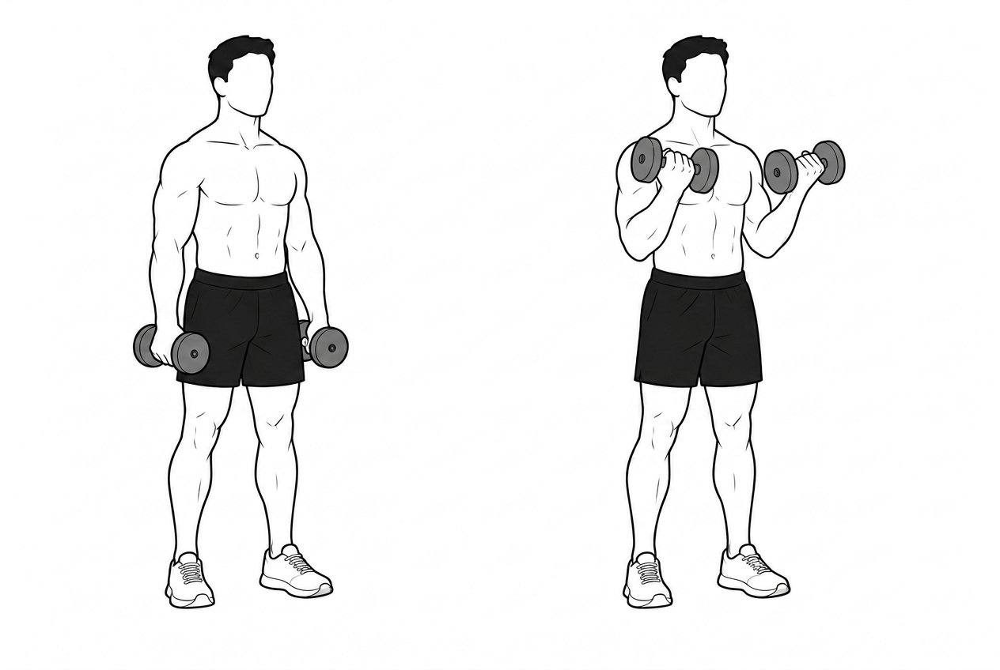

Arms hanging at sides holding dumbbells / Dumbbells curled to upper chest with supinated palms

Stand upright and curl two dumbbells simultaneously toward shoulder height while maintaining a stable torso and keeping the upper arms pinned at the sides.

- **Danish:** Bicepscurl med håndvægte
- **Aliases:** Standing dumbbell curl, Dumbbell curl, Biceps curl with dumbbells, Standing dumbbell biceps curl
- **Primary muscles:** Biceps brachii
- **Assisting muscles:** Brachialis, Brachioradialis
- **Stabilizers:** Forearm flexors, Anterior deltoid
- **Equipment:** Two dumbbells
- **Movement:** Elbow flexion - standing upright; Bilateral
- **Grip:** Supinated, starting with palms facing thighs or slightly forward and rotating into full supination as elbows flex.
- **Difficulty:** Beginner (editorial label)
- **Review:** draft; revision 1

### Setup

- Stand tall with feet hip-width apart and knees softly unlocked.
- Hold a dumbbell in each hand with arms extended downward at the sides.
- Engage the core and pull the shoulder blades down and back.

### Execution

1. Curl both dumbbells upward simultaneously by flexing the elbows.
2. Keep the upper arms vertical and fixed against the sides of the torso.
3. Rotate palms into full supination facing upward near chest height.
4. Squeeze the biceps at peak contraction, then lower slowly back to full extension under control.

### Cues

- Keep upper arms pinned.
- Turn palms up through the curl.
- Lower under strict control without swinging.

### Common mistakes

- Swinging the hips or using momentum to heave weights upward.
- Flaring the elbows outward or allowing upper arms to drift forward.
- Cutting the range of motion short at the bottom.

### Logging convention

Two 14 kg dumbbells: record 14 kg per dumbbell.

Record the individual dumbbell mass rather than the combined load of the pair.

### Variants and alternatives

Standing bilateral variant. In the illustration, the starting pose shows dumbbells hanging at the sides with relaxed wrists before rotating into full supination at the peak.

- Incline Dumbbell Biceps Curl
- Standing Barbell Curl
- Dumbbell Hammer Curl

### Review notes

- Drafted from FitTrack ID 150 (Dumbbell Biceps Curl).
- Starting pose depicts a natural sagittal hang before full supination at the top of the curl.

### References

- [ExRx.net - Dumbbell Biceps Curl](https://exrx.net/WeightExercises/Biceps/DBCurl): Standing bilateral dumbbell curl technique, joint movement, and mover classifications.

[Editable JSON](../catalog/exercises/dumbbell-biceps-curl.json)

## Dumbbell Hammer Curl

Dumbbells at sides / Neutral-grip curl

Curl two dumbbells while maintaining a neutral hand position, with the upper arms close to the sides.

- **Danish:** Hammercurl med håndvægte
- **Aliases:** Hammer Curl, Standing hammer curl
- **Primary muscles:** Brachialis, Brachioradialis
- **Assisting muscles:** Biceps brachii
- **Stabilizers:** Forearm flexors, Rotator cuff, Abdominal wall
- **Equipment:** Two dumbbells
- **Movement:** Elbow flexion - neutral grip; Bilateral
- **Grip:** Neutral throughout, with palms facing each other and thumbs toward the upper dumbbell heads.
- **Difficulty:** Beginner (editorial label)
- **Review:** draft; revision 1

### Setup

- Stand with a dumbbell beside each thigh, palms facing inward.
- Keep a small knee bend, straight wrists and shoulders relaxed.

### Execution

1. Flex both elbows to bring the dumbbells toward the fronts of the shoulders.
2. Keep the palms facing each other rather than rotating them upward.
3. Keep the upper arms and torso steady.
4. Lower the dumbbells under control to the starting position.

### Cues

- Keep thumbs pointing upward.
- Keep elbows beside the torso.
- Avoid swinging.

### Common mistakes

- Turning into a supinated curl.
- Rocking backward or lifting the elbows far forward.

### Logging convention

Two 12 kg dumbbells: record 12 kg per dumbbell.

Keep the same exercise variant and record each dumbbell's mass rather than the combined pair.

### Variants and alternatives

Standing simultaneous neutral-grip curl. Alternating and cross-body versions differ in timing or arm path.

- Standing Dumbbell Curl
- Standing Barbell Curl

### Review notes

- Both arms are illustrated together; use separate side records if logging alternating repetitions.
- Muscle roles are qualitative; the exercise still trains the biceps.

### References

- [ACE - Hammer Curl](https://www.acefitness.org/resources/everyone/exercise-library/10/hammer-curl/): Standing dumbbell hammer curl and neutral hand position; anatomical role ordering is editorial.

[Editable JSON](../catalog/exercises/dumbbell-hammer-curl.json)

## Dumbbell Lateral Raise

Arms lowered / Arms raised

Raise the arms out to the sides against the dumbbells' weight while keeping the torso still. The side shoulders lead the movement.

- **Danish:** Sideløft med håndvægte
- **Aliases:** Side raise, Standing dumbbell side raise
- **Primary muscles:** Lateral deltoid
- **Assisting muscles:** Supraspinatus
- **Stabilizers:** Rotator cuff, Trapezius and serratus anterior - scapular control, Abdominal wall
- **Equipment:** Two dumbbells
- **Movement:** Shoulder abduction; Bilateral
- **Grip:** Neutral at the bottom, rotating naturally as the arms rise; wrists stay straight.
- **Difficulty:** Beginner (editorial label)
- **Review:** draft; revision 1

### Setup

- Stand comfortably with a dumbbell in each hand and knees soft.
- Hold the weights beside the thighs with a small bend in the elbows.

### Execution

1. Lift the arms out and slightly forward of the body in a comfortable path.
2. Keep a similar elbow bend as elbows and upper arms rise together.
3. Stop around shoulder height, or earlier if that is your comfortable range.
4. Lower slowly without swinging the torso or dropping the weights.

### Cues

- Lead with the upper arms.
- Keep the neck relaxed.
- Control the lowering phase.

### Common mistakes

- Swinging the hips to start each repetition.
- Shrugging to finish or turning the thumbs sharply downward.

### Logging convention

Two 8 kg dumbbells: record 8 kg per dumbbell.

Keep seated, machine and cable versions as distinct variants.

### Variants and alternatives

Elbow angle and arm path distinguish this movement from an upright row or front raise.

- Cable Lateral Raise
- Machine Lateral Raise

### Review notes

- Difficulty is an editorial label, not a clinical rating.
- Trainer review of technique and illustrations pending.

### References

- [ACE - Lateral Raise](https://www.acefitness.org/resources/everyone/exercise-library/26/lateral-raise/): General lateral-raise setup and movement.

[Editable JSON](../catalog/exercises/dumbbell-lateral-raise.json)

## Dumbbell Romanian Deadlift

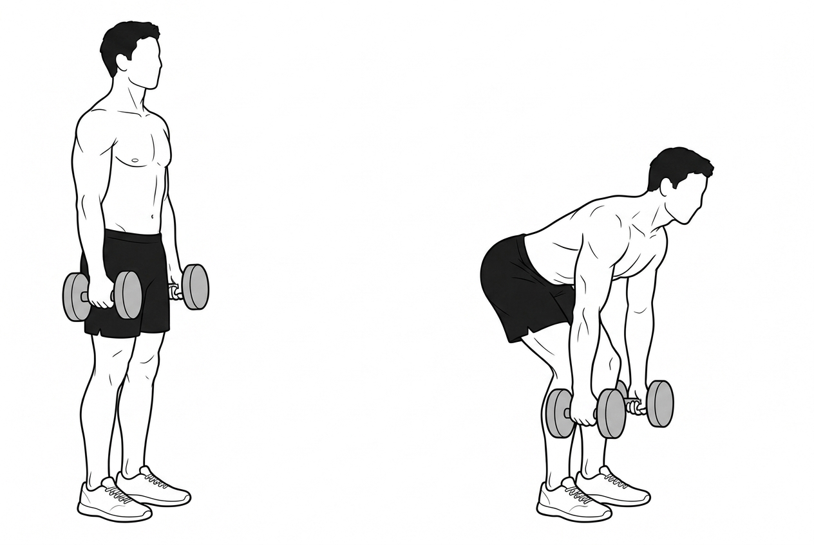

Standing tall holding dumbbells at thighs / Hinged at hips with dumbbells along shins and neutral spine

Execute a bilateral hip-hinge Romanian deadlift holding two dumbbells, driving the hips back with a flat back and lowering the dumbbells to mid-shin level before returning upright.

- **Danish:** Rumænsk dødløft med håndvægte
- **Aliases:** Dumbbell RDL, DB Romanian deadlift, Romanian deadlift with dumbbells
- **Primary muscles:** Gluteus maximus, Hamstrings
- **Assisting muscles:** Erector spinae, Adductor magnus
- **Stabilizers:** Latissimus dorsi, Trapezius, Forearm flexors
- **Equipment:** Two dumbbells
- **Movement:** Hip hinge; Bilateral
- **Grip:** Pronated (overhand), holding dumbbell handles horizontally in front of the thighs.
- **Difficulty:** Intermediate (editorial label)
- **Review:** draft; revision 1

### Setup

- Stand upright with feet hip-width apart holding a dumbbell in each hand in front of the thighs.
- Soften the knees slightly and keep the shins relatively vertical.
- Draw the shoulder blades back and engage the lats to keep weights close to the legs.

### Execution

1. Initiate the movement by hinging backward at the hips, keeping the spine completely flat and neutral.
2. Lower the dumbbells vertically in front of the shins until reaching full hamstring stretch (approx. mid-shin).
3. Pause briefly without letting the dumbbells touch the floor or allowing the lumbar spine to flex.
4. Drive the hips forward to return to standing tall, squeezing the glutes at the lockout.

### Cues

- Push the hips to the wall behind you.
- Keep dumbbells shaving down the front of the shins.
- Maintain a proud chest and neutral spine throughout.

### Common mistakes

- Squatting down by bending knees forward instead of hinging hips back.
- Rounding the lower back to force extra depth.
- Allowing dumbbells to drift away from the legs, increasing lumbar torque.

### Logging convention

Two 24 kg dumbbells: record 24 kg per dumbbell.

Record the mass of an individual dumbbell rather than the combined total weight of both dumbbells.

### Variants and alternatives

Bilateral dumbbell variation allowing independent wrist positioning while loading the posterior chain through a standard hip hinge.

- Barbell Romanian Deadlift
- Barbell Deadlift

### Review notes

- Drafted from FitTrack ID 144 (Dumbbell Romanian Deadlift).
- Dumbbells reverse at mid-shin depth under control without touching the floor.

### References

- [ExRx.net - Dumbbell Romanian Deadlift](https://exrx.net/WeightExercises/Hamstrings/DBRomanianDeadlift): Bilateral hip-hinge kinematics, hamstring stretching mechanics, and spinal stability.

[Editable JSON](../catalog/exercises/dumbbell-romanian-deadlift.json)

## Dumbbell Single-Leg Calf Raise

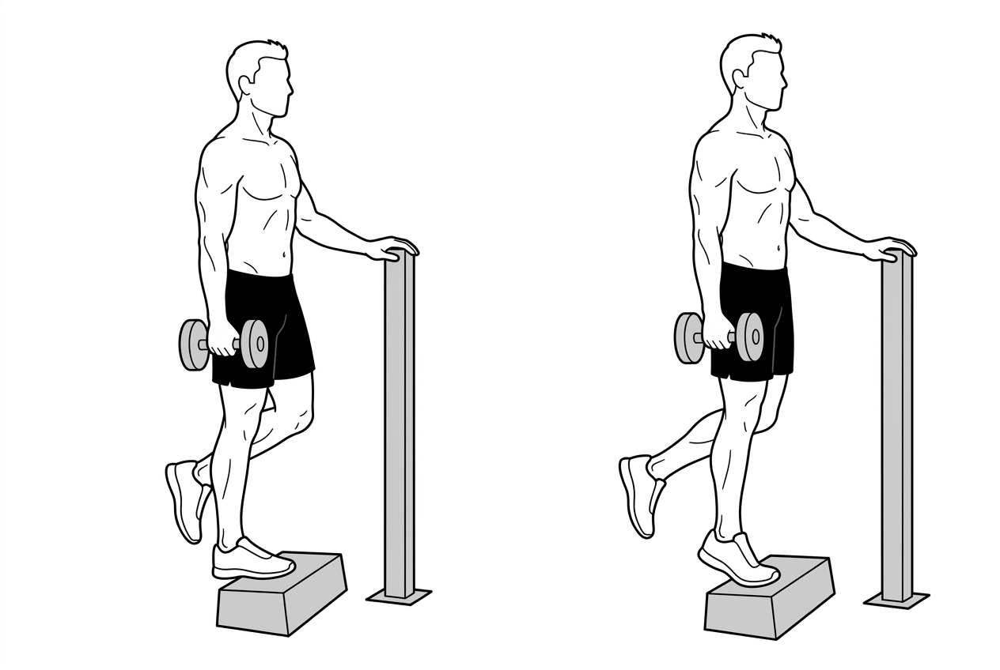

Starting position / Peak contraction position

Perform unilateral ankle plantar flexion on a raised calf block while holding a dumbbell on the working side, isolating the gastrocnemius under loaded stretch.

- **Danish:** Etbens lægløft med håndvægt
- **Aliases:** Dumbbell Single-Leg Calf Raise, Single-leg dumbbell calf raise, One-leg calf raise with dumbbell, Unilateral standing calf raise
- **Primary muscles:** Gastrocnemius
- **Assisting muscles:** Soleus, Tibialis posterior
- **Stabilizers:** Abdominal wall, Quadriceps, Forearm flexors
- **Equipment:** One dumbbell, Raised calf block or step, Support post or wall for balance
- **Movement:** Ankle plantar flexion - unilateral; Unilateral
- **Grip:** Working side hand holds dumbbell at side with straight arm; non-working side hand touches post for balance.
- **Difficulty:** Intermediate (editorial label)
- **Review:** draft; revision 1

### Setup

- Stand on a raised calf block or sturdy platform with the ball of the working foot on the edge and the heel hanging freely.
- Hold a dumbbell at your side on the working side with arm extended.
- Hook the non-working foot behind the working ankle and place your free hand lightly against an upright post or wall for balance.

### Execution

1. Lower your working heel smoothly below the platform level into deep ankle dorsiflexion until you feel a complete stretch through the calf.
2. Press forcefully through the ball of the foot into full plantar flexion, rising onto your tiptoes as high as possible.
3. Hold the peak contraction at the top for a moment, squeezing the calf muscle.
4. Lower slowly under complete control back into the full bottom stretch before beginning the next repetition.
5. Complete all repetitions on one side before switching to the opposite leg.

### Cues

- Press straight up through the ball of the foot.
- Keep the working knee motionless and softly unlocked.
- Use the support post only for balance, not for assistance.

### Common mistakes

- Bending the working knee into a single-leg squat to assist the lift.
- Cutting the bottom stretch short without letting the heel drop below the block.
- Pushing off the wall or post with the free hand.

### Logging convention

Single 18 kg dumbbell held on working side: record 18 kg.

Record the mass of the single dumbbell used. If performed with bodyweight only, record 0 kg external load.

### Variants and alternatives

Unilateral standing calf raise on a raised platform holding a single dumbbell on the working side with knee straight to isolate gastrocnemius.

- Standing Calf Raise
- Leg Press Calf Press

### Review notes

- Drafted from FitTrack ID 72 (Dumbbell Single-Leg Calf Raise).
- Requires strict unilateral depiction: working foot on block with heel in full dorsiflexion/plantar flexion, opposite foot hooked behind ankle.

### References

- [ExRx.net - Dumbbell Single Leg Calf Raise](https://exrx.net/WeightExercises/Gastrocnemius/DBSingleLegCalfRaise): Unilateral calf raise mechanics, gastrocnemius recruitment under loaded stretch, and balance protocols.

[Editable JSON](../catalog/exercises/dumbbell-single-leg-calf-raise.json)

## Dumbbell Spider Curl

Arms hanging vertically / Dumbbells curled upward

Curl two dumbbells while lying chest-down on an incline bench with the arms hanging vertically in front of the support pad.

- **Danish:** Spider curl med håndvægte
- **Aliases:** Spider Curl, Chest-supported incline dumbbell curl, Prone incline dumbbell biceps curl
- **Primary muscles:** Biceps brachii
- **Assisting muscles:** Brachialis, Brachioradialis
- **Stabilizers:** Rotator cuff, Forearm flexors, Upper trapezius and scapular stabilizers
- **Equipment:** Two dumbbells, Adjustable incline bench
- **Movement:** Elbow flexion - prone torso, vertical upper arms; Bilateral
- **Grip:** Supinated, palms facing forward at the bottom and upward toward the shoulders as the elbows flex.
- **Difficulty:** Beginner (editorial label)
- **Review:** draft; revision 1

### Setup

- Set an adjustable bench to a moderate incline of roughly 45 degrees above horizontal.
- Lie prone with the chest and stomach supported against the backrest, upper chest near the top edge, and feet braced on the floor behind you.
- Hold a dumbbell in each hand and let both arms hang straight down toward the floor with palms facing forward.

### Execution

1. Keep the chest pressed into the pad and upper arms hanging vertically.
2. Flex both elbows to curl the dumbbells upward in an arc toward the shoulders.
3. Pause briefly near peak elbow flexion without lifting the chest off the bench or driving the elbows forward.
4. Lower the dumbbells slowly to the hanging start position under full control.

### Cues

- Keep the chest heavy on the pad.
- Let the upper arms hang straight down.
- Curl through the elbows without swinging.

### Common mistakes

- Pushing the chest up off the incline pad to create momentum.
- Pulling the elbows backward into a row or swinging the upper arms forward at the top.

### Logging convention

Two 10 kg dumbbells: record 10 kg per dumbbell.

Keep the same equipment variant and record the mass of a single dumbbell rather than the combined pair. EZ-bar or barbell spider curls use total bar mass and should be logged as a separate exercise.

### Variants and alternatives

Assumption: bilateral dumbbell spider curl lying prone on an ~45-degree incline bench rather than over the vertical side of a preacher pad or with an EZ-bar/barbell.

- Incline Dumbbell Biceps Curl
- Machine Preacher Curl
- Standing Barbell Curl

### Review notes

- Confirm whether your consumer catalog maps generic 'Spider Curl' to dumbbells on an incline bench or an EZ-bar on a vertical preacher pad.
- In the left panel, the near hand retains a slightly neutral wrist angle while the far hand shows supination; keep at draft until trainer/equipment review.

### References

- [ACE - Incline Dumbbell Curl](https://www.acefitness.org/resources/everyone/exercise-library/94/incline-dumbbell-curl/): General incline dumbbell curl reference; does not validate exact bench angle or prone chest-supported spider curl mechanics.
- [ExRx.net - Biceps Brachii Exercise Directory](https://exrx.net/Lists/ExList/ArmWt#Biceps): Anatomical classification of elbow flexors (biceps brachii, brachialis, brachioradialis); does not validate the specific incline-bench equipment setup.

[Editable JSON](../catalog/exercises/dumbbell-spider-curl.json)

## Face Pulls with Wrist Cuffs

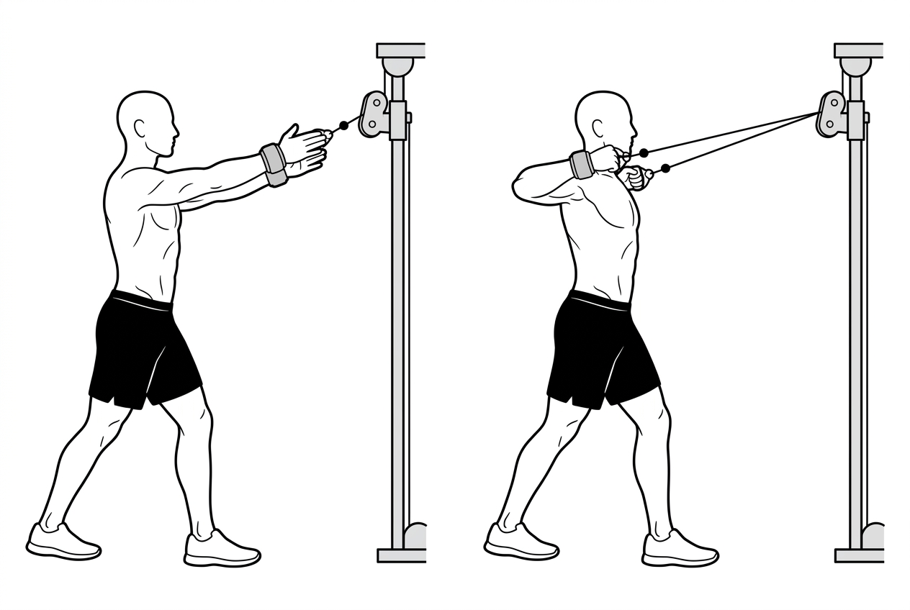

Starting position / Peak contraction position

Perform high-cable face pulls using padded wrist cuffs rather than handles, eliminating forearm grip fatigue and isolating shoulder external rotation and rear deltoid recruitment.

- **Danish:** Face pulls med håndledsmanchetter i kabel
- **Aliases:** Face Pulls with Cuffs, Cuff face pull, Cable face pull with wrist cuffs, Cable Rope Face Curl
- **Primary muscles:** Posterior deltoid, Infraspinatus, Teres minor
- **Assisting muscles:** Middle trapezius, Rhomboids, Lateral deltoid
- **Stabilizers:** Rotator cuff, Abdominal wall
- **Equipment:** High cable pulley, Padded wrist cuffs
- **Movement:** Shoulder horizontal abduction and external rotation; Bilateral
- **Grip:** Hands relaxed in padded wrist cuffs fastened around the wrists, with tension applied directly to D-rings.
- **Difficulty:** Intermediate (editorial label)
- **Review:** draft; revision 1

### Setup

- Attach dual cables or a split cable to a high pulley set around eye or forehead height.
- Fasten padded wrist cuffs securely around both wrists and attach them to the cable carabiners.
- Step back into a stable staggered stance with arms extended forward and upward toward the pulley, hands relaxed.

### Execution

1. Initiate the pull by drawing your elbows backward and outward at eye level.
2. Externally rotate your shoulders as your hands approach your face, finishing with hands beside your temples/ears.
3. Keep hands and fingers completely relaxed inside the cuffs so the tension pulls through the wrists.
4. Pause for a second at peak contraction, squeezing rear deltoids and external rotators.
5. Slowly extend your arms back toward the pulley under control.

### Cues

- Lead with the elbows high and wide.
- Keep hands relaxed.
- Rotate shoulders outward at the finish.

### Common mistakes

- Clenching fists or trying to grip the straps, negating cuff benefits.
- Dropping elbows low into a row instead of keeping them at eye level.
- Leaning the torso backward to use bodyweight.

### Logging convention

Stack pin set to 15 kg: record 15 kg selected stack load.

Record selected stack load, pulley height, and cuff attachment. Using wrist cuffs eliminates grip limitations.

### Variants and alternatives

Face pull adaptation using padded wrist cuffs attached to high cable pulley, removing forearm/grip fatigue and isolating posterior deltoids and external rotators.

- Single-Arm Rear-Delt Cable Fly
- Seated Machine Lateral Raise

### Review notes

- Drafted from FitTrack ID 80 (Face Pulls with Cuffs) and reconciles ID 130 (Cable Rope Face Curl).
- Illustration accurately reflects relaxed hands in wrist cuffs with cables pulling through D-rings to temple level.

### References

- [ExRx.net - Cable Face Pull](https://exrx.net/WeightExercises/DeltoidPosterior/CBFacePull): High cable face pull mechanics, posterior deltoid and external rotator activation.

[Editable JSON](../catalog/exercises/face-pull-wrist-cuffs.json)

## Flat Dumbbell Fly

Dumbbells above chest / Arms opened

Open and close the arms in a broad arc above a flat bench while keeping a small, nearly fixed elbow bend.

- **Danish:** Flyes med håndvægte på flad bænk
- **Aliases:** Dumbbell fly, Flat dumbbell flye, Dumbbell chest fly
- **Primary muscles:** Pectoralis major
- **Assisting muscles:** Anterior deltoid
- **Stabilizers:** Rotator cuff, Biceps brachii, Triceps brachii, Abdominal wall
- **Equipment:** Two dumbbells, Flat bench
- **Movement:** Shoulder horizontal adduction; Bilateral
- **Grip:** Neutral, palms facing each other, with wrists straight throughout the arc.
- **Difficulty:** Intermediate (editorial label)
- **Review:** draft; revision 1

### Setup

- Sit with light dumbbells near the thighs and lie back with the weights controlled close to the chest.
- Plant the feet and support the head, upper back and hips on the flat bench.
- Bring the dumbbells above the chest with palms facing and elbows slightly bent.

### Execution

1. Open the arms slowly out to the sides while preserving the elbow bend.
2. Stop around torso level, or earlier if needed to keep the shoulders comfortable.
3. Bring the arms together in the same arc above the chest.
4. Keep the dumbbells separate and lower them under control when ending the set.

### Cues

- Move through the shoulders.
- Keep soft elbows.
- Use a controlled, comfortable arc.

### Common mistakes

- Changing elbow bend so the movement becomes a press.
- Lowering too far or dropping the weights quickly into the stretched position.

### Logging convention

Two 12 kg dumbbells: record 12 kg per dumbbell.

Keep the same exercise variant and record each dumbbell's mass rather than the combined pair.

### Variants and alternatives

Flat bench with a neutral grip and nearly fixed elbow bend. Incline and decline fly variations are separate.

- Cable Chest Fly
- Pec Deck Fly

### Review notes

- Dumbbell fly depth must suit the individual; the drawing is not a depth prescription.
- Trainer review of shoulder and elbow position pending.

### References

- [Muscle & Strength - Dumbbell Flys](https://www.muscleandstrength.com/exercises/dumbbell-flys.html): Flat-bench fly, neutral hand position, controlled shoulder arc and consistent elbow bend.

[Editable JSON](../catalog/exercises/flat-dumbbell-fly.json)

## Incline Chest Press Machine

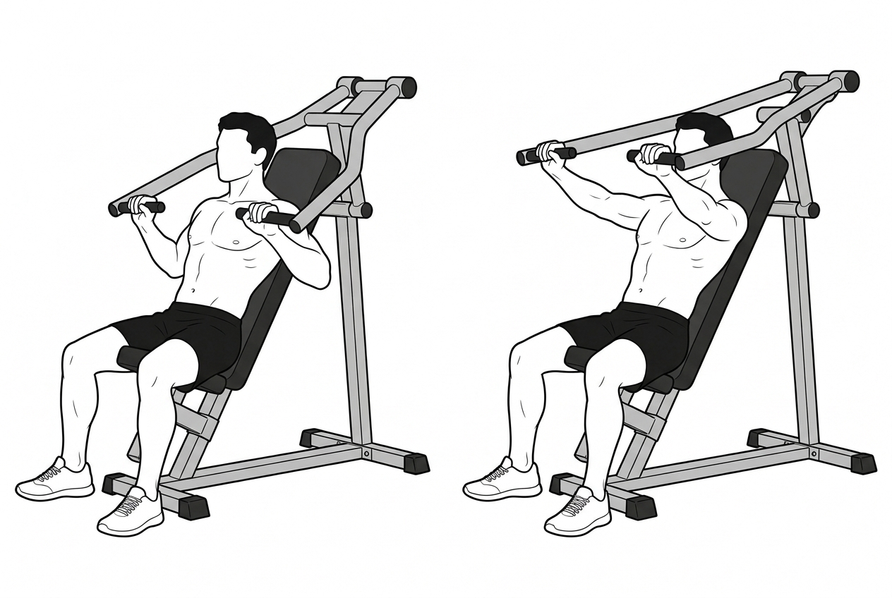

Seated on incline machine with handles retracted at chest / Press handles pushed forward and upward along incline arc with extended arms

Perform a seated press on an incline chest machine, pressing along a fixed upward arc that emphasizes the upper clavicular portion of the chest.

- **Danish:** Incline brystpres i maskine
- **Aliases:** Machine incline chest press, Incline machine press, Seated incline chest press machine
- **Primary muscles:** Pectoralis major (clavicular head)
- **Assisting muscles:** Anterior deltoid, Triceps brachii, Pectoralis major (sternal head)
- **Stabilizers:** Rotator cuff, Serratus anterior
- **Equipment:** Incline chest press machine
- **Movement:** Horizontal and inclined chest press - guided machine; Bilateral
- **Grip:** Pronated or neutral grip on guided machine press handles.
- **Difficulty:** Beginner (editorial label)
- **Review:** draft; revision 1

### Setup

- Adjust the seat so the press handles sit level with the upper chest.
- Sit firmly with back and head resting against the incline backrest, feet flat on the floor.
- Grip the handles firmly with forearms aligned with the machine levers.

### Execution

1. Press the handles forward and upward along the machine track until the arms are extended without locking the elbows.
2. Keep the head and upper back firmly braced against the back pad.
3. Pause under control at extension, then lower slowly until a comfortable chest stretch is achieved.
4. Do not let the weight stack touch down abruptly between repetitions.

### Cues

- Keep back glued to the pad.
- Press up along the machine angle.
- Lower slowly with control.

### Common mistakes

- Lifting shoulders or upper back off the backrest at lockout.
- Arching the lower back excessively to change the pressing angle.
- Letting the weight plates slam at the bottom of the movement.

### Logging convention

Weight pin set to 55 kg: record 55 kg selected machine load.

Machine lever arms, cams, and pulley ratios vary widely across manufacturers; record the selected stack pin or plate load without assuming 1:1 free-weight equivalency.

### Variants and alternatives

Dedicated seated incline chest press machine with approx. 45-degree backrest. Levers travel along a guided incline path.

- Decline Dumbbell Bench Press
- Barbell Bench Press

### Review notes

- Drafted from FitTrack ID 135 (Incline Chest Press Machine).
- Illustration depicts a standardized converging incline lever machine frame; specific gym models vary.

### References

- [ExRx.net - Lever Incline Chest Press](https://exrx.net/WeightExercises/PectoralClavicular/LVInclineChestPress): Machine incline pressing mechanics, clavicular pectoral recruitment, and setup standards.

[Editable JSON](../catalog/exercises/incline-chest-press-machine.json)

## Incline Dumbbell Biceps Curl

Arms hanging / Dumbbells curled

Curl two dumbbells while reclining on an incline bench, keeping the upper arms hanging beside the torso.

- **Danish:** Skrå bicepscurl med håndvægte
- **Aliases:** Dumbbell incline biceps curl, Incline dumbbell curl
- **Primary muscles:** Biceps brachii
- **Assisting muscles:** Brachialis, Brachioradialis
- **Stabilizers:** Rotator cuff, Forearm flexors
- **Equipment:** Two dumbbells, Adjustable incline bench
- **Movement:** Elbow flexion - reclined torso; Bilateral
- **Grip:** Supinated, palms facing forward at the bottom and upward as the elbows bend.
- **Difficulty:** Beginner (editorial label)
- **Review:** draft; revision 1

### Setup

- Set the backrest to a comfortable incline, approximately 45-60 degrees above horizontal.
- Sit with the back supported and feet flat, holding a dumbbell in each hand.
- Let the arms hang beside the bench with palms forward and elbows softly extended.

### Execution

1. Bend both elbows to curl the dumbbells toward the shoulders.
2. Keep the upper arms hanging rather than swinging them forward.
3. Pause before the shoulders lift from the bench.
4. Lower slowly toward the starting position without forcing elbow or shoulder extension.

### Cues

- Keep the back on the support.
- Curl through the elbows.
- Lower with control.

### Common mistakes

- Swinging the upper arms forward to finish.
- Arching away from the backrest or forcing a deep shoulder stretch.

### Logging convention

Two 12 kg dumbbells: record 12 kg per dumbbell.

Keep the same exercise variant and record each dumbbell's mass rather than the combined pair.

### Variants and alternatives

Seated incline, both arms curling together with palms supinated. The illustration uses about a 50-degree backrest; keep bench angle consistent.

- Standing Dumbbell Curl
- Machine Preacher Curl

### Review notes

- Confirm preferred bench angle and simultaneous rather than alternating execution.
- The far arm is partly occluded in the illustration's lowered pose; the written version uses two dumbbells.

### References

- [Muscle & Strength - Incline Dumbbell Curl](https://www.muscleandstrength.com/exercises/incline-dumbbell-curl.html): Incline-bench dumbbell curl, controlled elbow flexion and supported torso.

[Editable JSON](../catalog/exercises/incline-dumbbell-biceps-curl.json)

## Incline Smith Machine Press

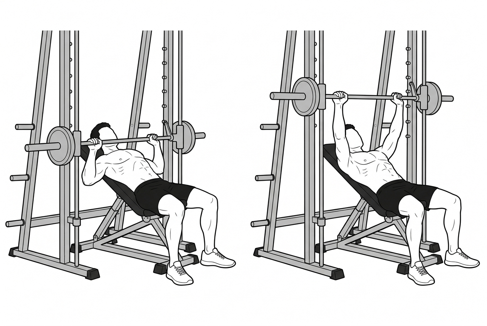

Starting position / Peak contraction position

Press a fixed-track Smith machine barbell from the upper chest along guided vertical guide rods while seated on an incline bench, emphasizing the clavicular head of the pectoralis major with maximum stability.

- **Danish:** Skrå bænkpres i Smith-stativ
- **Aliases:** Incline Smith Machine Press, Smith machine incline press, Incline Smith press, Smith incline bench press
- **Primary muscles:** Pectoralis major (clavicular head)
- **Assisting muscles:** Anterior deltoid, Triceps brachii, Pectoralis major (sternal head)
- **Stabilizers:** Rotator cuff, Abdominal wall
- **Equipment:** Smith machine, Adjustable incline bench, Weight plates
- **Movement:** Incline chest press - guided vertical/angled plane; Bilateral
- **Grip:** Overhand pronated grip slightly wider than shoulder width with wrists straight and stacked over forearms.
- **Difficulty:** Intermediate (editorial label)
- **Review:** draft; revision 1

### Setup

- Position an adjustable incline bench at approximately 30 to 45 degrees inside the Smith machine.
- Align the bench so the bar lowers across the upper clavicular chest (just below the collarbones) in a straight path.
- Set safety catch pins just below the target bottom chest level.
- Lie back with upper back and hips flat against the bench, feet firmly planted on the floor.
- Grip the bar with an overhand grip slightly wider than shoulder-width and unrack the bar with a wrist rotation.

### Execution

1. Lower the bar slowly under control toward your upper chest, allowing elbows to tuck naturally to about 45 to 60 degrees relative to your torso.
2. Touch the bar lightly to the upper chest or stop just above without bouncing off the ribcage.
3. Press the bar upward along the fixed track by contracting the upper pectorals and triceps until arms are extended with elbows softly unlocked.
4. Rotate wrists to engage the safety catches when the set is finished.

### Cues

- Press through the upper chest.
- Keep wrists straight and forearms vertical.
- Control the descent to the clavicles.

### Common mistakes

- Setting the bench too far forward or backward, forcing unnatural shoulder internal rotation along the fixed track.
- Bouncing the bar off the chest.
- Flaring elbows out to 90 degrees, causing anterior shoulder impingement.

### Logging convention

Two 20 kg plates loaded (40 kg plates) plus 10 kg counterbalance bar: record 50 kg total effective load (or record 40 kg plate load + note bar weight).

Smith machine bars vary in counterbalance weight (typically 5 kg to 15 kg); record total loaded plate mass and note machine bar tare.

### Variants and alternatives

Incline barbell pressing performed on a fixed-track Smith machine. Eliminates stabilization requirements to isolate clavicular pectoral recruitment along a linear guided path.

- Barbell Incline Bench Press
- Incline Chest Press Machine
- Dumbbell Bench Press

### Review notes

- Drafted from FitTrack ID 54 (Incline Smith Machine Press).
- Illustration depicts 30-45 degree incline bench centered inside vertical Smith machine frame with safety hooks.

### References

- [ExRx.net - Smith Incline Bench Press](https://exrx.net/WeightExercises/PectoralClavicular/SMBenchPressIncline): Smith machine incline press kinematics, clavicular pectoralis recruitment, and guide-rod alignment.

[Editable JSON](../catalog/exercises/incline-smith-machine-press.json)

## Leg Press Calf Press

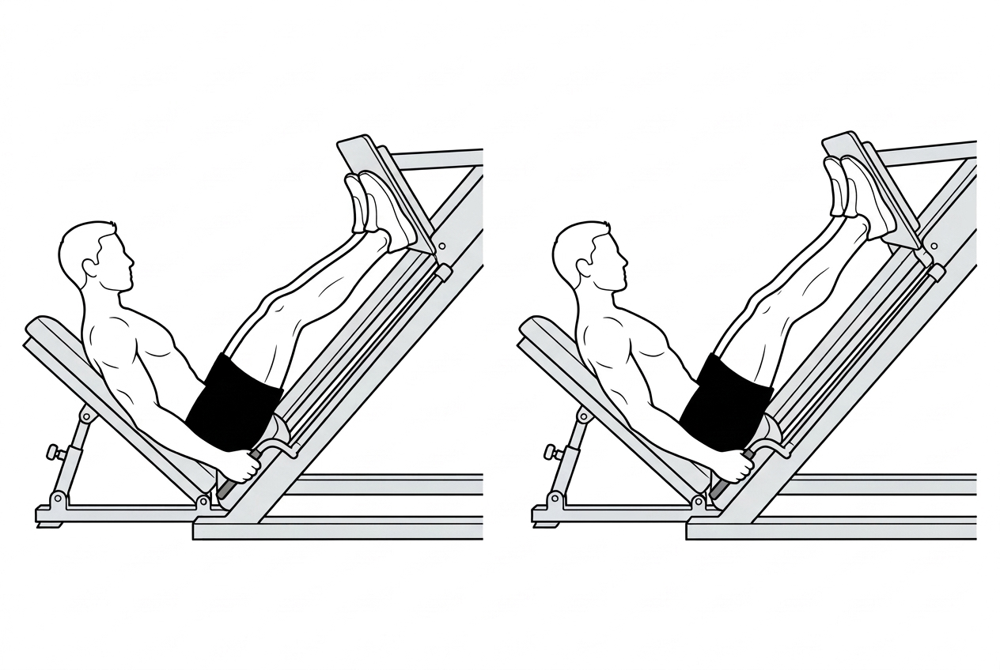

Starting position / Peak contraction position

Perform ankle plantar flexion against the leg press footplate with knees softly extended, emphasizing the gastrocnemius.

- **Danish:** Lægpres i benpresmaskine
- **Aliases:** Calf Press (Leg Press), Leg press calf raise, 45-degree leg press calf press, Calf press on leg press
- **Primary muscles:** Gastrocnemius
- **Assisting muscles:** Soleus, Tibialis posterior
- **Stabilizers:** Quadriceps
- **Equipment:** 45-degree sled leg press machine
- **Movement:** Ankle plantar flexion; Bilateral
- **Grip:** Hands holding side safety handles of the leg press carriage.
- **Difficulty:** Beginner (editorial label)
- **Review:** draft; revision 1

### Setup

- Sit firmly in the 45-degree leg press with back and hips supported against the pads.
- Place the balls of both feet along the lower edge of the footplate, hip-width apart, with heels free to drop into dorsiflexion.
- Extend legs so knees are softly unlocked (never hyperextended) and disengage the safety bars.

### Execution

1. Lower the carriage by allowing your ankles to dorsiflex, letting your heels drop below the footplate edge until you feel a deep calf stretch.
2. Press through the balls of your feet into full plantar flexion, driving the sled upward with your calves.
3. Hold the peak contraction at the top for a moment on your toes.
4. Lower slowly under control back into the full stretch before beginning the next repetition.

### Cues

- Keep knees softly unlocked and motionless.
- Press through the balls of the feet.
- Pause at the bottom stretch.

### Common mistakes

- Bending and straightening the knees to turn the exercise into a leg press.
- Hyperextending or locking out the knees under heavy sled load.
- Bouncing out of the bottom stretch without control.

### Logging convention

Four 20 kg plates loaded (two per side): record 80 kg total plate load on sled.

45-degree sleds have an effective load of approximately 70% of plate mass plus carriage weight; record loaded plate mass.

### Variants and alternatives

Calf press performed on a 45-degree sled leg press machine with straight legs to recruit the gastrocnemius under stretch.

- Dumbbell Romanian Deadlift
- Pendulum Squat

### Review notes

- Drafted from FitTrack ID 100 (Calf Press (Leg Press)).
- Illustration depicts soft knee extension and ankle dorsiflexion to plantar flexion range of motion on an incline carriage.

### References

- [ExRx.net - Sled 45° Calf Press](https://exrx.net/WeightExercises/Gastrocnemius/SL45CalfPress): 45-degree sled calf press biomechanics, gastrocnemius isolation, and safety considerations.

[Editable JSON](../catalog/exercises/leg-press-calf-press.json)

## Lying Leg Curl

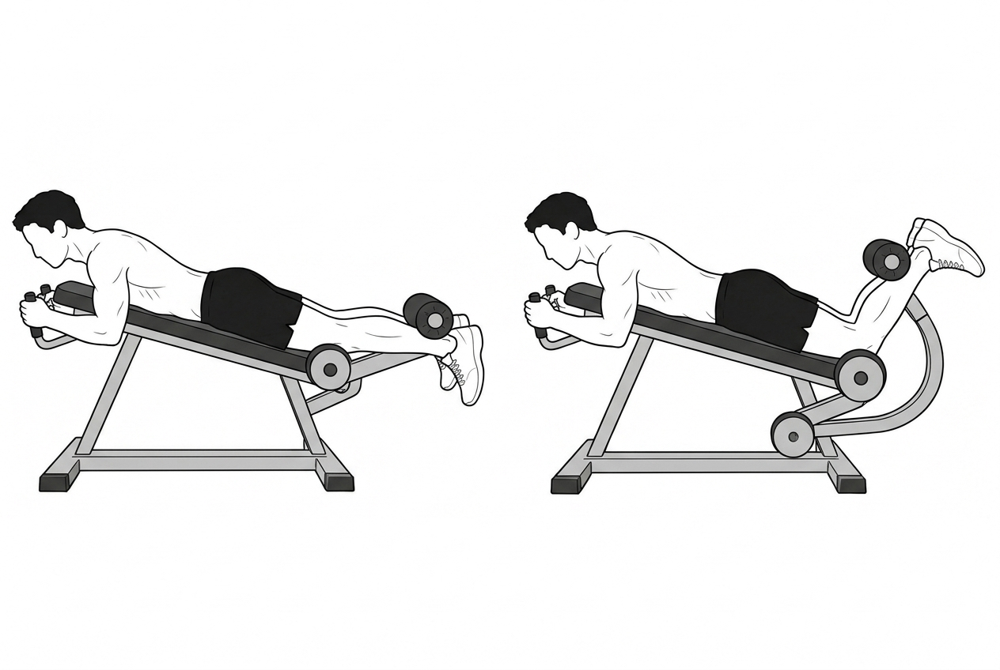

Starting position / Peak contraction position

Flex knees against a padded machine roller while lying prone on an angled bench, isolating the hamstring complex through open-chain knee flexion.

- **Danish:** Liggende lårcurl i maskine
- **Aliases:** Lying Leg Curl, Prone leg curl, Prone machine hamstring curl, Lying hamstring curl, Lying leg curl machine
- **Primary muscles:** Biceps femoris, Semitendinosus, Semimembranosus
- **Assisting muscles:** Gastrocnemius, Gracilis, Sartorius
- **Stabilizers:** Spinal erectors, Abdominal wall, Gluteus maximus
- **Equipment:** Lying leg curl machine
- **Movement:** Knee flexion - prone machine; Bilateral
- **Grip:** Hands gripping side support handles on the machine bench.
- **Difficulty:** Beginner (editorial label)
- **Review:** draft; revision 1

### Setup

- Select the desired pin load on the weight stack.
- Adjust the padded roller so it rests just below the calves against the lower Achilles tendon with knees aligned with the machine pivot axis.
- Lie prone with your hips and torso supported against the angled bench pads and grasp the side handles firmly.

### Execution

1. Curl both heels upward and backward toward your glutes by flexing your knees through a smooth, controlled arc.
2. Keep your hips and pelvis pressed firmly against the bench pad without hyperextending your lower back.
3. Squeeze your hamstrings firmly at peak contraction when the roller approaches the glutes.
4. Lower the lever slowly under control back to the starting position with legs nearly fully extended before the next rep.

### Cues

- Glue your hips to the bench.
- Pull heels all the way to the glutes.
- Control the negative descent.

### Common mistakes

- Lifting the pelvis and hips off the bench pad to recruit hip flexors and lower back.
- Using explosive swinging momentum that slams the weight stack at the bottom.
- Setting the roller pad too high on the calf or too low on the foot.

### Logging convention

Weight stack pin set to 35 kg: record 35 kg selected machine load.

Cam shapes and lever ratios vary across machine manufacturers; record the selected stack pin load.

### Variants and alternatives

Prone selectorized lying leg curl machine isolating knee flexion. Angled bench pad reduces passive insufficiency by placing hips in slight flexion.

- Barbell Romanian Deadlift
- Dumbbell Romanian Deadlift
- Machine Seated Leg Curl

### Review notes

- Drafted from FitTrack ID 62 (Lying Leg Curl).
- Depicts prone position on angled bench with full knee flexion arc to glutes without pelvic elevation.

### References

- [ExRx.net - Lever Lying Leg Curl](https://exrx.net/WeightExercises/Hamstrings/LVLyingLegCurl): Prone machine leg curl kinematics, hamstring recruitment, and pelvic stabilization.

[Editable JSON](../catalog/exercises/lying-leg-curl.json)

## Machine Chest Press

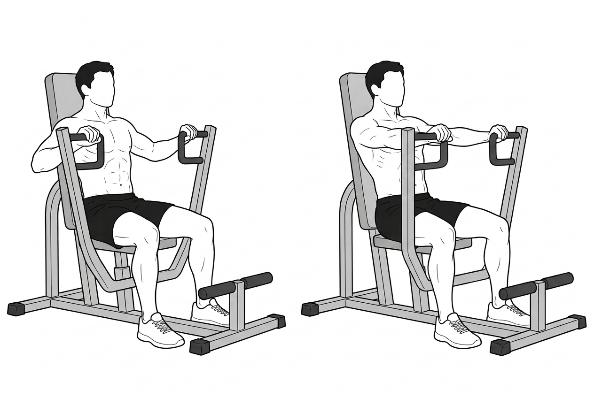

Starting position / Peak contraction position

Perform a seated horizontal press on a chest machine, pushing handles forward along a guided path while keeping the back supported.

- **Danish:** Brystpres i maskine
- **Aliases:** Chest Press, Machine Chest Press, Seated Chest Press Machine, Selectorized Chest Press
- **Primary muscles:** Pectoralis major (sternal head)
- **Assisting muscles:** Pectoralis major (clavicular head), Anterior deltoid, Triceps brachii
- **Stabilizers:** Rotator cuff, Serratus anterior
- **Equipment:** Seated chest press machine
- **Movement:** Horizontal chest press - guided machine; Bilateral
- **Grip:** Pronated or neutral grip on guided horizontal press handles.
- **Difficulty:** Beginner (editorial label)
- **Review:** draft; revision 1

### Setup

- Adjust the seat height so the machine handles align with the mid-to-lower chest.
- Sit with back, shoulders, and head resting against the vertical back pad, feet firmly planted on the floor.
- Grasp the horizontal press handles with a pronated grip and elbows bent comfortably behind the handles.

### Execution

1. Press the handles forward smoothly along the machine's guide track until arms are fully extended without locking the elbows.
2. Maintain steady contact between the upper back and back pad throughout the press.
3. Pause briefly at peak extension under control.
4. Lower the weight smoothly under control until hands return to chest level, feeling a gentle stretch in the pectorals before initiating the next rep.

### Cues

- Keep back flat against the pad.
- Press straight forward.
- Control the return without slamming the stack.

### Common mistakes

- Arching the lower back off the pad to assist the press.
- Locking the elbows forcefully at full extension.
- Letting weight plates slam between repetitions.

### Logging convention

Weight pin set to 60 kg: record 60 kg selected machine load.

Machine lever cams and pulley ratios vary between manufacturers; record the selected stack pin or plate load without assuming 1:1 free-weight equivalency.

### Variants and alternatives

Standard seated selectorized machine chest press with vertical back pad support and bilateral horizontal pressing levers.

- Incline Chest Press Machine
- Dumbbell Bench Press
- Barbell Bench Press

### Review notes

- Drafted from FitTrack ID 123 (Chest Press).
- Illustration shows seated upright position with pronated grip; minor forward lean at lockout noted in right panel, but machine geometry and mechanics remain consistent.

### References

- [ExRx.net - Lever Chest Press](https://exrx.net/WeightExercises/PectoralSternal/LVChestPress): Machine chest press mechanics, pectoral activation, and seat height setup.

[Editable JSON](../catalog/exercises/machine-chest-press.json)

## Machine Hip Thrust

Lowered position / Hip extension

A supported hip extension against a dedicated machine's resistance. Your upper back stays supported while your hips move the padded belt or lever.

- **Danish:** Hip thrust i maskine
- **Aliases:** Glute drive, Hip thrust machine
- **Primary muscles:** Gluteus maximus
- **Assisting muscles:** Hamstrings, Adductor magnus
- **Stabilizers:** Abdominal wall
- **Equipment:** Dedicated hip-thrust machine, Weight plates for plate-loaded model
- **Movement:** Supported hip extension; Bilateral
- **Grip:** Hands steady the machine's handles; they do not lift the resistance.
- **Difficulty:** Intermediate (editorial label)
- **Review:** draft; revision 1

### Setup

- Follow the actual machine's instructions for the pad or belt, load and any safety catch.
- Place your upper back on its support and feet firmly on the platform; adjust your position for the machine.

### Execution

1. Brace the trunk and use the handles for stability.
2. Follow the machine's release sequence, then lower the hips under control.
3. Extend the hips until trunk and thighs are approximately aligned, without arching the lower back.
4. Return under control; re-engage the catch before releasing the belt or leaving.

### Cues

- Move at the hips.
- Keep ribs and pelvis controlled.
- Keep both feet planted.

### Common mistakes

- Arching the lower back to lift higher.
- Changing foot position mid-set or releasing the restraint before securing the load.

### Logging convention

Two 20 kg plates: record 40 kg added load on this machine.

Do not invent an empty-lever weight or compare loads across machines. A stack model needs a separate logging convention.

### Variants and alternatives

Illustrated as a generic belt-loaded model. Selectorized and rigid-pad machines may use a different setup and release sequence.

- Barbell Hip Thrust
- Smith Machine Hip Thrust

### Review notes

- Actual machine model, belt/pad position and catch sequence need confirmation.
- Generic schematic, not a manufacturer-specific diagram; trainer review pending.

### References

- [ACE - Understanding the Barbell Hip Thrust](https://www.acefitness.org/continuing-education/certified/november-2019/7403/understanding-the-barbell-hip-thrust/): General hip-thrust movement and muscle roles, not this exact machine.
- [Life Fitness - Plate-Loaded Glute Drive](https://shop.lifefitness.com/products/hammer-strength-plate-loaded-glute-drive): Example of dedicated machine with upper-back support, footplate and hip strap; not confirmation of the user's model.

[Editable JSON](../catalog/exercises/machine-hip-thrust.json)

## Machine Inner Chest Press

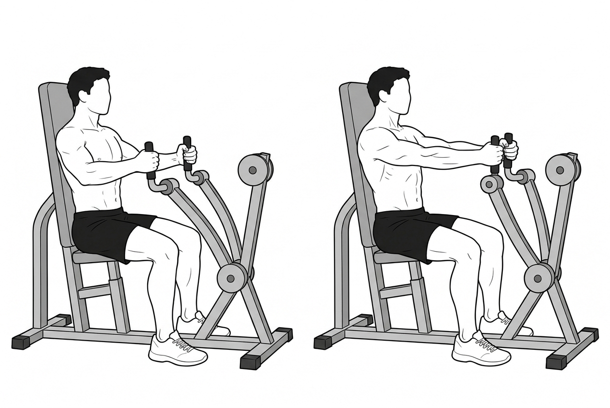

Starting position / Peak contraction position

Press seated machine handles forward along a converging path using an inner neutral or narrow grip, creating peak horizontal adduction tension across the inner sternal pectorals at lockout.

- **Danish:** Brystpres med samlende greb i maskine
- **Aliases:** Machine Inner Chest Press, Converging chest press machine, Neutral-grip machine chest press, Close-grip machine chest press
- **Primary muscles:** Pectoralis major (sternal head)
- **Assisting muscles:** Triceps brachii, Anterior deltoid, Pectoralis major (clavicular head)
- **Stabilizers:** Abdominal wall, Rotator cuff
- **Equipment:** Seated chest press machine
- **Movement:** Horizontal push - converging machine; Bilateral
- **Grip:** Neutral or narrow overhand grip on inner converging machine handles.
- **Difficulty:** Beginner (editorial label)
- **Review:** draft; revision 1

### Setup

- Adjust the seat height so the inner handles align with mid-chest level.
- Sit upright with hips, upper back, and head firmly against the vertical back pad, feet flat on the floor.
- Grasp the inner/neutral handles with elbows tucked comfortably at ~45 degrees to the torso.

### Execution

1. Press the handles smoothly forward away from your chest along the machine's converging track.
2. Extend your arms fully, bringing your hands closer together in front of the center chest without locking out elbows aggressively.
3. Squeeze your pectorals forcefully at the peak contraction.
4. Return the handles slowly under complete control until hands are back beside the chest, feeling a comfortable chest stretch before the next rep.

### Cues

- Press forward and squeeze hands together in the center.
- Keep upper back and head against the backrest.
- Control the stretch on the return.

### Common mistakes

- Allowing shoulders to roll forward off the backrest at peak extension.
- Flaring elbows high and wide, shifting load away from the chest to anterior shoulders.
- Bouncing weight plates off the stack stops between repetitions.

### Logging convention

Weight pin set to 55 kg: record 55 kg selected machine load.

Leverage and converging cam paths vary between manufacturers; record selected stack pin load.

### Variants and alternatives

Seated machine chest press utilizing inner or converging handles to maximize horizontal adduction and peak sternal pectoral contraction.

- Machine Chest Press
- Incline Chest Press Machine
- Barbell Bench Press

### Review notes

- Drafted from FitTrack ID 50 (Machine Inner Chest Press).
- Focuses on inner/converging handle variation of selectorized chest press distinct from wide flat bench pressing.

### References

- [ExRx.net - Lever Seated Chest Press](https://exrx.net/WeightExercises/PectoralSternal/LVChestPress): Selectorized chest press mechanics, grip width variations, and converging lever advantages.

[Editable JSON](../catalog/exercises/machine-inner-chest-press.json)

## Machine Preacher Curl

Elbows comfortably extended / Handles curled upward

Curl the handles of a preacher machine while the upper arms remain supported on its angled pad.

- **Danish:** Preachercurl i maskine
- **Aliases:** Preacher Curl, Selectorized preacher curl, Machine biceps curl
- **Primary muscles:** Biceps brachii
- **Assisting muscles:** Brachialis, Brachioradialis
- **Stabilizers:** Forearm flexors, Rotator cuff
- **Equipment:** Selectorized preacher-curl machine
- **Movement:** Elbow flexion - supported upper arms; Bilateral, shared lever
- **Grip:** Underhand or the machine's semi-supinated handles, keeping wrists aligned with the forearms.
- **Difficulty:** Beginner (editorial label)
- **Review:** draft; revision 1

### Setup

- Select a light stack setting and adjust the seat following the machine's instructions.
- Place both upper arms on the pad and align the elbows with the machine's indicated axis.
- Grasp the handles without lifting the shoulders or reaching the elbows off the pad.

### Execution

1. Bend the elbows to raise the machine handles toward the shoulders.
2. Keep the upper arms supported and the torso still.
3. Stop at the machine's comfortable range without forcing the handles closer.
4. Lower slowly without snapping the elbows straight or letting the stack drop.

### Cues

- Keep upper arms on the pad.
- Move through the elbows.
- Let the machine guide the path.

### Common mistakes

- Lifting the upper arms or chest to finish the curl.
- Using a seat setting that misaligns elbows and pivot.

### Logging convention

Machine stack selected at 20 kg: record 20 kg with the machine identified.

Record the stack setting and machine identity. Plate-loaded, independent-arm and different lever-ratio machines do not share a directly comparable load scale.

### Variants and alternatives

Machine preacher version is confirmed. Selectorized, bilateral shared lever is an equipment assumption; actual gym model, handle shape and pivot alignment need checking.

- EZ-Bar Preacher Curl
- Incline Dumbbell Biceps Curl

### Review notes

- Generic equipment schematic, not a model-specific operating diagram.
- Illustrated handle-to-lever connection and pivot geometry remain unresolved; replace or approve against the actual machine before marking reviewed.

### References

- [Life Fitness - Insignia Series Biceps Curl](https://www.lifefitness.com/en-us/catalog/strength-training/selectorized/insignia-series-biceps-curl): Manufacturer example of a supported-arm selectorized biceps machine. Does not identify the gym machine or validate this generic illustration.

[Editable JSON](../catalog/exercises/machine-preacher-curl.json)

## Overhead Rope Cable Triceps Extension

Elbows bent overhead / Elbows extended overhead

Extend both elbows with the upper arms overhead while a rope connects to a cable behind the body.

- **Danish:** Overhead tricepsextension med reb i kabel
- **Aliases:** Overhead rope extension, Cable rope triceps extension, Standing Rope Triceps Extension, Cable High-Pulley Overhead Triceps Extension, Tricep Extension, Triceps Extension
- **Primary muscles:** Triceps brachii
- **Assisting muscles:** Anconeus
- **Stabilizers:** Rotator cuff, Abdominal wall, Forearm flexors
- **Equipment:** Low cable pulley, Rope attachment
- **Movement:** Elbow extension - arms overhead; Bilateral
- **Grip:** One rope end in each hand, palms facing each other and wrists aligned with the forearms.
- **Difficulty:** Intermediate (editorial label)
- **Review:** draft; revision 1

### Setup

- Attach the rope to a low pulley and select a manageable stack setting.
- Bring the rope behind the head and step into a stable staggered stance facing away from the stack.
- Raise the upper arms beside the head and establish cable tension without arching the back.

### Execution

1. Begin with elbows bent and hands behind the head in a comfortable position.
2. Straighten the elbows while keeping the upper arms nearly stationary.
3. Finish overhead without forcing the elbows into hyperextension.
4. Bend the elbows slowly to return; keep the cable controlled when ending the set.

### Cues

- Move at the elbows.
- Keep the ribs down.
- Let the rope ends move naturally.

### Common mistakes

- Arching the lower back to raise the hands.
- Swinging the shoulders or letting the stack pull the arms back suddenly.

### Logging convention

A single stack selected at 20 kg: record 20 kg on that machine.

Record the selected stack value, attachment and pulley setup. Pulley ratios and machine calibration make stack values unsuitable for direct comparisons across machines.

### Variants and alternatives

Overhead rope version, distinct from a pushdown. A low pulley behind the standing athlete is the illustrated assumption; a high-pulley forward-leaning version needs its own setup.

- Overhead Dumbbell Triceps Extension
- Cable Triceps Pushdown

### Review notes

- Overhead rope attachment is confirmed; exact pulley height and stance still need equipment review.
- The source's seated low-pulley setup supports the rope and elbow action, not validation of the illustrated standing adaptation.

### References

- [Muscle & Strength - Seated Cable Tricep Extension](https://www.muscleandstrength.com/node/4120): Seated low-pulley overhead rope extension; standing stance is an editorial adaptation requiring review.

[Editable JSON](../catalog/exercises/overhead-rope-cable-triceps-extension.json)

## Pec Deck

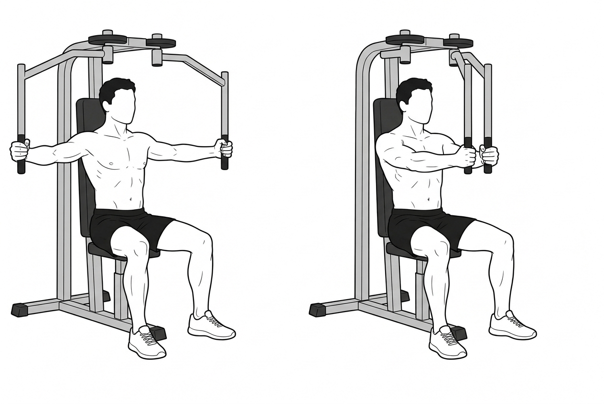

Seated with arms open wide holding machine fly handles / Handles brought together in front of chest in horizontal adduction

Sit upright against the back pad of a pec deck machine and adduct both arms horizontally toward the center line in a controlled hugging arc.

- **Danish:** Pec deck
- **Aliases:** Pec deck fly, Machine chest fly, Seated machine fly, Butterfly machine
- **Primary muscles:** Pectoralis major (sternal head)
- **Assisting muscles:** Pectoralis major (clavicular head), Anterior deltoid
- **Stabilizers:** Biceps brachii (short head), Pectoralis minor
- **Equipment:** Pec deck machine
- **Movement:** Horizontal adduction - seated machine; Bilateral
- **Grip:** Neutral or semi-pronated grip holding the vertical padded machine handles.
- **Difficulty:** Beginner (editorial label)
- **Review:** draft; revision 1

### Setup

- Adjust seat height so the handles align across mid-chest level when gripped.
- Sit with hips, upper back, and head firmly supported against the vertical back pad.
- Grip the vertical handles with a slight, fixed bend in the elbows.

### Execution

1. Contract the chest muscles to bring the lever handles together in front of the sternum.
2. Maintain the same soft elbow angle throughout the horizontal arc; do not turn the fly into a press.
3. Squeeze the chest at full adduction for a brief pause.
4. Slowly return the arms back to the starting stretch position under control without letting the weight stack slam.

### Cues

- Hug a wide barrel.
- Keep upper back pinned to the pad.
- Lead with the inner elbows and chest.

### Common mistakes

- Pressing with the triceps by straightening the elbows during adduction.
- Shrugging the shoulders up toward the ears.
- Overextending the arms backward past active shoulder mobility at the stretch.

### Logging convention

Pin placed at 45 kg: record 45 kg selected machine load.

Machine lever arms, cams, and pulley ratios vary widely across manufacturers; record the selected stack pin load.

### Variants and alternatives

Dedicated seated machine chest fly with vertical handles. Maintains continuous tension on pectoralis major through horizontal adduction.

- Flat Dumbbell Fly
- Cable High Fly

### Review notes

- Drafted from FitTrack ID 114 (Pec Deck).
- Illustration captures the horizontal fly arc with soft constant elbow bend.

### References

- [ExRx.net - Lever Chest Fly](https://exrx.net/WeightExercises/PectoralSternal/LVChestFly): Lever machine chest fly mechanics, horizontal adduction, and stabilizer involvement.

[Editable JSON](../catalog/exercises/pec-deck.json)

## Pendlay Row

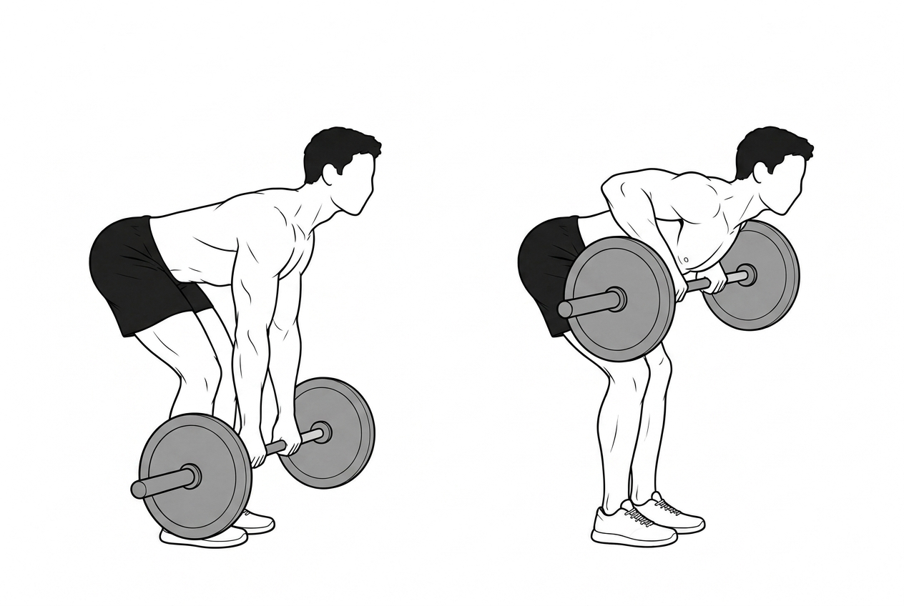

Hinged with torso parallel to floor gripping barbell resting on floor / Barbell rowed up to lower sternum with elbows driven high

Perform a strict bent-over barbell row starting from a dead stop on the floor for each repetition, maintaining a strictly horizontal torso parallel to the ground.

- **Danish:** Pendlay row
- **Aliases:** Dead-stop barbell row, Strict barbell row from floor, Strict Pendlay row
- **Primary muscles:** Latissimus dorsi, Trapezius, Rhomboids
- **Assisting muscles:** Posterior deltoid, Infraspinatus, Teres minor, Brachialis, Brachioradialis
- **Stabilizers:** Erector spinae, Hamstrings, Gluteus maximus
- **Equipment:** Barbell, Weight plates
- **Movement:** Horizontal pull - parallel torso from floor; Bilateral
- **Grip:** Pronated (overhand) grip slightly wider than shoulder width.
- **Difficulty:** Intermediate (editorial label)
- **Review:** draft; revision 1

### Setup

- Step up to a loaded barbell on the floor with feet hip-width apart.
- Hinge deeply at the hips and bend knees until torso is strictly parallel to the floor.
- Grip the barbell with an overhand pronated grip slightly wider than shoulder width.
- Brace the core, flatten the spine, and take the slack out of the barbell.

### Execution

1. Explosively pull the barbell upward from the floor by driving elbows toward the ceiling.
2. Contact the barbell against the lower chest or upper abdomen without standing up or raising torso angle.
3. Lower the barbell under control all the way back to a dead stop on the floor.
4. Reset spinal tension completely between every repetition.

### Cues

- Torso stays parallel like a table.
- Pull from a dead stop.
- Drive elbows to the ceiling.

### Common mistakes

- Rising the torso into a 45-degree angle to heave the bar upward.
- Bouncing the bar off the floor instead of pulling from a complete dead stop.
- Rounding the lower spine under heavy loads.

### Logging convention

Bar (20 kg) plus 50 kg plates: record 70 kg total barbell mass.

Record total combined mass of the barbell and loaded plates.

### Variants and alternatives

Strict dead-stop barbell row with horizontal torso parallel to the floor. Eliminates stretch-shortening cycle momentum.

- Bent-Over Barbell Row
- Supinated Barbell Bent-Over Row
- T-Bar Row

### Review notes

- Drafted from FitTrack ID 116 (Pendlay Row).
- Illustration shows dead stop on floor and horizontal torso; minor knee angle extension between panels noted.

### References

- [ExRx.net - Barbell Bent-over Row](https://exrx.net/WeightExercises/BackGeneral/BBBentOverRow): Bent-over barbell row mechanics, back musculature recruitment, and spinal brace requirements.

[Editable JSON](../catalog/exercises/pendlay-row.json)

## Pendulum Squat

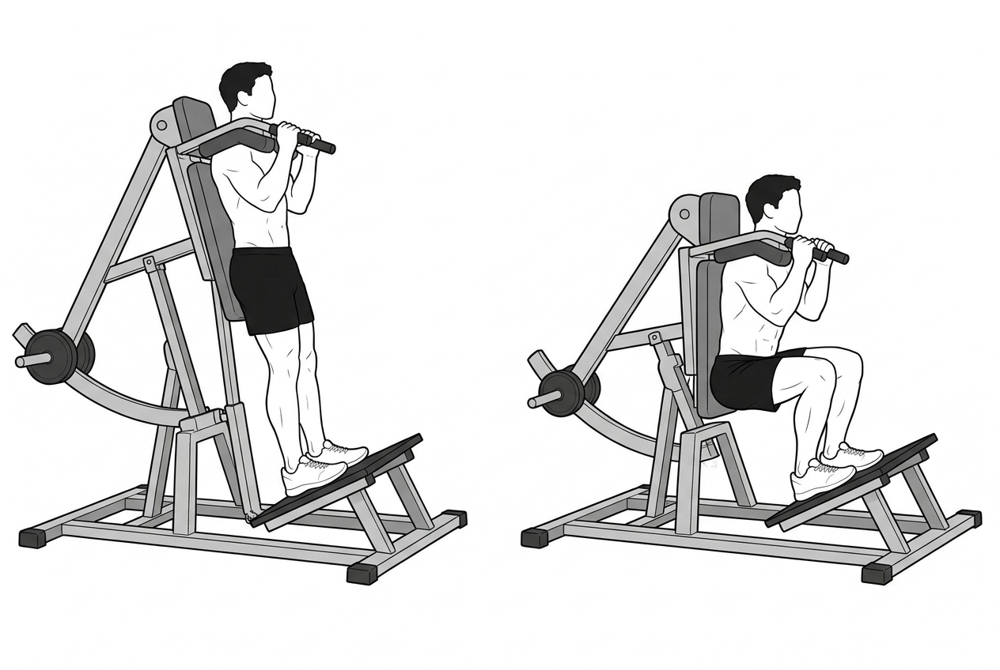

Starting position / Peak contraction position

Perform a guided squat on a counterweighted pendulum machine along a curved arc that maximizes knee flexion and quad loading while minimizing lumbar stress.

- **Danish:** Pendulum squat
- **Aliases:** Pendulum Squat, Pendulum Squat Machine
- **Primary muscles:** Quadriceps
- **Assisting muscles:** Gluteus maximus, Adductor magnus, Soleus
- **Stabilizers:** Abdominal wall, Erector spinae
- **Equipment:** Pendulum squat machine
- **Movement:** Squat - guided pendulum machine; Bilateral
- **Grip:** Hands gripping support handles on machine shoulder harness.
- **Difficulty:** Intermediate (editorial label)
- **Review:** draft; revision 1

### Setup

- Load weight plates onto the machine's counterbalanced pendulum horn.
- Step onto the angled footplate with feet shoulder-width apart.
- Position shoulders snugly under the padded harness and back resting flat against the pivoting back support.
- Release the safety latch and stand tall with knees softly unlocked.

### Execution

1. Descend smoothly by flexing knees and hips, allowing the pendulum arm to swing backward along its curved arc.
2. Lower until thighs reach parallel to the footplate or full knee flexion is achieved, keeping back flat against the pad.
3. Pause briefly at the bottom under complete muscular control.
4. Drive through the mid-foot to push back up along the pendulum arc to the starting position without forcefully locking knees.

### Cues

- Keep back flat against the pad.
- Track knees over toes along the arc.
- Drive through the mid-foot.

### Common mistakes

- Letting lower back or pelvis lift off the back support at depth.
- Locking knees aggressively at the top.
- Bouncing out of the bottom position.

### Logging convention

Two 20 kg plates on weight horn: record 40 kg total plate load.

Pendulum squat machines feature counterweights and curved mechanical leverage arcs; record total loaded plate mass rather than attempting free barbell equivalency.

### Variants and alternatives

Guided squat on a counterweighted pendulum machine with angled footplate and pivoting back support.

- Barbell Back Squat
- Hack Squat
- Leg Press

### Review notes

- Drafted from FitTrack ID 109 (Pendulum Squat).
- Illustration accurately captures the counterweighted pivot frame and curved movement arc.

### References

- [ExRx.net - Lever Squat](https://exrx.net/WeightExercises/Quadriceps/LVSquat): Guided machine squat mechanics, knee flexion torque, and footplate positioning.

[Editable JSON](../catalog/exercises/pendulum-squat.json)

## Plate Loaded Lat Pulldown

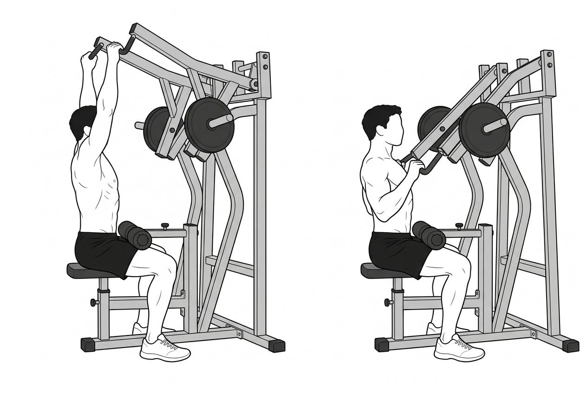

Starting position / Peak contraction position

Pull bilateral converging plate-loaded lever arms downward to the upper chest while seated with thighs secured under roller pads.

- **Danish:** Brysttræk i maskine med vægtskiver
- **Aliases:** Plate Loaded Lat Pulldown, Lever lat pulldown, Converging lat pulldown machine, Plate-loaded pulldown
- **Primary muscles:** Latissimus dorsi
- **Assisting muscles:** Teres major, Biceps brachii, Brachialis, Lower trapezius, Rhomboids
- **Stabilizers:** Abdominal wall, Rotator cuff
- **Equipment:** Plate-loaded lat pulldown machine
- **Movement:** Vertical pull; Bilateral
- **Grip:** Semi-neutral or underhand grip on machine lever handles.
- **Difficulty:** Beginner (editorial label)
- **Review:** draft; revision 1

### Setup

- Load weight plates evenly onto both machine lever horns.
- Adjust the thigh pads so your legs are firmly secured with feet flat on the floor.
- Sit tall, grasp the overhead lever handles, and allow arms to fully extend overhead into a deep lat stretch.

### Execution

1. Pull both lever arms downward and slightly inward toward your upper chest along the converging arc.
2. Drive your elbows down and back tight toward your ribcage.
3. Pause briefly at peak contraction with chest lifted and lats fully engaged.
4. Control the ascent slowly until your arms are fully extended overhead before initiating the next repetition.

### Cues

- Drive elbows down to the ribs.
- Keep chest lifted tall.
- Control the overhead stretch.

### Common mistakes

- Leaning excessively backward to swing the weight down.
- Letting the levers crash into the top stops between reps.
- Lifting thighs off the support pads.

### Logging convention

Two 20 kg plates loaded (one per lever): record 40 kg total plate load.

Plate-loaded machines feature converging lever arcs; record the total mass of plates loaded across both horns.

### Variants and alternatives

Bilateral vertical pull on a converging plate-loaded machine with dual lever arms.

- Single-Arm Plate Loaded Lat Pulldown
- Seated Lat Pulldown Machine
- Single-Arm Supinated Pulldown

### Review notes

- Drafted from FitTrack ID 93 (Plate Loaded Lat Pulldown).
- Illustration depicts bilateral execution on converging lever machine with thigh support.

### References

- [ExRx.net - Lever Front Pulldown](https://exrx.net/WeightExercises/LatissimusDorsi/LVFrontPulldown): Converging lever pulldown mechanics, latissimus dorsi recruitment, and seated execution.

[Editable JSON](../catalog/exercises/plate-loaded-lat-pulldown.json)

## Reverse Pec Deck

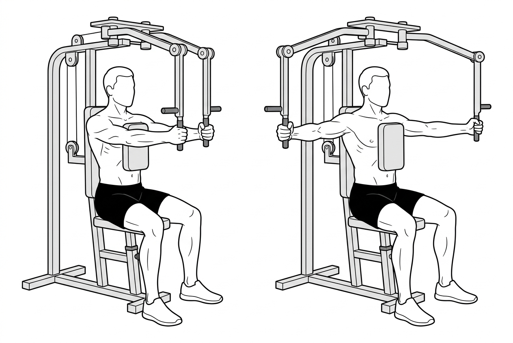

Starting position / Peak contraction position

Sit facing the chest support pad of a dual-function pec deck machine and horizontally abduct both arms outward and backward, isolating the posterior deltoids and external rotators.

- **Danish:** Omvendt pec deck
- **Aliases:** Reverse Pec Deck, Rear delt pec deck, Machine rear delt fly, Reverse fly machine, Pec deck rear delt
- **Primary muscles:** Posterior deltoid
- **Assisting muscles:** Infraspinatus, Teres minor, Middle trapezius, Rhomboids
- **Stabilizers:** Rotator cuff, Abdominal wall
- **Equipment:** Pec deck machine
- **Movement:** Shoulder horizontal abduction - seated machine; Bilateral
- **Grip:** Neutral or pronated grip holding the horizontal or vertical machine handles at shoulder height.
- **Difficulty:** Beginner (editorial label)
- **Review:** draft; revision 1

### Setup

- Adjust the seat height so the handles align directly with shoulder height when seated.
- Set the machine arm stops to the rear-most position so handles meet directly in front of the chest.
- Sit facing inward with chest pressed firmly against the vertical support pad and feet flat on the floor.
- Grasp the handles with straight wrists and a slight, fixed bend in both elbows.

### Execution

1. Pull the handles outward and backward in a wide horizontal arc by contracting your rear deltoids.
2. Maintain the fixed, subtle elbow bend throughout the entire motion.
3. Continue until your arms are in line with your shoulders or slightly past, squeezing the back of your shoulders.
4. Slowly reverse the movement under control, resisting the weight stack until hands return to the front starting position.

### Cues

- Lead with the elbows wide.
- Keep chest pressed against the pad.
- Do not shrug shoulders upward.

### Common mistakes

- Bending and straightening the elbows into a row instead of a fly.
- Arching the spine and lifting the chest off the support pad to swing the load.
- Shrugging the upper traps and pulling handles toward the neck.

### Logging convention

Stack pin set to 30 kg: record 30 kg selected machine load.

Pec deck lever geometry and cam ratios vary between manufacturers; record selected stack pin load.

### Variants and alternatives

Chest-supported reverse machine fly on a dual-function pec deck / rear delt machine, isolating posterior deltoids through guided horizontal abduction.

- Single-Arm Rear-Delt Cable Fly
- Face Pulls with Wrist Cuffs
- Seated Machine Lateral Raise

### Review notes

- Drafted from FitTrack ID 56 (Reverse Pec Deck).
- Distinguished from anterior chest pec deck by inward-facing chest-supported orientation and horizontal abduction arc.

### References

- [ExRx.net - Lever Seated Rear Lateral Raise](https://exrx.net/WeightExercises/DeltoidPosterior/LVSeatedRearLateralRaise): Seated machine rear lateral raise mechanics, posterior deltoid isolation, and pelvic/torso alignment.

[Editable JSON](../catalog/exercises/reverse-pec-deck.json)

## Seated Cable Row

Arms extended / Handle at lower ribs

Pull a close-grip handle toward the lower ribs from a seated position while keeping the torso steady.

- **Danish:** Siddende kabelroning med håndtag
- **Aliases:** Seated low cable row, Close-grip cable row, Seated Cable Row with Handles, Cable Rope Seated Row
- **Primary muscles:** Latissimus dorsi, Rhomboids, Middle trapezius
- **Assisting muscles:** Posterior deltoid, Biceps brachii, Brachialis
- **Stabilizers:** Abdominal wall, Spinal erectors, Forearm flexors
- **Equipment:** Low cable pulley, Close neutral-grip row handle, Stable bench and foot supports
- **Movement:** Horizontal pull - elbows close; Bilateral, shared cable
- **Grip:** Both hands grasp the parallel grips of one close row handle, palms facing each other.
- **Difficulty:** Beginner (editorial label)
- **Review:** draft; revision 1

### Setup

- Attach a close row handle to one low cable and select the stack load.
- Sit on the bench, brace both feet on the supports and keep a small knee bend.
- Grasp the handle with both hands and sit tall at a distance that permits a controlled reach.

### Execution

1. Begin with arms extended and the shoulders allowed to reach forward without rounding the lower back.
2. Pull the elbows back close to the sides as the handle approaches the lower ribs.
3. Allow the shoulder blades to move naturally; avoid exaggerated backward leaning.
4. Extend the arms slowly to return without dropping the stack.

### Cues

- Bring elbows toward your sides.
- Keep the torso quiet.
- Control the reach.

### Common mistakes

- Rocking the whole torso to move the load.
- Shrugging or pulling the handle high toward the neck.

### Logging convention

A single stack selected at 20 kg: record 20 kg on that machine.

Record the selected stack value, attachment and pulley setup. Pulley ratios and machine calibration make stack values unsuitable for direct comparisons across machines.

### Variants and alternatives

One low cable with a hand-held close neutral-grip handle. Cuff rows and two independent cable stacks remain distinct entries.

- Seated Cable Row with Wrist Cuffs
- Bent-Over Barbell Row

### Review notes

- Close neutral handle and seated foot-supported setup are assumptions for the generic name.
- Trainer review of technique and illustrations pending.

### References

- [ACE - Cable Training, Seated Row](https://www.acefitness.org/cp/pdfs/CertifiedNews/AugSept09Cert.pdf): General seated low-cable row with close elbows; specific handle geometry is an editorial equipment assumption.

[Editable JSON](../catalog/exercises/seated-cable-row.json)

## Seated Cable Row with Wrist Cuffs

Arms extended / Elbows drawn back

A low cable row in which cuffs carry the resistance instead of hand-held handles. The elbows travel toward the sides while the torso remains steady.

- **Danish:** Siddende kabelroning med håndledscuffs
- **Aliases:** Seated Cable Row med cuffs, Cuff cable row, Wrist-cuff seated row
- **Primary muscles:** Latissimus dorsi
- **Assisting muscles:** Rhomboids, Middle trapezius, Posterior deltoid, Biceps brachii, Brachialis
- **Stabilizers:** Abdominal wall, Spinal erectors
- **Equipment:** Two low cable pulleys, Two load-rated wrist cuffs with attachment rings, Two compatible connectors, Stable bench and foot supports
- **Movement:** Horizontal pull - elbows close; Bilateral, independent cables
- **Grip:** No hand-held grip. Hands stay relaxed; resistance connects through the wrist cuffs.
- **Difficulty:** Intermediate (editorial label)
- **Review:** draft; revision 1

### Setup

- Attach one cuff to each wrist using the cuff maker's fit and attachment instructions, then connect one low cable to each cuff.
- Sit tall with feet braced, knees slightly bent and enough distance to begin with arms extended.

### Execution

1. Begin with relaxed hands and gentle cable tension; keep the torso upright.
2. Pull the elbows back toward the lower ribs without leaning backward.
3. Finish with the upper arms near the torso and shoulder blades moving naturally.
4. Extend the arms slowly and repeat without letting the cables jerk the cuffs.

### Cues

- Pull through the elbows.
- Let the cuffs carry the load.
- Keep the torso quiet.

### Common mistakes

- Swinging backward to complete the row.
- Gripping a handle or letting loose cuffs slide toward the hands.

### Logging convention

Two independent stacks each set to 15 kg: record 15 kg per side, with two stacks noted.

Keep the same cable system. A shared-stack or single-cable rig is a different setup; pulley ratios affect resistance.

### Variants and alternatives

Assumption: cuffs around the wrists, two low cables, close-elbow row. Upper-arm cuffs and a shared cable need their own variant instructions.

- Seated Cable Row with Handles
- Single-Arm Cable Row with Wrist Cuff

### Review notes

- Confirm cuff placement and whether your gym uses one cable or two.
- General rowing references do not validate this specific cuff adaptation; trainer review pending.

### References

- [ACE - Cable training, Seated Row](https://www.acefitness.org/cp/pdfs/CertifiedNews/AugSept09Cert.pdf): General low-cable seated row. Does not validate the wrist-cuff adaptation.
- [GymPin - Handles and Grips](https://gym-pin.co.uk/collections/handles-grips): Manufacturer lists cuffs for wrist and upper-arm cable training; not a cuff-row technique guide.

[Editable JSON](../catalog/exercises/seated-cable-row-wrist-cuffs.json)

## Seated Hip Abduction Machine

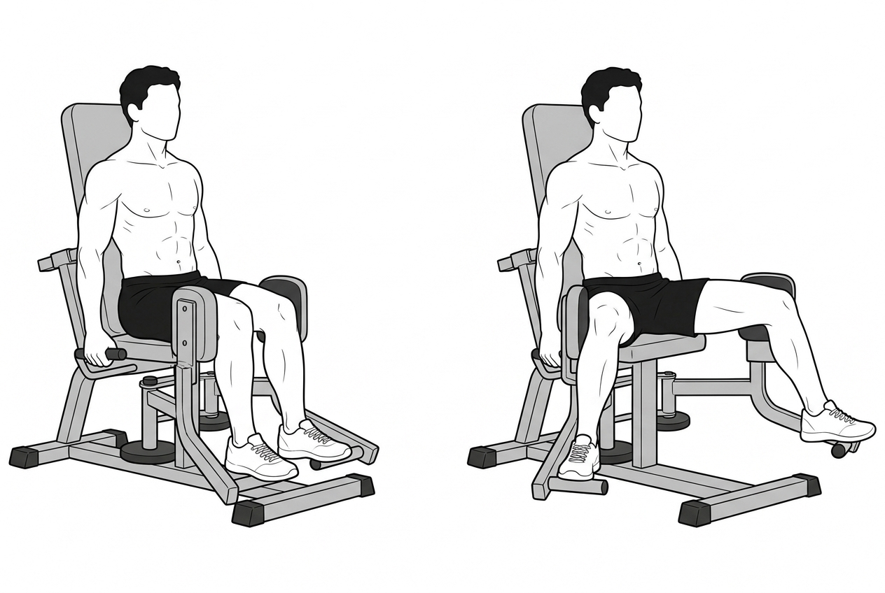

Starting position / Peak contraction position

Push the knees outward against padded machine levers while seated, isolating the gluteus medius and outer hip stabilizers.

- **Danish:** Siddende hofteabduktion i maskine
- **Aliases:** Hip Abduction Machine, Seated Hip Abduction, Outer thigh machine, Machine abductor
- **Primary muscles:** Gluteus medius, Gluteus minimus
- **Assisting muscles:** Tensor fasciae latae, Gluteus maximus
- **Stabilizers:** Abdominal wall
- **Equipment:** Seated hip abduction machine
- **Movement:** Hip abduction; Bilateral
- **Grip:** Hands gripping side support handles beside seat.
- **Difficulty:** Beginner (editorial label)
- **Review:** draft; revision 1

### Setup

- Select the desired weight stack load and adjust the swing arms so the lever pads rest against the outer sides of your knees with legs closed.
- Sit firmly with your back and hips flat against the backrest, feet placed on the foot supports.
- Grasp the side stability handles for support.

### Execution

1. Push your knees outward away from each other against the padded levers into wide hip abduction.
2. Hold the peak contraction at the widest point for a count of one, feeling the squeeze in your side glutes.
3. Return slowly under control back to the center position without allowing the weight plates to crash.
4. Repeat for the desired number of repetitions.

### Cues

- Push outward through the knees.
- Hold the peak contraction.
- Control the return to the center.

### Common mistakes

- Leaning or sliding forward on the seat to change the leverage angle.
- Using jerky explosive momentum instead of controlled glute contraction.
- Allowing the stack to slam between reps.

### Logging convention

Weight pin set to 45 kg: record 45 kg selected machine load.

Lever mechanics and cam shapes differ across equipment brands; record the selected stack pin load.

### Variants and alternatives

Selectorized seated outer-hip abduction machine isolating the gluteus medius and hip abductors.

- Machine Hip Thrust
- Barbell Romanian Deadlift

### Review notes

- Drafted from FitTrack ID 86 (Hip Abduction Machine) and ID 57 (Seated Hip Abduction).
- Illustration depicts closed start position in panel A and wide outward push in panel B; slight perspective asymmetry noted between legs.

### References

- [ExRx.net - Lever Seated Hip Abduction](https://exrx.net/WeightExercises/HipAbductors/LVSeatedHipAbduction): Machine hip abduction mechanics, gluteus medius recruitment, and proper seated posture.

[Editable JSON](../catalog/exercises/seated-hip-abduction-machine.json)

## Seated Hip Adduction Machine

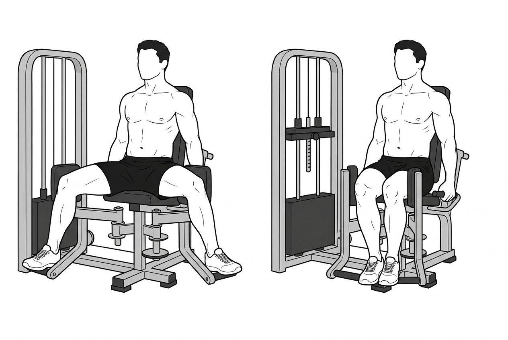

Starting position / Peak contraction position

Squeeze the thighs inward against padded machine levers while seated, isolating the adductor muscle group of the inner thighs.

- **Danish:** Siddende hofteadduktion i maskine
- **Aliases:** Hip Adduction Machine, Seated Hip Adduction, Inner thigh machine, Machine adductor
- **Primary muscles:** Adductor magnus, Adductor longus, Adductor brevis
- **Assisting muscles:** Gracilis, Pectineus
- **Stabilizers:** Abdominal wall, Pelvic floor
- **Equipment:** Seated hip adduction machine
- **Movement:** Hip adduction; Bilateral
- **Grip:** Hands gripping side support handles beside seat.
- **Difficulty:** Beginner (editorial label)
- **Review:** draft; revision 1

### Setup

- Select the desired weight stack setting and release the range-of-motion lever to open the swing arms to a comfortable wide stretch.
- Sit with your back firmly against the backrest, knees bent at 90 degrees, and inner knees resting against the padded lever arms.
- Grasp the side stability handles lightly.

### Execution

1. Squeeze your thighs smoothly together against the lever pads until they touch or meet in the center.
2. Pause under complete muscular control at the peak adduction contraction.
3. Slowly open your legs back to the wide starting position, resisting the stack resistance across the full range.
4. Do not let the weight stack smash down between repetitions.

### Cues

- Squeeze thighs together with control.
- Keep back flat against the backrest.
- Open slowly into the stretch.

### Common mistakes

- Using momentum or bouncing out of the wide stretch position.
- Lifting the pelvis or lower back off the seat to force the pads together.
- Setting the starting width beyond safe hip mobility.

### Logging convention

Weight pin set to 40 kg: record 40 kg selected machine load.

Cam geometry and lever arm ratios vary between manufacturers; record selected stack pin load.

### Variants and alternatives

Selectorized seated inner-thigh adduction machine isolating the adductor complex through a horizontal squeezing arc.

- Barbell Back Squat
- Seated Leg Press

### Review notes

- Drafted from FitTrack ID 87 (Hip Adduction Machine) and ID 58 (Seated Hip Adduction).
- Illustration depicts seated posture with wide-spread start in panel A and closed center adduction in panel B.

### References

- [ExRx.net - Lever Seated Hip Adduction](https://exrx.net/WeightExercises/HipAdductors/LVSeatedHipAdduction): Machine hip adduction execution, adductor magnus/longus recruitment, and pelvic alignment.

[Editable JSON](../catalog/exercises/seated-hip-adduction-machine.json)

## Seated Lat Pulldown Machine

Arms overhead / Bar near upper chest

Pull a high-cable bar toward the upper chest while seated with the thighs secured under the machine pads.

- **Danish:** Siddende pulldown i maskine
- **Aliases:** Seated Lat Pull Down Machine, Wide-grip lat pulldown, Lat pulldown, Cable Pulldown
- **Primary muscles:** Latissimus dorsi
- **Assisting muscles:** Teres major, Biceps brachii, Brachialis, Lower trapezius, Rhomboids
- **Stabilizers:** Rotator cuff, Abdominal wall, Forearm flexors
- **Equipment:** Selectorized lat-pulldown machine with thigh pads, Wide pulldown bar
- **Movement:** Vertical pull; Bilateral, shared cable
- **Grip:** Closed overhand grip slightly wider than shoulders, using the bar's comfortable angled sections.
- **Difficulty:** Beginner (editorial label)
- **Review:** draft; revision 1

### Setup

- Set the stack load and adjust the thigh pads to secure the legs without excessive pressure.
- Grasp the bar, sit down with feet on the floor and establish a small stable backward incline.
- Begin with arms reaching overhead and cable tension controlled.

### Execution

1. Draw the elbows down toward the sides to bring the bar toward the upper chest.
2. Keep the torso angle stable rather than rocking backward.
3. Stop within a comfortable shoulder range, with the bar in front of the head.
4. Let the arms rise slowly and allow the shoulder blades to move naturally.

### Cues

- Bring elbows toward the ribs.
- Keep the bar in front.
- Control the overhead return.

### Common mistakes

- Pulling behind the neck.
- Swinging the torso or pulling so low that the wrists and shoulders collapse.

### Logging convention

A single stack selected at 20 kg: record 20 kg on that machine.

Record the selected stack value, attachment and pulley setup. Pulley ratios and machine calibration make stack values unsuitable for direct comparisons across machines.

### Variants and alternatives

Assumes a selectorized high cable, wide overhand bar and thigh pads. A plate-loaded lever pulldown or independent handles requires a separate equipment variant.

- Neutral-Grip Lat Pulldown
- Assisted Pull-Up

### Review notes

- Exact gym machine and handle are unspecified; confirm before matching a consumer record.
- Trainer review of cable path and shoulder range pending.

### References

- [Muscle & Strength - Lat Pull Down](https://www.muscleandstrength.com/exercises/lat-pull-down.html): Seated high-cable overhand pulldown, elbow path and controlled return; exact machine geometry is unspecified.

[Editable JSON](../catalog/exercises/seated-lat-pulldown-machine.json)

## Seated Leg Press

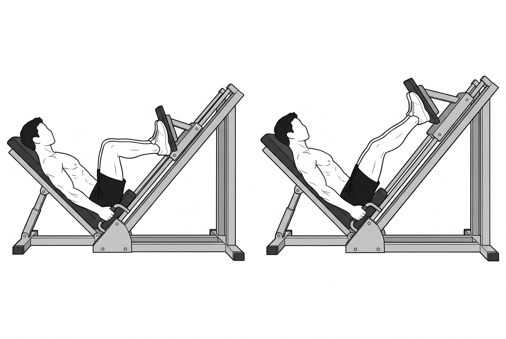

Starting position / Peak contraction position

Press a weighted sled upward along 45-degree rails using hip and knee extension while seated with back and hips fully supported.

- **Danish:** Siddende benpres
- **Aliases:** Seated Leg Press, 45-degree leg press, Sled leg press, Incline leg press
- **Primary muscles:** Quadriceps
- **Assisting muscles:** Gluteus maximus, Adductor magnus, Soleus
- **Stabilizers:** Abdominal wall
- **Equipment:** 45-degree sled leg press machine
- **Movement:** Squat - 45-degree sled; Bilateral
- **Grip:** Hands gripping side handles beside seat.
- **Difficulty:** Beginner (editorial label)
- **Review:** draft; revision 1

### Setup

- Sit firmly in the leg press seat with your back and glutes pressed securely against the back pad.
- Place feet flat on the center of the footplate shoulder-width apart, toes pointing slightly outward.
- Press the plate slightly to disengage the safety levers, then grasp the side handles for stability.

### Execution

1. Lower the sled smoothly by bending your knees and hips, allowing knees to track in line with your toes.
2. Descend until knees reach approximately 90 degrees or as deep as possible without rounding your lower back off the pad.
3. Drive through your mid-foot and heels to push the sled back up along the rails.
4. Stop just short of complete knee lockout (soft knees) to maintain tension and protect joints.

### Cues

- Keep lower back and glutes glued to the pad.
- Track knees over toes.
- Press through the mid-foot without locking knees.

### Common mistakes

- Allowing the lower back or pelvis to curl off the pad (butt wink) at the bottom.
- Forcefully hyperextending or slamming the knees into lockout at the top.
- Letting knees collapse inward (valgus collapse) during the press.

### Logging convention

Six 20 kg plates loaded (three per side): record 120 kg total plate load on sled.

45-degree sled leg presses feature guided rails with approximately 70% effective load resistance plus carriage mass; record loaded plate mass.

### Variants and alternatives

Standard 45-degree incline sled leg press with wide footplate and back support.

- Barbell Back Squat
- Pendulum Squat
- Barbell Deadlift

### Review notes

- Drafted from FitTrack ID 91 (Seated Leg Press).
- Illustration depicts 45-degree sled carriage with deep knee flexion in panel A and soft extension in panel B.

### References

- [ExRx.net - Sled 45° Leg Press](https://exrx.net/WeightExercises/Quadriceps/SL45LegPress): 45-degree leg press execution, quadriceps and gluteal biomechanics, and spinal safety standards.

[Editable JSON](../catalog/exercises/seated-leg-press.json)

## Seated Machine Lateral Raise

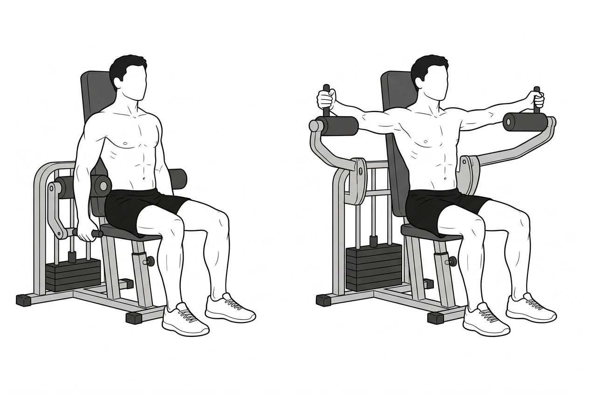

Starting position / Peak contraction position

Abduct both arms outward and upward against padded machine levers while seated, isolating the lateral deltoids through guided resistance.

- **Danish:** Siddende lateral raise i maskine
- **Aliases:** Seated Machine Lateral Raise, Machine lateral raise, Lever lateral raise, Seated side delt machine
- **Primary muscles:** Lateral deltoid
- **Assisting muscles:** Anterior deltoid, Supraspinatus, Middle trapezius, Serratus anterior
- **Stabilizers:** Rotator cuff, Abdominal wall
- **Equipment:** Seated lateral raise machine
- **Movement:** Shoulder abduction; Bilateral
- **Grip:** Light neutral grip on machine handles with elbows against roller pads.
- **Difficulty:** Beginner (editorial label)
- **Review:** draft; revision 1

### Setup

- Adjust the seat height so your shoulder joints align directly with the machine's pivot axes.
- Sit tall with your chest or back firmly supported by the torso pad and feet flat on the floor.
- Place your upper arms/elbows against the inside of the roller pads, holding the guide handles lightly with elbows bent ~90 degrees.

### Execution

1. Raise both arms outward and upward by driving your elbows into the roller pads until upper arms are parallel to the floor (shoulder height).
2. Keep your torso completely stationary against the pad, avoiding leaning backward or using body momentum.
3. Pause briefly at shoulder height, squeezing the lateral deltoids.
4. Lower the arms slowly under control back to the starting position beside your hips without letting the weight stack crash.

### Cues

- Lead with the elbows.
- Keep torso glued to the support pad.
- Control the descent.

### Common mistakes

- Setting seat too high or too low, misaligning shoulder pivot with machine axis.
- Shrugging upper traps to heave the weight up instead of abducting with deltoids.
- Swinging the torso backward to generate momentum.

### Logging convention

Weight pin set to 35 kg: record 35 kg selected machine load.

Cam shapes, lever lengths, and pulley configurations differ widely across machine brands; record selected stack setting without assuming free-weight equivalency.

### Variants and alternatives

Guided lever machine lateral raise with padded arm rollers and fixed rotational axis isolating the lateral deltoid head.

- Dumbbell Lateral Raise
- Single-Arm Rear-Delt Cable Fly
- Standing Barbell Strict Press

### Review notes

- Drafted from FitTrack ID 90 (Seated Machine Lateral Raise).
- Illustration depicts seated position with 90-degree elbow flexion driving roller levers to parallel shoulder height.

### References

- [ExRx.net - Lever Lateral Raise](https://exrx.net/WeightExercises/DeltoidLateral/LVLateralRaise): Machine lateral raise biomechanics, lateral deltoid isolation, and machine pivot axis alignment.

[Editable JSON](../catalog/exercises/seated-machine-lateral-raise.json)

## Single-Arm Plate Loaded Lat Pulldown

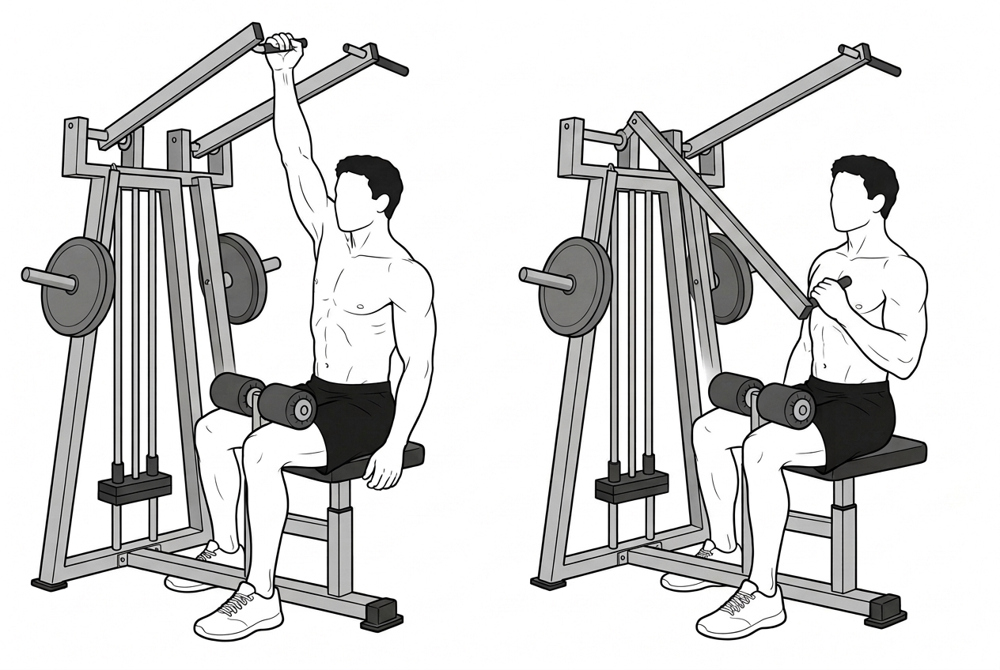

Starting position / Peak contraction position

Pull an independent plate-loaded overhead lever arm downward with one arm, securing thighs under machine pads to target latissimus fibers.

- **Danish:** Enarms pulldown i maskine med vægtskiver
- **Aliases:** Single-Arm Plate Loaded Lat Pulldown, Unilateral plate loaded lat pulldown, Iso-lateral lat pulldown, Single-arm converging pulldown
- **Primary muscles:** Latissimus dorsi
- **Assisting muscles:** Teres major, Biceps brachii, Brachialis, Lower trapezius, Rhomboids
- **Stabilizers:** Abdominal wall, Rotator cuff
- **Equipment:** Plate-loaded lat pulldown machine
- **Movement:** Vertical pull; Unilateral
- **Grip:** Semi-neutral or underhand grip on machine lever handle.
- **Difficulty:** Intermediate (editorial label)
- **Review:** draft; revision 1

### Setup

- Load weight plates onto the working side lever horn.
- Adjust the thigh pads so your legs are securely anchored with feet flat on the floor.
- Sit upright, reach overhead with working arm to grasp the handle, and allow non-working arm to rest relaxed on your thigh.
- Take up the load with arm extended overhead into a full lat stretch.

### Execution

1. Drive the working elbow downward and slightly inward toward your hip along the lever's natural converging arc.
2. Keep your chest lifted with a natural thoracic arch, avoiding lateral torso leaning.
3. Squeeze the lat firmly as the handle reaches upper chest level.
4. Return the handle slowly upward until the arm is fully extended overhead under control.
5. Complete the set, then switch to the other arm.

### Cues

- Drive elbow straight down to the hip.
- Keep torso upright and braced.
- Non-working arm stays relaxed.

### Common mistakes

- Leaning or twisting the torso sideways to heave the lever down.
- Letting the non-working arm assist the movement.
- Letting the lever slam against the top stops.

### Logging convention

One 20 kg plate loaded on working lever: record 20 kg per side.

Plate-loaded machines feature independent lever arms with specific pivot mechanics; record the plate mass loaded on that working side.

### Variants and alternatives

Unilateral vertical pull on a plate-loaded machine with independent converging lever arms, isolating each lat.

- Single-Arm Supinated Pulldown
- Seated Lat Pulldown Machine
- Single-Arm Seated Row (Plate Loaded)

### Review notes

- Drafted from FitTrack ID 95 (Single-Arm Plate Loaded Lat Pulldown).
- Illustration strictly depicts unilateral execution with non-working arm resting motionless on thigh and opposite lever disengaged.

### References

- [ExRx.net - Lever Front Pulldown](https://exrx.net/WeightExercises/LatissimusDorsi/LVFrontPulldown): Converging lever pulldown mechanics, latissimus dorsi activation, and seated positioning.

[Editable JSON](../catalog/exercises/single-arm-plate-loaded-lat-pulldown.json)

## Single-Arm Rear-Delt Cable Fly

Working arm across chest / Same arm opened outward

Open one arm away from a cross-body cable reach while keeping the torso and elbow bend nearly unchanged.

- **Danish:** Enarms kabel-flyes til bagskulder
- **Aliases:** Single Arm Rear Delt Cable Fly, Single-arm cable reverse fly, One-arm rear delt fly
- **Primary muscles:** Posterior deltoid
- **Assisting muscles:** Middle trapezius, Rhomboids
- **Stabilizers:** Rotator cuff, Abdominal wall, Forearm flexors
- **Equipment:** Adjustable cable pulley, Single D-handle
- **Movement:** Shoulder horizontal abduction; Unilateral
- **Grip:** Neutral grip on one D-handle with the wrist aligned with the forearm.
- **Difficulty:** Intermediate (editorial label)
- **Review:** draft; revision 1

### Setup

- Set one pulley around shoulder height and attach a D-handle.
- Stand side-on to the stack and take the handle with the hand farther from the pulley.
- Reach that arm across the upper chest, establish a small elbow bend and take up cable tension.

### Execution

1. Sweep the working arm outward at approximately shoulder height.
2. Keep the elbow bend similar so the motion comes mainly from the shoulder.
3. Stop around the torso plane without twisting the body or pulling the elbow far behind.
4. Return slowly across the body, then repeat for the other side with the same setup.

### Cues

- Open the arm in an arc.
- Keep the chest facing forward.
- Keep the elbow bend quiet.

### Common mistakes

- Bending the elbow into a row.
- Turning the torso or shrugging to move the handle.

### Logging convention

One stack selected at 5 kg for each arm: record 5 kg per side and repetitions for each side.

Use the same pulley height and machine for both sides. Do not sum the two sides' loads; stack markings and pulley ratios differ across machines.

### Variants and alternatives

One hand-held cable, standing with a shoulder-height pulley. Cuff attachment, low-pulley bent-over and two-arm versions need separate instructions.

- Standing Cable Reverse Fly
- Reverse Pec Deck Fly

### Review notes

- Pulley height and D-handle are assumptions for the generic single-arm name.
- Source describes bilateral standing cable reverse fly; unilateral execution is an editorial adaptation requiring technique review.

### References

- [Muscle & Strength - Standing Cable Reverse Fly](https://www.muscleandstrength.com/exercises/standing-cable-flys.html): General standing reverse-fly shoulder action with a similar elbow bend. Source is bilateral; this draft adapts it to one arm and an explicitly stated pulley height.

[Editable JSON](../catalog/exercises/single-arm-rear-delt-cable-fly.json)

## Single-Arm Seated Row (Plate Loaded)

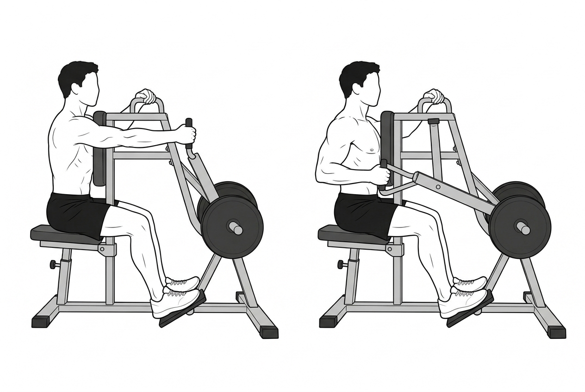

Starting position / Peak contraction position

Perform a unilateral row on a chest-supported plate-loaded machine, pulling one lever arm backward while bracing with the opposite hand.

- **Danish:** Enarms siddende roning i maskine med vægtskiver
- **Aliases:** Single-Arm Seated Row (Plate Loaded), Single-arm plate loaded row, Unilateral plate loaded row, Iso-lateral seated row
- **Primary muscles:** Latissimus dorsi, Rhomboids, Middle trapezius
- **Assisting muscles:** Biceps brachii, Brachialis, Posterior deltoid, Lower trapezius
- **Stabilizers:** Forearm flexors, Abdominal wall
- **Equipment:** Plate-loaded seated row machine
- **Movement:** Horizontal pull - chest supported; Unilateral
- **Grip:** Neutral grip on vertical machine handle.
- **Difficulty:** Beginner (editorial label)
- **Review:** draft; revision 1

### Setup

- Adjust the seat height so the chest pad supports your sternum and the neutral handle aligns with your lower chest.
- Sit tall with your chest pressed firmly against the chest pad and feet flat on the foot braces.
- Grasp the top stationary handle with your non-working hand for stability.
- Reach forward with your working arm and take a neutral grip on the row lever handle with full arm extension.

### Execution

1. Initiate the row by driving your working elbow backward past your torso toward your hip.
2. Squeeze the shoulder blade and lat firmly at the peak contraction while keeping your chest glued to the pad.
3. Avoid rotating or twisting your torso to complete the pull.
4. Lower the weight smoothly under control until your arm is fully extended and your lat is stretched.
5. Complete the set, then switch to the other side.

### Cues

- Keep chest glued to the pad.
- Drive elbow back to the hip.
- Brace firmly with non-working hand.

### Common mistakes

- Twisting the torso away from the pad to heave the weight.
- Lifting the chest off the pad.
- Using momentum instead of controlled lat engagement.

### Logging convention

One 25 kg plate loaded on working lever: record 25 kg per side.

Plate-loaded machines feature independent lever arms; record the plate mass loaded on that specific side.

### Variants and alternatives

Unilateral chest-supported plate-loaded machine row with neutral handle grip and independent lever arms.

- T-Bar Row
- Seated Cable Row
- Pendlay Row

### Review notes

- Drafted from FitTrack ID 97 (Single-Arm Seated Row (Plate Loaded)).
- Illustration accurately depicts unilateral execution with non-working hand braced on top handle and stationary chest pad contact.

### References

- [ExRx.net - Lever Seated Row](https://exrx.net/WeightExercises/BackGeneral/LVSeatedRow): Lever machine seated row mechanics, chest-supported posture, and latissimus engagement.

[Editable JSON](../catalog/exercises/single-arm-seated-plate-loaded-row.json)

## Single-Arm Supinated Pulldown

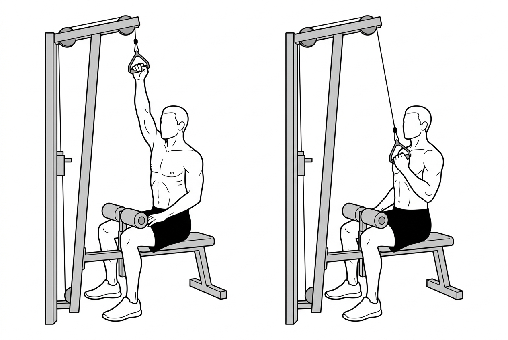

Starting position / Peak contraction position

Pull a high cable D-handle downward with a supinated grip to the upper chest, aligning elbow path with latissimus fibers while seated.

- **Danish:** Enarms underhånds træk til bryst
- **Aliases:** Single Arm Pulldown, Single-Arm Supinated Pulldown, Unilateral Supinated Lat Pulldown, One-Arm Underhand Pulldown
- **Primary muscles:** Latissimus dorsi
- **Assisting muscles:** Biceps brachii, Brachialis, Teres major, Lower trapezius, Rhomboids
- **Stabilizers:** Abdominal wall, Rotator cuff, Forearm flexors
- **Equipment:** High cable pulley, Single D-handle, Lat-pulldown bench with thigh pads
- **Movement:** Vertical pull; Unilateral
- **Grip:** Supinated (underhand) grip on D-handle with palm facing inward/backward.
- **Difficulty:** Intermediate (editorial label)
- **Review:** draft; revision 1

### Setup

- Attach a single D-handle to an overhead cable pulley and adjust the thigh pads to secure your legs.
- Sit tall on the bench, sliding thighs snugly under the pads with feet flat on the floor.
- Reach overhead with working arm and grasp D-handle with a supinated (underhand) grip, allowing arm to fully extend.
- Rest non-working hand on thigh pad or bench for stability.

### Execution

1. Initiate the pull by drawing the elbow down and slightly inward toward your hip.
2. Keep torso tall with a slight natural thoracic arch, avoiding twisting or leaning sideways.
3. Pull until the handle approaches collarbone or upper chest level, achieving a strong contraction in the lat.
4. Control the return upward until the working arm is fully extended overhead and the lat is stretched.
5. Complete all repetitions, then switch to the other arm.

### Cues

- Drive elbow down to your hip.
- Keep torso upright and braced.
- Control the stretch overhead.

### Common mistakes

- Twisting or leaning the torso laterally to yank the handle down.
- Using an overhand grip instead of supinated, altering the pulling plane.
- Failing to secure thighs under pads.

### Logging convention

Cable pin set to 30 kg: record 30 kg selected stack load per side.

High pulley ratios and friction vary; record stack pin setting per working arm without converting to bilateral bar numbers.

### Variants and alternatives

Unilateral vertical pulldown using a high cable pulley and D-handle with a supinated grip, emphasizing lat adduction.

- Seated Lat Pulldown Machine
- Seated Cable Row
- Bent-Over Barbell Row

### Review notes

- Drafted from FitTrack ID 117 (Single Arm Pulldown).
- Supinated underhand grip specified canonically to optimize lat muscle fiber recruitment.

### References

- [ExRx.net - Cable Underhand Lat Pulldown](https://exrx.net/WeightExercises/LatissimusDorsi/CBUnderhandPulldown): Underhand vertical pulling mechanics and latissimus recruitment patterns.

[Editable JSON](../catalog/exercises/single-arm-supinated-pulldown.json)

## Standing Barbell Curl

Bar at thighs / Bar curled upward

Curl a straight bar upward by bending the elbows while standing with the upper arms close to the torso.

- **Danish:** Stående bicepscurl med vægtstang
- **Aliases:** Barbell biceps curl, Straight-bar curl
- **Primary muscles:** Biceps brachii
- **Assisting muscles:** Brachialis, Brachioradialis
- **Stabilizers:** Abdominal wall, Rotator cuff, Forearm flexors
- **Equipment:** Barbell, Weight plates
- **Movement:** Elbow flexion; Bilateral
- **Grip:** Supinated underhand, approximately shoulder width, with wrists aligned with the forearms.
- **Difficulty:** Beginner (editorial label)
- **Review:** draft; revision 1

### Setup

- Hold a straight bar in front of the thighs with an underhand grip.
- Stand evenly on both feet, soften the knees and brace the torso.

### Execution

1. Bend the elbows to raise the bar without leaning backward.
2. Keep the upper arms close to the sides as the bar approaches the lower chest.
3. Stop before the shoulders roll forward or the elbows need to swing.
4. Lower slowly toward extended elbows without snapping them straight.

### Cues

- Keep the elbows quiet.
- Keep the wrists straight.
- Control both directions.

### Common mistakes

- Swinging the hips or leaning backward.
- Bending the wrists to finish the curl.

### Logging convention

A 20 kg bar plus two 15 kg plates: record 50 kg total.

Include the bar and both sides' plates; preserve the original load convention in existing logs.

### Variants and alternatives

Straight bar with a supinated grip. An EZ bar changes hand position and should retain its own equipment identity.

- EZ-Bar Curl
- Dumbbell Hammer Curl

### Review notes

- Difficulty is an editorial label; load and range remain individual.
- Trainer review of technique and illustrations pending.

### References

- [Muscle & Strength - Standing Barbell Curl](https://www.muscleandstrength.com/exercises/standing-barbell-curl.html): Standing underhand bar curl, elbow flexion and avoidance of body swing.

[Editable JSON](../catalog/exercises/standing-barbell-curl.json)

## Standing Barbell Strict Press

Bar at upper chest / Bar overhead

Press a barbell from the upper chest to overhead while standing with the legs still.

- **Danish:** Stående skulderpres med vægtstang
- **Aliases:** Strict Press, Military press, Barbell overhead press, Barbell Standing Wide-Grip Military Press
- **Primary muscles:** Anterior deltoid, Lateral deltoid
- **Assisting muscles:** Triceps brachii, Serratus anterior, Trapezius
- **Stabilizers:** Rotator cuff, Abdominal wall, Gluteus maximus
- **Equipment:** Barbell, Weight plates, Rack for setup
- **Movement:** Vertical push; Bilateral
- **Grip:** Overhand, at or just outside shoulder width, with the bar supported securely in the hands.
- **Difficulty:** Intermediate (editorial label)
- **Review:** draft; revision 1

### Setup

- Set the rack just below shoulder height and take an overhand grip.
- Unrack the bar to the upper chest, step clear and establish a balanced stance.
- Brace the trunk with elbows slightly in front of the bar.

### Execution

1. Move the head just enough to let the bar pass, then press upward without knee drive.
2. Allow the shoulder blades to rotate upward as the bar rises.
3. Finish with the bar balanced over the shoulders and midfoot, head neutral.
4. Lower under control to the upper chest, keeping the torso stable.

### Cues

- Keep the bar close.
- Reach upward at the top.
- Keep the ribs over the pelvis.

### Common mistakes

- Driving with the knees or leaning far backward.
- Pressing behind the neck or letting the bar drift forward.

### Logging convention

A 20 kg bar plus two 15 kg plates: record 50 kg total.

Include the bar and both sides' plates; preserve the original load convention in existing logs.

### Variants and alternatives

Standing front-of-neck strict barbell press. The generic alias Strict Press is mapped to this barbell variant; seated, dumbbell and push presses are distinct.

- Standing Dumbbell Strict Press
- Seated Barbell Shoulder Press

### Review notes

- Standing barbell is the assumption for the generic name Strict Press.
- Trainer review of technique and illustrations pending.

### References

- [Muscle & Strength - Military Press](https://www.muscleandstrength.com/exercises/military-press.html): Standing barbell strict press, rack setup, no leg drive and overhead scapular movement.

[Editable JSON](../catalog/exercises/standing-barbell-strict-press.json)

## Standing Calf Raise

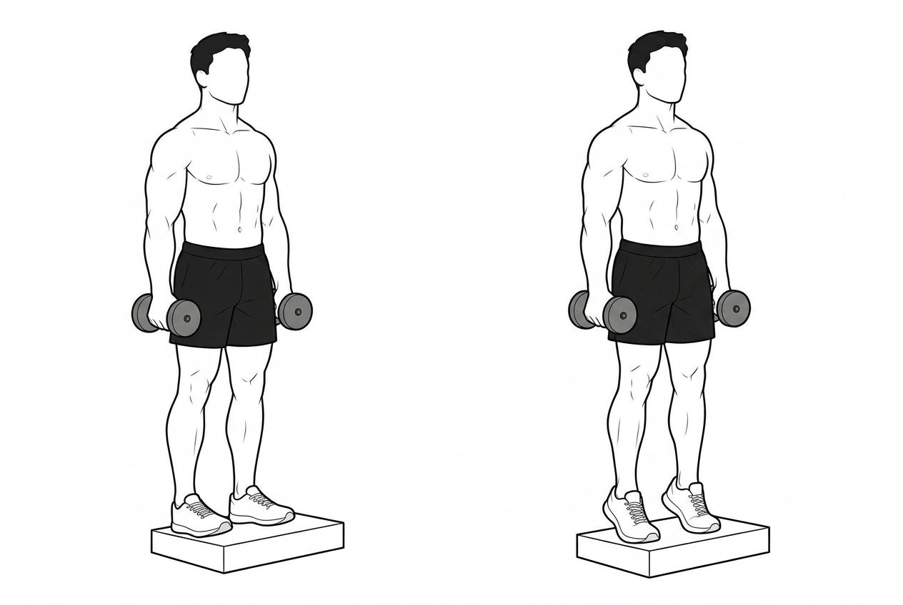

Starting position / Peak contraction position

Raise heels off the ground by performing bilateral ankle plantar flexion with knees softly extended, emphasizing the gastrocnemius under loaded stretch.

- **Danish:** Stående lægløft
- **Aliases:** Dumbbell Standing Calf Raise, Standing dumbbell calf raise, Two-legged standing calf raise
- **Primary muscles:** Gastrocnemius
- **Assisting muscles:** Soleus, Tibialis posterior
- **Stabilizers:** Abdominal wall, Forearm flexors, Quadriceps
- **Equipment:** Two dumbbells, Raised calf block or step
- **Movement:** Ankle plantar flexion; Bilateral
- **Grip:** Neutral grip holding dumbbells at sides with arms fully extended.
- **Difficulty:** Beginner (editorial label)
- **Review:** draft; revision 1

### Setup

- Hold a dumbbell in each hand with arms straight at your sides.
- Step onto a raised calf block or sturdy platform with the balls of both feet on the edge and heels hanging freely.
- Stand tall with chest lifted, core braced, and knees softly extended without locking them out.

### Execution

1. Lower your heels smoothly below the level of the block into deep ankle dorsiflexion until you feel a complete stretch through your calves.
2. Press forcefully through the balls of both feet into full plantar flexion, elevating your heels as high as possible onto your tiptoes.
3. Hold the peak contraction briefly at the top, squeezing your calves firmly.
4. Lower your heels in a slow, controlled descent back into the deep bottom stretch before initiating the next repetition.

### Cues

- Press through the balls of the feet.
- Keep knees motionless and softly unlocked.
- Pause in the bottom stretch.

### Common mistakes

- Bending the knees to bounce or turn the movement into a squat.
- Cutting the bottom range of motion short and failing to reach a full stretch.
- Swinging dumbbells or using upper body momentum.

### Logging convention

Two 16 kg dumbbells: record 16 kg per dumbbell.

Record the mass of an individual dumbbell rather than the combined total of the pair.

### Variants and alternatives

Standing bilateral calf raise performed on a raised block holding dumbbells, keeping knees straight to recruit the gastrocnemius.

- Leg Press Calf Press

### Review notes

- Drafted from FitTrack ID 71 (Standing Calf Raise).
- Illustration depicts bilateral standing calf raise on a raised platform from stretch to tiptoe plantar flexion.

### References

- [ExRx.net - Dumbbell Standing Calf Raise](https://exrx.net/WeightExercises/Gastrocnemius/DBStandingCalfRaise): Dumbbell standing calf raise execution, gastrocnemius recruitment, and stretch mechanics.

[Editable JSON](../catalog/exercises/standing-calf-raise.json)

## Standing Dumbbell Strict Press

Dumbbells at shoulders / Dumbbells overhead

Press two dumbbells from shoulder height to overhead while standing without leg drive.

- **Danish:** Stående skulderpres med håndvægte
- **Aliases:** Dumbbell Strict Press, Standing dumbbell shoulder press
- **Primary muscles:** Anterior deltoid, Lateral deltoid
- **Assisting muscles:** Triceps brachii, Serratus anterior, Trapezius
- **Stabilizers:** Rotator cuff, Abdominal wall, Gluteus maximus
- **Equipment:** Two dumbbells
- **Movement:** Vertical push; Bilateral
- **Grip:** Overhand or slightly turned inward, with straight wrists and forearms beneath the dumbbells.
- **Difficulty:** Intermediate (editorial label)
- **Review:** draft; revision 1

### Setup

- Stand with feet about hip-width and bring a dumbbell to each shoulder.
- Position the elbows slightly forward of the torso, brace the trunk and balance over the whole foot.

### Execution

1. Press both dumbbells overhead without bending and driving through the knees.
2. Allow the shoulder blades to rotate upward as the arms rise.
3. Finish with the weights balanced over the shoulders and torso steady.
4. Lower to shoulder height under control.

### Cues

- Keep ribs over pelvis.
- Reach upward through both arms.
- Keep wrists over elbows.

### Common mistakes

- Leaning backward to finish the press.
- Turning the movement into a push press with leg drive.

### Logging convention

Two 12 kg dumbbells: record 12 kg per dumbbell.

Keep the same exercise variant and record each dumbbell's mass rather than the combined pair.

### Variants and alternatives

Standing, simultaneous two-dumbbell press. Seated and alternating presses are separate variants.

- Standing Barbell Strict Press
- Seated Dumbbell Shoulder Press

### Review notes

- Confirm standing rather than seated equipment setup before linking an ambiguous exercise name.
- Trainer review of technique and illustrations pending.

### References

- [Muscle & Strength - Standing Dumbbell Shoulder Press](https://www.muscleandstrength.com/exercises/standing-dumbbell-press.html): Standing two-dumbbell overhead press and general setup; muscle roles are qualitative editorial classifications.

[Editable JSON](../catalog/exercises/standing-dumbbell-strict-press.json)

## Standing Single-Arm Cable Biceps Curl

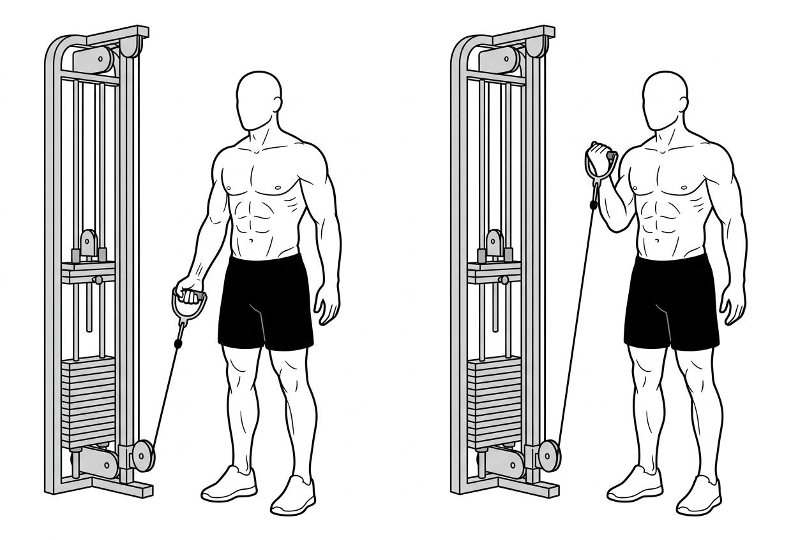

Starting position / Peak contraction position

Flex one elbow to curl a low cable D-handle upward, maintaining constant cable tension on the biceps throughout the range of motion.

- **Danish:** Stående enarms kabel-bicepscurl
- **Aliases:** Single Arm Cable Biceps Curl, Standing Single-Arm Cable Curl, Unilateral Cable Biceps Curl, One-Arm Low Cable Curl
- **Primary muscles:** Biceps brachii
- **Assisting muscles:** Brachialis, Brachioradialis
- **Stabilizers:** Abdominal wall, Forearm flexors, Rotator cuff
- **Equipment:** Adjustable cable pulley, Single D-handle
- **Movement:** Elbow flexion; Unilateral
- **Grip:** Supinated grip on D-handle with palm facing upward.
- **Difficulty:** Beginner (editorial label)
- **Review:** draft; revision 1

### Setup

- Position the cable pulley at the lowest setting and attach a single D-handle.
- Stand facing the pulley or slightly offset, grasping the handle in one hand with a supinated (underhand) grip.
- Keep feet shoulder-width apart, knees softly unlocked, and upper arm pinned vertically to your side.
- Non-working arm rests relaxed at your side or braced on your hip.

### Execution

1. Curl the D-handle upward toward shoulder height by flexing the elbow, keeping the upper arm strictly stationary.
2. Squeeze the biceps firmly at the top of the curl without swinging the torso or letting the elbow drift forward.
3. Lower the handle slowly under control along the cable line until the elbow is fully extended.
4. Complete the desired repetitions, then switch to the opposite arm.

### Cues

- Keep elbow pinned at your side.
- Curl up smoothly against continuous cable tension.
- Lower all the way down with control.

### Common mistakes

- Swinging the torso or using hip momentum to start the curl.
- Drifting the elbow forward, turning elbow flexion into front shoulder raise.
- Cutting the bottom range of motion short.

### Logging convention

Cable pin set to 12.5 kg: record 12.5 kg selected stack load per side.

Pulley mechanical advantages vary (often 2:1 on dual adjustable pulleys); record the pin setting on that specific station.

### Variants and alternatives

Unilateral standing biceps curl using a low cable pulley and single D-handle, keeping upper arm stationary.

- Dumbbell Biceps Curl
- Incline Dumbbell Biceps Curl
- Machine Preacher Curl

### Review notes

- Drafted from FitTrack ID 131 (Single Arm Cable Biceps Curl).
- Illustration shows clean unilateral low-pulley mechanics with supinated palm orientation throughout.

### References

- [ExRx.net - Cable One Arm Curl](https://exrx.net/WeightExercises/Biceps/CBOneArmCurl): Unilateral cable biceps curl biomechanics, arm stabilization, and execution.

[Editable JSON](../catalog/exercises/standing-single-arm-cable-biceps-curl.json)

## Straight-Arm Cable Pullover

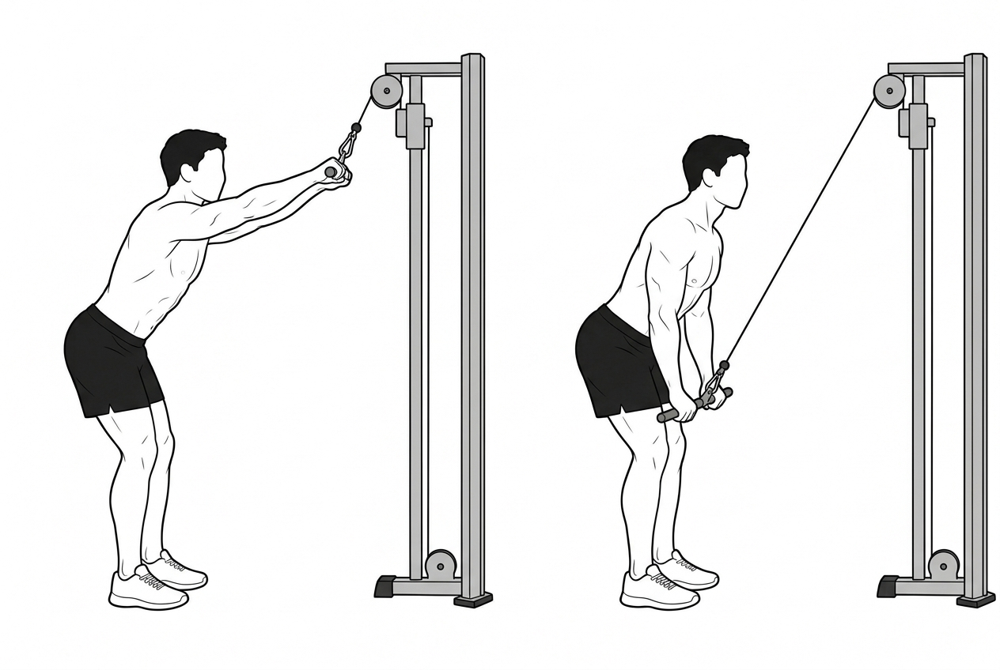

Starting position / Peak contraction position

Sweep a high-cable bar downward in a wide arc to the upper thighs with softly unlocked elbows, isolating the latissimus dorsi through pure shoulder extension.

- **Danish:** Stående straight-arm kabel pullover
- **Aliases:** Lat Cable Pullover, Straight-arm cable pulldown, Cable lat pullover, Standing cable pullover
- **Primary muscles:** Latissimus dorsi
- **Assisting muscles:** Teres major, Triceps brachii, Posterior deltoid, Pectoralis major (sternal head)
- **Stabilizers:** Abdominal wall, Rotator cuff, Forearm flexors
- **Equipment:** High cable pulley, Straight-bar attachment
- **Movement:** Shoulder extension - sagittal plane; Bilateral
- **Grip:** Overhand grip on straight bar slightly wider than shoulder-width.
- **Difficulty:** Beginner (editorial label)
- **Review:** draft; revision 1

### Setup

- Attach a straight bar to a high cable pulley and select the stack weight.
- Grasp the bar with an overhand shoulder-width grip and take a step back.
- Hinge forward at the hips approximately 30 degrees with a flat spine, knees softly bent, and arms reaching toward head level into a full lat stretch.

### Execution

1. Pull the bar downward and backward in a wide circular arc toward your upper thighs by contracting your lats.
2. Maintain a constant, subtle bend in your elbows throughout the entire path (do not bend into a triceps pushdown).
3. Squeeze your lats firmly as the bar approaches your thighs.
4. Slowly allow the bar to return along the same arc back to eye/head height, feeling a full stretch in the lats.

### Cues

- Pull with the lats, not the triceps.
- Keep elbows softly locked at a fixed angle.
- Hinge hips back and keep torso steady.

### Common mistakes

- Bending and straightening the elbows, turning the exercise into a triceps pushdown.
- Swinging the torso upright and backward to yank the weight down.
- Shrugging the shoulders upward at the bottom.

### Logging convention

Weight pin set to 25 kg: record 25 kg on that cable station.

High pulley resistance and cable friction vary between single and dual cable stations; record selected stack setting.

### Variants and alternatives

Standing straight-arm cable pullover using a high pulley and straight bar, keeping elbow angle fixed to isolate shoulder extension.

- Single-Arm Supinated Pulldown
- Seated Cable Row
- Pendlay Row

### Review notes

- Drafted from FitTrack ID 85 (Lat Cable Pullover).
- Illustration depicts hinged torso stance with wide circular arm arc finishing at upper thighs without elbow flexion.

### References

- [ExRx.net - Cable Pulldown (Straight Arm)](https://exrx.net/WeightExercises/LatissimusDorsi/CBStraightArmPulldown): Straight-arm cable pulldown mechanics, latissimus isolation through shoulder extension, and torso stabilization.

[Editable JSON](../catalog/exercises/straight-arm-cable-pullover.json)

## Supinated Barbell Bent-Over Row

Arms extended below knees / Bar drawn toward torso

Row a barbell toward the abdomen from a hip hinge, using an underhand grip and elbows close to the sides.

- **Danish:** Foroverbøjet roning med vægtstang og underhåndsgreb
- **Aliases:** Supinated Barbell Bent Over Row, Reverse-grip bent-over row, Underhand barbell row
- **Primary muscles:** Latissimus dorsi, Rhomboids, Middle trapezius
- **Assisting muscles:** Posterior deltoid, Biceps brachii, Brachialis
- **Stabilizers:** Spinal erectors, Abdominal wall, Hamstrings, Gluteus maximus, Forearm flexors
- **Equipment:** Barbell, Weight plates
- **Movement:** Horizontal pull - unsupported hip hinge; Bilateral
- **Grip:** Supinated underhand, around shoulder width; palms face forward away from the thighs at the bottom.
- **Difficulty:** Intermediate (editorial label)
- **Review:** draft; revision 1

### Setup

- Pick up the bar with a controlled hinge, then establish a balanced stance.
- Soften the knees and hinge the hips back until the torso is inclined, keeping the back stable.

### Execution

1. Let the bar hang below the knees with the arms extended.
2. Draw the elbows back to bring the bar toward the lower ribs or upper abdomen.
3. Keep the torso angle and knee bend steady as the shoulder blades move naturally.
4. Lower under control to extended arms without dropping the bar or rounding the back.

### Cues

- Hold the hinge.
- Pull with the elbows.
- Lower without swinging.

### Common mistakes

- Standing up on each pull to move the load.
- Jerking the bar or rounding the trunk.

### Logging convention

A 20 kg bar plus two 15 kg plates: record 50 kg total.

Include the bar and both sides' plates; preserve the original load convention in existing logs.

### Variants and alternatives

Supinated grip with a stable inclined torso. This is a row, not a standing curl; more upright Yates-style setups need their own note.

- Bent-Over Barbell Row
- Seated Cable Row

### Review notes

- Torso angle and grip width may vary; keep the selected setup consistent.
- Trainer review of technique and illustrations pending.

### References

- [Muscle & Strength - Reverse Grip Bent Over Row](https://www.muscleandstrength.com/exercises/reverse-grip-bent-over-row.html): Underhand grip, hip-hinged torso and controlled row with close elbows.

[Editable JSON](../catalog/exercises/supinated-barbell-bent-over-row.json)

## T-Bar Row

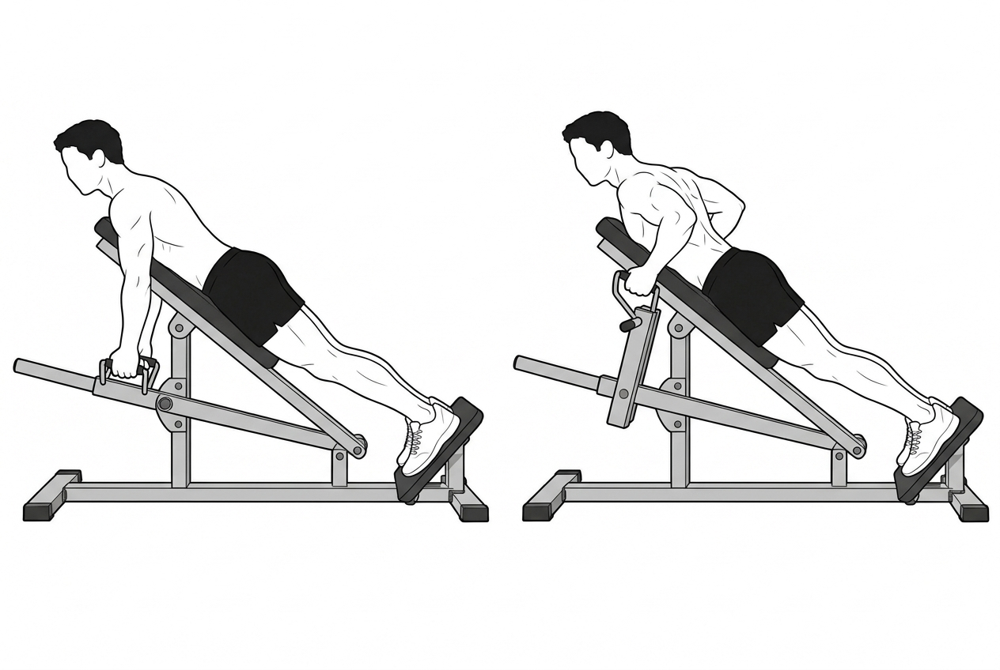

Starting position / Peak contraction position

Pull an angled lever row upward while lying prone on a chest-support pad, isolating the upper back musculature without lumbar strain.

- **Danish:** T-bar roning med bryststøtte
- **Aliases:** T-Bar Row, Chest-Supported T-Bar Row, Machine T-Bar Row, Prone Incline T-Bar Row
- **Primary muscles:** Latissimus dorsi, Rhomboids, Middle trapezius
- **Assisting muscles:** Biceps brachii, Brachialis, Posterior deltoid, Lower trapezius
- **Stabilizers:** Forearm flexors
- **Equipment:** Chest-supported T-bar row machine
- **Movement:** Horizontal pull - chest supported; Bilateral
- **Grip:** Pronated or neutral closed grip on row handles.
- **Difficulty:** Beginner (editorial label)
- **Review:** draft; revision 1

### Setup

- Adjust the footplate height so your chest rests comfortably against the upper angled pad (~45 degrees).
- Lie face down with chest firmly supported and feet braced securely on the footrests.
- Reach down to grasp the row handles with an overhand or neutral grip, extending arms fully to take up the load.

### Execution

1. Pull the handles upward and backward toward your lower ribs or upper abdomen by driving elbows behind the torso.
2. Squeeze the shoulder blades together at the top of the pull while keeping your chest glued to the pad.
3. Pause briefly at peak contraction without extending your lumbar spine or lifting off the pad.
4. Lower the weight under control until arms are fully extended and lats/rhomboids are comfortably stretched.

### Cues

- Chest stays glued to pad.
- Drive elbows high and back.
- Squeeze shoulder blades together.

### Common mistakes

- Arching the back or lifting the sternum off the chest pad.
- Using excessive momentum or jerking the lever at the start of the pull.
- Failing to achieve full arm extension at the bottom.

### Logging convention

Two 20 kg plates on lever peg: record 40 kg total plate load.

Chest-supported T-bar rows use pivoted lever arms with varying mechanical advantage; record loaded plate mass rather than free-weight barbell equivalent.

### Variants and alternatives

Chest-supported incline T-bar machine variant (~45° pad angle), which eliminates lower-back shear compared to bent-over free-weight T-bar rows.

- Pendlay Row
- Bent-Over Barbell Row
- Seated Cable Row

### Review notes

- Drafted from FitTrack ID 113 (T-Bar Row).
- Illustration depicts chest-supported variant to match modern commercial gym setups and eliminate lumbar fatigue.

### References

- [ExRx.net - Lever Incline Row (Chest Supported)](https://exrx.net/WeightExercises/BackGeneral/LVInclineRow): Chest-supported lever row execution, latissimus and rhomboid biomechanics.

[Editable JSON](../catalog/exercises/t-bar-row.json)

## Trap-Bar Deadlift

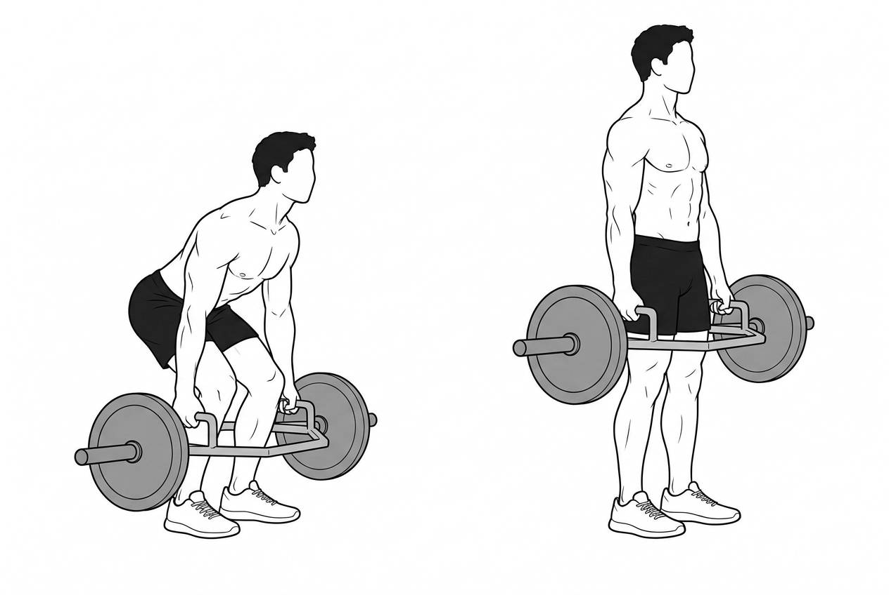

Hinged inside hex bar with knees bent gripping side handles / Standing fully erect with neutral grip handles at sides

Stand centered inside a hexagonal trap bar, hinge at the hips and bend knees to grip the neutral side handles, and drive through the floor to stand fully erect.

- **Danish:** Trap-bar dødløft
- **Aliases:** Hex bar deadlift, Hex-bar deadlift, Trap bar deadlift
- **Primary muscles:** Quadriceps, Gluteus maximus, Hamstrings
- **Assisting muscles:** Erector spinae, Adductor magnus, Soleus
- **Stabilizers:** Trapezius, Rhomboids, Latissimus dorsi, Forearm flexors
- **Equipment:** Trap bar (hex bar), Weight plates
- **Movement:** Hip hinge and knee extension - vertical pull; Bilateral
- **Grip:** Neutral grip holding the dual parallel side handles of the trap bar.
- **Difficulty:** Intermediate (editorial label)
- **Review:** draft; revision 1

### Setup

- Stand centered inside the trap bar with feet hip- to shoulder-width apart.
- Hinge at the hips and bend knees until hands can grip the neutral side handles firmly.
- Keep chest lifted, shoulders pulled back and down, and spine neutral.

### Execution

1. Push forcefully through the floor with feet to drive hips and knees into extension simultaneously.
2. Keep arms straight and handles centered along the mid-thigh as you stand tall.
3. Lock out hips and knees with a tall posture without leaning backward.
4. Reverse the movement by hinging hips back and bending knees to return weights to the floor under control.

### Cues

- Push the floor away.
- Stand tall through the hips.
- Keep arms long like ropes.

### Common mistakes

- Hyperextending the lower back at the top lockout.
- Allowing the knees to cave inward during the drive.
- Jerking the bar off the floor rather than building tension.

### Logging convention

Trap bar (25 kg) plus 75 kg plates: record 100 kg total mass.

Record total combined mass including the trap bar frame and all loaded weight plates.

### Variants and alternatives

Neutral-grip trap bar variation. Positions the load in line with the body's center of mass, reducing lumbar shear forces relative to a conventional straight barbell.

- Barbell Deadlift
- Barbell Romanian Deadlift

### Review notes

- Drafted from FitTrack ID 115 (Trap-Bar Deadlift).
- Depicts low/standard handle orientation with neutral grip centered inside hexagonal frame.

### References

- [ExRx.net - Trap Bar Deadlift](https://exrx.net/WeightExercises/GluteusMaximus/TBDL): Hex bar deadlift mechanics, joint moments, and prime mover distribution.

[Editable JSON](../catalog/exercises/trap-bar-deadlift.json)

## Weighted Dips

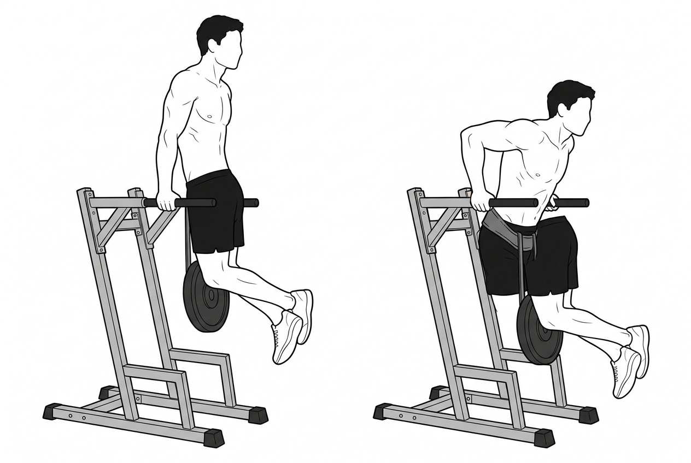

Starting position / Peak contraction position

Lower and press your bodyweight with added external plate resistance suspended from a dipping belt on parallel bars, developing pressing power in the triceps and chest.

- **Danish:** Dips med ekstra vægt
- **Aliases:** Weighted Dips, Weighted parallel bar dips, Parallel bar dips with weight, Weighted dip, Dips (Weighted)
- **Primary muscles:** Triceps brachii, Pectoralis major (sternal head)
- **Assisting muscles:** Anterior deltoid, Pectoralis minor
- **Stabilizers:** Rhomboids, Lower trapezius, Abdominal wall
- **Equipment:** Parallel dip bars, Dipping belt and weight plates
- **Movement:** Vertical push - compound bodyweight extension; Bilateral
- **Grip:** Neutral grip with palms facing inward, grasping parallel bars firmly with wrists stacked over forearms.
- **Difficulty:** Advanced (editorial label)
- **Review:** draft; revision 1

### Setup

- Secure a dipping belt around your waist with the desired weight plate suspended comfortably between your legs.
- Mount parallel dip bars with arms fully extended, shoulders depressed away from your ears, and elbows softly unlocked.
- Incline your torso slightly forward (~15 degrees) with knees bent and feet crossed behind or held steady beneath you.

### Execution

1. Lower your body under control by bending your elbows and allowing shoulders to extend until upper arms are at least parallel to the floor (elbows at 90 degrees).
2. Maintain the slight forward torso tilt to protect the anterior shoulder capsule and engage the chest.
3. Push forcefully through your palms into the bars to extend your arms, driving your body back to the top lockout.
4. Do not bounce aggressively out of the bottom position; reverse smoothly under muscular tension.

### Cues

- Keep shoulders packed down away from ears.
- Maintain a slight forward lean throughout.
- Drive through the heels of the hands.

### Common mistakes

- Descending too deep into uncontrolled hyperextension, placing extreme strain on anterior shoulder joint.
- Swinging the suspended weight plates or kicking the legs to generate momentum.
- Shrugging shoulders up toward the ears at the lockout.

### Logging convention

One 20 kg plate on dipping belt: record 20 kg added external load.

Record only the external added plate mass on the dip belt; athlete bodyweight provides the baseline load.

### Variants and alternatives

Parallel bar dip performed with additional external weight suspended from a dip belt. Emphasizes triceps and lower chest.

- Barbell Bench Press
- Cable Rope Triceps Pushdown
- Dumbbell Bench Press

### Review notes

- Drafted from FitTrack ID 63 (Weighted Dips).
- Illustration must depict parallel bars with dipping belt and suspended plate between thighs with controlled 15-degree forward lean.

### References

- [ExRx.net - Chest Dip](https://exrx.net/WeightExercises/PectoralSternal/BWChestDip): Parallel bar dip biomechanics, shoulder safety angles, and added load considerations.

[Editable JSON](../catalog/exercises/weighted-dip.json)

## Wide-Grip Upright Row

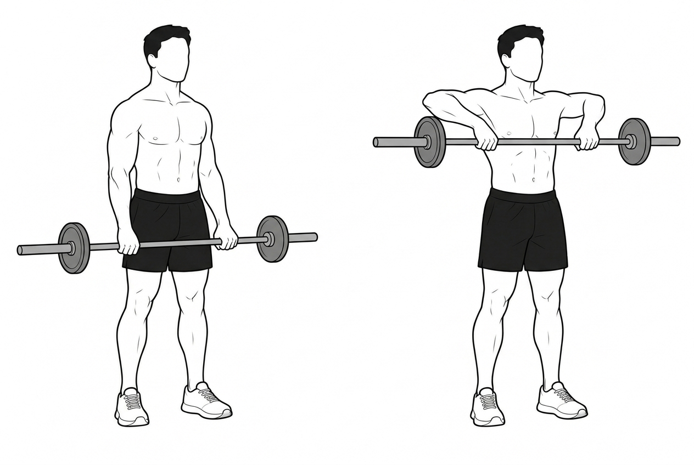

Standing upright holding barbell across thighs with wide grip / Barbell pulled to mid-chest with elbows flared high and wide

Stand upright and pull a barbell vertically to mid-chest height using a wide overhand grip, leading with the elbows flared outward to emphasize the lateral deltoids while minimizing shoulder impingement.

- **Danish:** Bredt oprejst roning med vægtstang
- **Aliases:** Wide grip upright row, Barbell wide-grip upright row, Upright barbell row wide grip
- **Primary muscles:** Lateral deltoid, Trapezius
- **Assisting muscles:** Anterior deltoid, Brachialis, Brachioradialis, Biceps brachii
- **Stabilizers:** Erector spinae, Core musculature
- **Equipment:** Barbell, Weight plates
- **Movement:** Vertical pull - shoulder abduction and elbow flexion; Bilateral
- **Grip:** Wide pronated (overhand) grip, approximately 1.5 times shoulder width.
- **Difficulty:** Intermediate (editorial label)
- **Review:** draft; revision 1

### Setup

- Stand tall with feet hip-width apart and knees softly unlocked.
- Grip the barbell with an overhand grip approximately 1.5 times shoulder width.
- Let the bar hang at arms length across the upper thighs, shoulders retracted and depressed.

### Execution

1. Pull the barbell upward along the torso by flaring elbows upward and outward.
2. Continue lifting until elbows reach shoulder height and the bar reaches mid-chest level.
3. Ensure hands remain below the level of the elbows at the apex of the pull.
4. Lower the barbell under control back to the starting hang position.

### Cues

- Lead with the elbows wide.
- Keep hands below elbows.
- Stand tall without swinging the hips.

### Common mistakes

- Using a narrow grip which causes internal shoulder impingement.
- Pulling the bar too high to the chin, forcing wrists above elbows.
- Using excessive body momentum or hip thrusting to lift the weight.

### Logging convention

Bar (20 kg) plus 20 kg plates: record 40 kg total barbell mass.

Record total combined mass of the barbell and loaded plates.

### Variants and alternatives

Wide-grip barbell variation (hands approx. 1.5x shoulder width). Minimizes subacromial impingement compared to narrow-grip upright rows.

- Dumbbell Lateral Raise
- Single-Arm Rear-Delt Cable Fly

### Review notes

- Drafted from FitTrack ID 120 (Wide-Grip Upright Row).
- Illustration confirms wide grip and elbows driven higher than hands at mid-chest level.

### References

- [ExRx.net - Barbell Upright Row](https://exrx.net/WeightExercises/DeltoidLateral/BBUprightRow): Barbell upright row biomechanics, grip width considerations, and lateral deltoid activation.

[Editable JSON](../catalog/exercises/wide-grip-upright-row.json)
