# Illustrated exercise catalog

23 original draft entries in the line-art-v1 visual style. Technique review is pending; cuff and machine details need confirmation. These are catalog entries, not prescribed workout programs.

## Index

- [Barbell Back Squat](../catalog/exercises/barbell-back-squat.json)
- [Barbell Bench Press](../catalog/exercises/barbell-bench-press.json)
- [Barbell Deadlift](../catalog/exercises/barbell-deadlift.json)
- [Barbell Romanian Deadlift](../catalog/exercises/barbell-romanian-deadlift.json)
- [Bent-Over Barbell Row](../catalog/exercises/bent-over-barbell-row.json)
- [Cable Triceps Pushdown](../catalog/exercises/cable-triceps-pushdown.json)
- [Decline Dumbbell Bench Press](../catalog/exercises/decline-dumbbell-bench-press.json)
- [Dumbbell Hammer Curl](../catalog/exercises/dumbbell-hammer-curl.json)
- [Dumbbell Lateral Raise](../catalog/exercises/dumbbell-lateral-raise.json)
- [Dumbbell Spider Curl](../catalog/exercises/dumbbell-spider-curl.json)
- [Flat Dumbbell Fly](../catalog/exercises/flat-dumbbell-fly.json)
- [Incline Dumbbell Biceps Curl](../catalog/exercises/incline-dumbbell-biceps-curl.json)
- [Machine Hip Thrust](../catalog/exercises/machine-hip-thrust.json)
- [Machine Preacher Curl](../catalog/exercises/machine-preacher-curl.json)
- [Overhead Rope Cable Triceps Extension](../catalog/exercises/overhead-rope-cable-triceps-extension.json)
- [Seated Cable Row](../catalog/exercises/seated-cable-row.json)
- [Seated Cable Row with Wrist Cuffs](../catalog/exercises/seated-cable-row-wrist-cuffs.json)
- [Seated Lat Pulldown Machine](../catalog/exercises/seated-lat-pulldown-machine.json)
- [Single-Arm Rear-Delt Cable Fly](../catalog/exercises/single-arm-rear-delt-cable-fly.json)
- [Standing Barbell Curl](../catalog/exercises/standing-barbell-curl.json)
- [Standing Barbell Strict Press](../catalog/exercises/standing-barbell-strict-press.json)
- [Standing Dumbbell Strict Press](../catalog/exercises/standing-dumbbell-strict-press.json)
- [Supinated Barbell Bent-Over Row](../catalog/exercises/supinated-barbell-bent-over-row.json)

## Barbell Back Squat

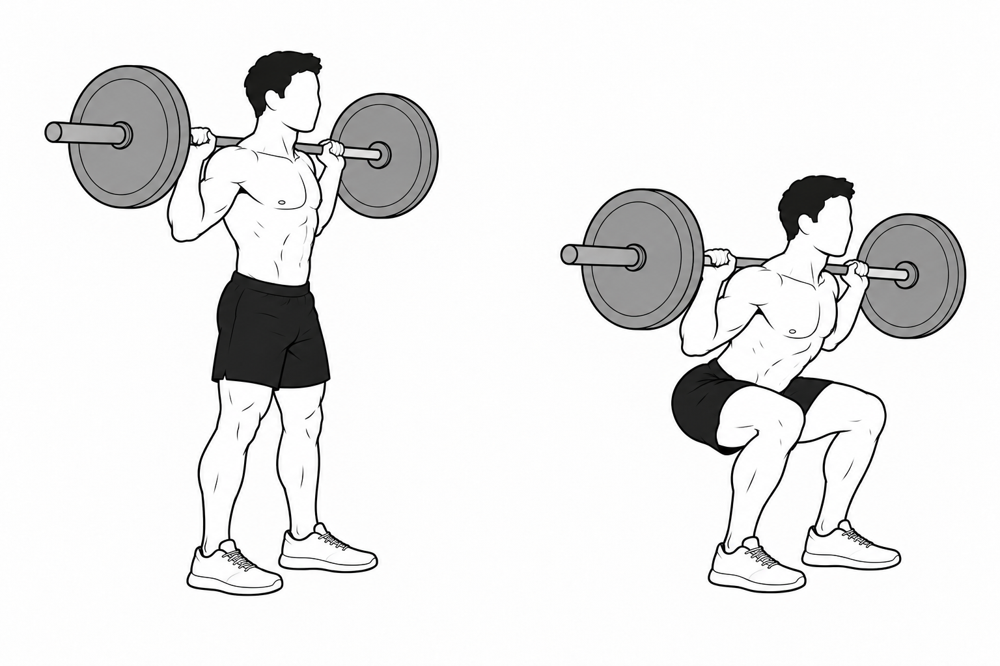

Standing under bar / Lowered squat

Squat with a barbell supported on the upper back, bending the knees and hips while keeping the feet planted.

- **Danish:** Squat med vægtstang på ryggen
- **Aliases:** Back squat, Barbell squat
- **Primary muscles:** Quadriceps, Gluteus maximus
- **Assisting muscles:** Adductor magnus
- **Stabilizers:** Spinal erectors, Abdominal wall, Upper back, Gluteus medius, Calf muscles
- **Equipment:** Barbell, Weight plates, Squat rack with safety supports
- **Movement:** Squat; Bilateral
- **Grip:** Closed grip outside the shoulders to secure the bar on the upper back; the hands do not carry the bar overhead.
- **Difficulty:** Intermediate (editorial label)
- **Review:** draft; revision 1

### Setup

- Set the rack and safety supports to suit your height and planned depth.
- Place the bar across the upper trapezius below the neck, grasp it securely and stand clear of the hooks.
- Choose a stable stance around shoulder-width, with the toes turned out as comfortable.

### Execution

1. Brace the trunk and lower by bending the knees and hips together.
2. Keep the whole foot loaded and knees tracking in the direction of the toes.
3. Descend to a depth you can control; the drawing shows thighs around parallel.
4. Drive through the feet to stand, then rerack securely after the set.

### Cues

- Keep the whole foot planted.
- Let knees follow the toes.
- Stand with chest and hips rising together.

### Common mistakes

- Lifting the heels or collapsing the knees inward.
- Losing trunk control to force extra depth.

### Logging convention

A 20 kg bar plus two 15 kg plates: record 50 kg total.

Include the bar and both sides' plates; preserve the original load convention in existing logs.

### Variants and alternatives

Illustrated as a high-bar back squat with approximately parallel depth. Low-bar placement, stance and individual depth can differ and need explicit notes.

- Goblet Squat
- Front Squat

### Review notes

- Rack setup and spotting are not illustrated; use the equipment's safety arrangements.
- Trainer review of bar position, depth and illustrations pending.

### References

- [ACE - Back Squat](https://www.acefitness.org/resources/everyone/exercise-library/11/back-squat/): Barbell back-squat setup and squat mechanics; chosen high-bar appearance and depth are editorial assumptions.

[Editable JSON](../catalog/exercises/barbell-back-squat.json)

## Barbell Bench Press

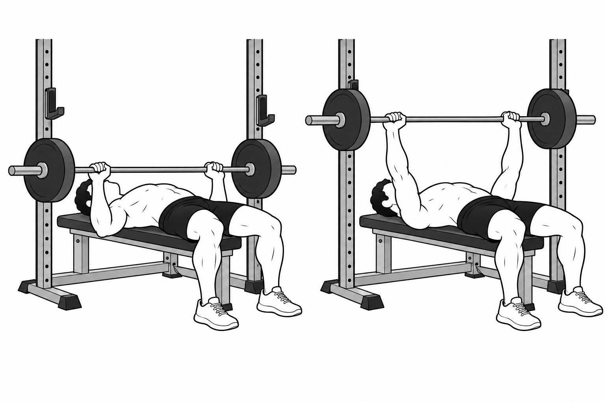

Bar lowered toward chest / Bar pressed upward

Press a barbell above the chest while lying on a flat bench with the feet planted.

- **Danish:** Bænkpres med vægtstang
- **Aliases:** Flat barbell bench press, Barbell chest press
- **Primary muscles:** Pectoralis major
- **Assisting muscles:** Anterior deltoid, Triceps brachii
- **Stabilizers:** Rotator cuff, Upper back, Abdominal wall
- **Equipment:** Barbell, Weight plates, Flat bench, Rack with safety supports or a competent spotter
- **Movement:** Horizontal push; Bilateral
- **Grip:** Closed overhand grip slightly wider than shoulders, with the bar secure over the forearms.
- **Difficulty:** Intermediate (editorial label)
- **Review:** draft; revision 1

### Setup

- Set rack hooks and safety supports for your body and range; use suitable spotting arrangements.
- Lie with head, shoulders and hips supported and feet firmly on the floor.
- Take a closed overhand grip and unrack the bar above the chest with the upper back stable.

### Execution

1. Lower the bar under control toward the middle or lower chest.
2. Keep wrists above the forearms and elbows at a comfortable angle to the torso.
3. Press back above the chest and shoulders without lifting the hips.
4. Finish the set by guiding the bar securely into both rack hooks.

### Cues

- Keep the feet planted.
- Control the bar above the chest.
- Maintain contact with the bench.

### Common mistakes

- Bouncing the bar off the chest or lowering toward the throat.
- Lifting the hips or losing control of the bar while reracking.

### Logging convention

A 20 kg bar plus two 15 kg plates: record 50 kg total.

Include the bar and both sides' plates; preserve the original load convention in existing logs.

### Variants and alternatives

Flat bench, moderate grip and controlled chestward lowering. Incline, decline and close-grip presses remain distinct.

- Flat Dumbbell Bench Press
- Decline Dumbbell Bench Press

### Review notes

- The illustration shows two positions, not unracking, spotting or the full bar path.
- Confirm rack support arrangement; trainer review of technique and bar position pending.

### References

- [Muscle & Strength - Barbell Bench Press](https://www.muscleandstrength.com/exercises/barbell-bench-press.html): Flat barbell press, chest targeting, supported setup and controlled lowering toward the sternum.

[Editable JSON](../catalog/exercises/barbell-bench-press.json)

## Barbell Deadlift

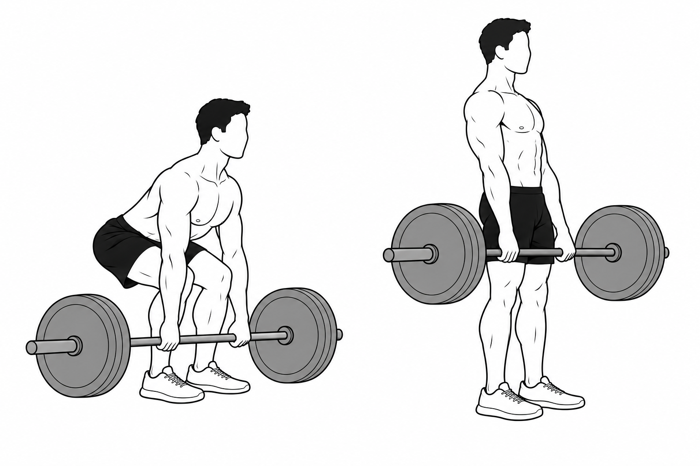

Bar settled on floor / Standing with bar

Lift a barbell from a settled floor position by extending the hips and knees, keeping the bar close to the legs.

- **Danish:** Konventionelt dødløft med vægtstang
- **Aliases:** Deadlift, Conventional barbell deadlift
- **Primary muscles:** Gluteus maximus, Quadriceps
- **Assisting muscles:** Hamstrings, Adductor magnus
- **Stabilizers:** Spinal erectors, Abdominal wall, Latissimus dorsi, Trapezius, Forearm flexors
- **Equipment:** Barbell, Weight plates, Level lifting surface
- **Movement:** Hip and knee extension - floor pull; Bilateral
- **Grip:** Double overhand, hands outside the legs. Mixed and hook grips are not illustrated.
- **Difficulty:** Intermediate (editorial label)
- **Review:** draft; revision 1

### Setup

- Position the bar over the midfoot with feet about hip-width apart.
- Hinge down and bend the knees to grasp the bar outside the legs.
- Set a stable trunk, keep the arms long and take up tension against the bar before lifting.

### Execution

1. Push through the floor and extend the hips and knees together while keeping the bar close.
2. Guide the bar past the knees without bending the elbows.
3. Stand tall with the bar at the thighs, without leaning backward.
4. Hinge back and bend the knees as needed to lower the bar, settle the plates and reset.

### Cues

- Keep the bar near the legs.
- Push the floor away.
- Finish tall.

### Common mistakes

- Jerking the bar from the floor with a rounded trunk.
- Letting the hips rise far ahead of the shoulders or leaning back at lockout.

### Logging convention

A 20 kg bar plus two 15 kg plates: record 50 kg total.

Include the bar and both sides' plates; preserve the original load convention in existing logs.

### Variants and alternatives

Conventional floor-start stance, resetting each repetition. Sumo, trap-bar and Romanian deadlifts are separate variants.

- Trap-Bar Deadlift
- Barbell Romanian Deadlift

### Review notes

- Plate diameter determines starting bar height; smaller plates may require a raised starting surface.
- Trainer review of setup and illustration pending.

### References

- [ACE - Deadlift](https://www.acefitness.org/resources/everyone/exercise-library/6/deadlift/): General conventional barbell deadlift setup and controlled floor-to-standing movement.

[Editable JSON](../catalog/exercises/barbell-deadlift.json)

## Barbell Romanian Deadlift

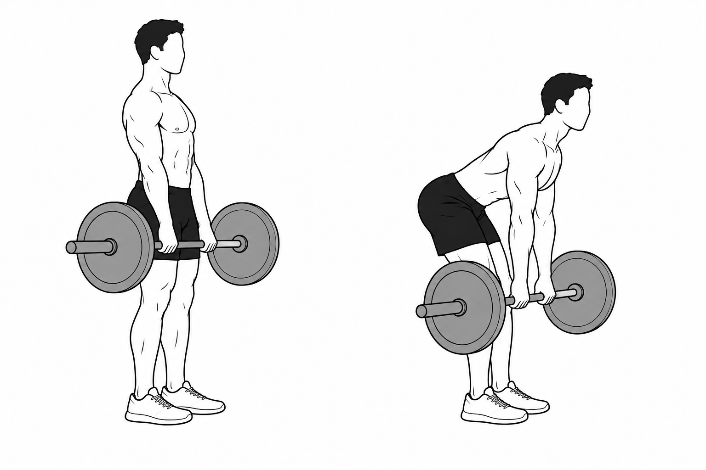

Standing position / Lowered hinge

A standing hip hinge that loads the back of the thighs and glutes. The hips move backward as the bar descends close to the legs.

- **Danish:** Rumænsk dødløft med vægtstang
- **Aliases:** Romanian deadlift, Barbell RDL
- **Primary muscles:** Hamstrings, Gluteus maximus
- **Assisting muscles:** Adductor magnus
- **Stabilizers:** Spinal erectors, Abdominal wall, Upper back, Forearm flexors
- **Equipment:** Barbell, Weight plates, Rack for setup, optional
- **Movement:** Hip hinge; Bilateral
- **Grip:** Double overhand, hands approximately shoulder-width apart.
- **Difficulty:** Intermediate (editorial label)
- **Review:** draft; revision 1

### Setup

- Stand with feet around hip-width and hold the bar in front of the thighs.
- Soften the knees, brace the trunk and keep the neck aligned with the spine.

### Execution

1. Push the hips backward while keeping the bar close and arms straight.
2. Lower only while you can maintain the hinge and a stable trunk; the plates need not reach the floor.
3. Keep roughly the same small knee bend rather than dropping into a squat.
4. Drive the hips forward to stand tall without leaning backward.

### Cues

- Hips back, bar close.
- Let the gaze follow the torso.
- Stand tall at the top.

### Common mistakes

- Rounding the back to force extra depth.
- Bending the knees into a squat or letting the bar drift forward.

### Logging convention

A 20 kg bar plus two 15 kg plates: record 50 kg total.

Include the bar; keep equipment and load convention consistent.

### Variants and alternatives

Starts upright and reverses at your controlled hinge depth; a conventional deadlift from the floor is separate.

- Dumbbell Romanian Deadlift
- B-Stance Romanian Deadlift

### Review notes

- Use a range of motion appropriate to your own hinge.
- Trainer review of technique and illustrations pending.

### References

- [ACE - Romanian Deadlift Technique Guide](https://www.acefitness.org/continuing-education/prosource/january-2016/5767/ace-technique-series-romanian-deadlift/): Hip hinge, setup, execution and involved muscle groups.

[Editable JSON](../catalog/exercises/barbell-romanian-deadlift.json)

## Bent-Over Barbell Row

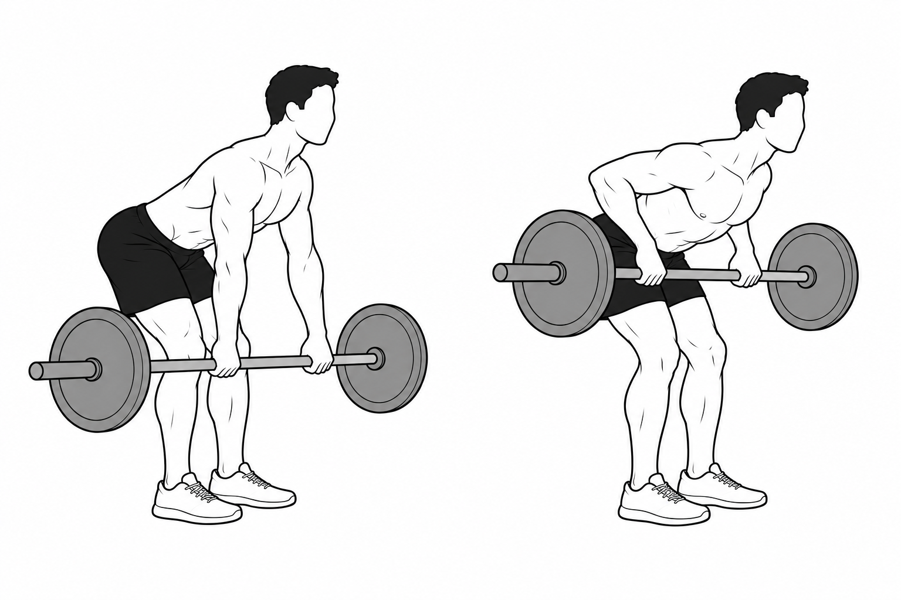

Arms extended below knees / Bar drawn toward torso

Row a barbell toward the lower ribs from a stable hip hinge using an overhand grip.

- **Danish:** Foroverbøjet roning med vægtstang
- **Aliases:** Bent Over Barbell Row, Pronated barbell row
- **Primary muscles:** Latissimus dorsi, Rhomboids, Middle trapezius
- **Assisting muscles:** Posterior deltoid, Biceps brachii, Brachialis
- **Stabilizers:** Spinal erectors, Abdominal wall, Hamstrings, Gluteus maximus, Forearm flexors
- **Equipment:** Barbell, Weight plates
- **Movement:** Horizontal pull - unsupported hip hinge; Bilateral
- **Grip:** Overhand, slightly outside shoulder width; palms face toward the legs at the bottom.
- **Difficulty:** Intermediate (editorial label)
- **Review:** draft; revision 1

### Setup

- Pick up the bar with a controlled hinge, then establish a balanced stance.
- Soften the knees and hinge the hips back until the torso is inclined, keeping the back stable.

### Execution

1. Let the bar hang below the knees with the arms extended.
2. Draw the elbows back to bring the bar toward the lower ribs or upper abdomen.
3. Keep the torso angle and knee bend steady as the shoulder blades move naturally.
4. Lower under control to extended arms without dropping the bar or rounding the back.

### Cues

- Hold the hinge.
- Pull with the elbows.
- Lower without swinging.

### Common mistakes

- Standing up on each pull to move the load.
- Jerking the bar or rounding the trunk.

### Logging convention

A 20 kg bar plus two 15 kg plates: record 50 kg total.

Include the bar and both sides' plates; preserve the original load convention in existing logs.

### Variants and alternatives

Pronated overhand grip with the bar suspended between repetitions. A floor-reset Pendlay row and underhand row require separate variants.

- Supinated Barbell Bent-Over Row
- Seated Cable Row

### Review notes

- Torso angle and grip width may vary; keep the selected setup consistent.
- Trainer review of technique and illustrations pending.

### References

- [Muscle & Strength - Bent Over Barbell Row](https://www.muscleandstrength.com/exercises/bent-over-barbell-row.html): Overhand bent-over row, fixed hip hinge and controlled pull toward the torso.

[Editable JSON](../catalog/exercises/bent-over-barbell-row.json)

## Cable Triceps Pushdown

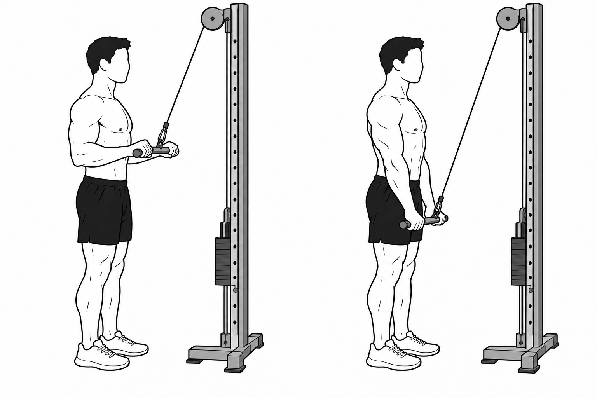

Elbows bent beside torso / Bar at upper thighs

Push a short cable bar downward by straightening the elbows while the upper arms stay beside the torso.

- **Danish:** Tricepspres ned i kabel med stang
- **Aliases:** Cable Triceps Pushdown, Straight-bar triceps pushdown, Tricep pushdown
- **Primary muscles:** Triceps brachii
- **Assisting muscles:** Anconeus
- **Stabilizers:** Forearm flexors, Rotator cuff, Abdominal wall
- **Equipment:** High cable pulley, Short straight-bar attachment
- **Movement:** Elbow extension - upper arms at sides; Bilateral
- **Grip:** Overhand, palms down, with both hands holding a short straight bar.
- **Difficulty:** Beginner (editorial label)
- **Review:** draft; revision 1

### Setup

- Attach a short straight bar to a high pulley and select the stack setting.
- Face the machine with a stable stance and grasp the bar overhand.
- Bring the elbows beside the ribs, beginning with a comfortable bend and cable tension.

### Execution

1. Straighten the elbows to move the bar toward the upper thighs.
2. Keep the upper arms near the sides and the torso steady.
3. Finish without forcing the elbows backward into hyperextension.
4. Allow the elbows to bend slowly as the bar returns, without the stack crashing.

### Cues

- Keep the elbows quiet.
- Press through the forearms.
- Control the return.

### Common mistakes

- Rocking the torso or driving the shoulders forward.
- Letting the elbows rise to turn the movement into a whole-arm press.

### Logging convention

A single stack selected at 20 kg: record 20 kg on that machine.

Record the selected stack value, attachment and pulley setup. Pulley ratios and machine calibration make stack values unsuitable for direct comparisons across machines.

### Variants and alternatives

Short straight-bar pushdown is the illustrated equipment assumption. A rope, V-bar or one-arm version changes the setup; this is separate from overhead rope extension.

- Rope Triceps Pushdown
- Overhead Rope Cable Triceps Extension

### Review notes

- Confirm the pushdown attachment; only the overhead exercise's rope attachment has been specified.
- Trainer review of technique and illustrations pending.

### References

- [Muscle & Strength - Straight Bar Tricep Extension](https://www.muscleandstrength.com/exercises/tricep-extension.html): High-pulley straight-bar pushdown with overhand grip and elbow extension.

[Editable JSON](../catalog/exercises/cable-triceps-pushdown.json)

## Decline Dumbbell Bench Press

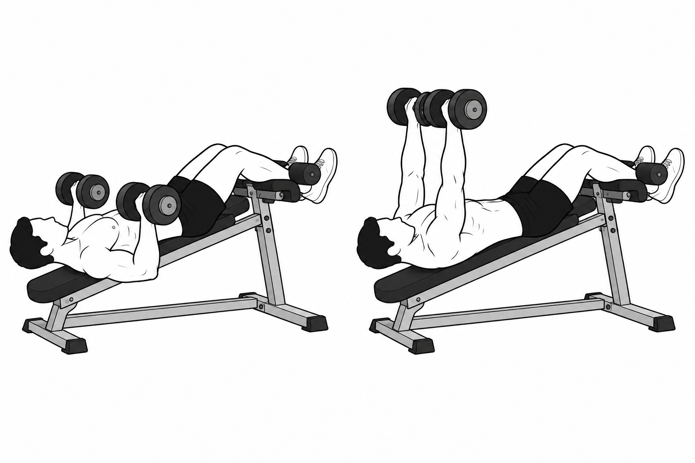

Lowered position / Pressed position

A supported dumbbell press performed with your head lower than your hips. The chest drives the press while the triceps and front shoulders assist.

- **Danish:** Decline brystpres med håndvægte
- **Aliases:** Decline dumbbell press, Decline DB bench press
- **Primary muscles:** Pectoralis major
- **Assisting muscles:** Triceps brachii, Anterior deltoid
- **Stabilizers:** Rotator cuff, Abdominal wall
- **Equipment:** Two dumbbells, Decline bench with leg supports
- **Movement:** Horizontal push - decline bench; Bilateral
- **Grip:** Pronated or slightly angled; wrists stacked above forearms.
- **Difficulty:** Intermediate (editorial label)
- **Review:** draft; revision 1

### Setup

- Set a shallow decline and secure your legs using the bench supports.
- Bring both dumbbells into position with a controlled entry; use assistance if needed.

### Execution

1. Begin with dumbbells beside the lower chest, forearms near vertical and elbows moderately tucked.
2. Press upward until the weights are above the chest and arms are comfortably extended.
3. Lower slowly along the same path to a controlled, comfortable depth.
4. Finish by securing both weights before sitting up or leaving the bench.

### Cues

- Keep wrists above elbows.
- Keep head and upper back supported.
- Move both weights under control.

### Common mistakes

- Flaring elbows widely or bending wrists back.
- Bouncing at the bottom or twisting while getting out.

### Logging convention

Two 20 kg dumbbells: record 20 kg per dumbbell, not 40 kg.

Proposed convention; check the existing exercise's history before applying.

### Variants and alternatives

An incline press is a separate exercise; bench direction matters.

- Flat Dumbbell Bench Press
- Decline Machine Chest Press

### Review notes

- Confirm your bench's supports and preferred grip.
- Trainer review of technique and illustrations pending.

### References

- [Muscle & Strength - Decline Dumbbell Bench Press](https://www.muscleandstrength.com/exercises/decline-dumbbell-bench-press.html): General decline press technique and involved muscle groups.

[Editable JSON](../catalog/exercises/decline-dumbbell-bench-press.json)

## Dumbbell Hammer Curl

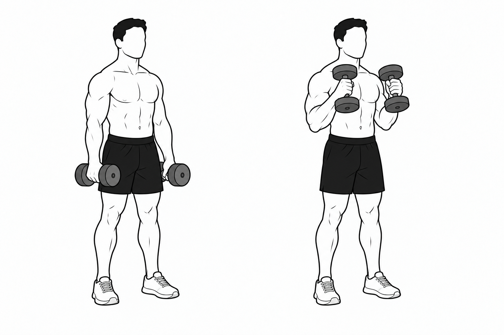

Dumbbells at sides / Neutral-grip curl

Curl two dumbbells while maintaining a neutral hand position, with the upper arms close to the sides.

- **Danish:** Hammercurl med håndvægte
- **Aliases:** Hammer Curl, Standing hammer curl
- **Primary muscles:** Brachialis, Brachioradialis
- **Assisting muscles:** Biceps brachii
- **Stabilizers:** Forearm flexors, Rotator cuff, Abdominal wall
- **Equipment:** Two dumbbells
- **Movement:** Elbow flexion - neutral grip; Bilateral
- **Grip:** Neutral throughout, with palms facing each other and thumbs toward the upper dumbbell heads.
- **Difficulty:** Beginner (editorial label)
- **Review:** draft; revision 1

### Setup

- Stand with a dumbbell beside each thigh, palms facing inward.
- Keep a small knee bend, straight wrists and shoulders relaxed.

### Execution

1. Flex both elbows to bring the dumbbells toward the fronts of the shoulders.
2. Keep the palms facing each other rather than rotating them upward.
3. Keep the upper arms and torso steady.
4. Lower the dumbbells under control to the starting position.

### Cues

- Keep thumbs pointing upward.
- Keep elbows beside the torso.
- Avoid swinging.

### Common mistakes

- Turning into a supinated curl.
- Rocking backward or lifting the elbows far forward.

### Logging convention

Two 12 kg dumbbells: record 12 kg per dumbbell.

Keep the same exercise variant and record each dumbbell's mass rather than the combined pair.

### Variants and alternatives

Standing simultaneous neutral-grip curl. Alternating and cross-body versions differ in timing or arm path.

- Standing Dumbbell Curl
- Standing Barbell Curl

### Review notes

- Both arms are illustrated together; use separate side records if logging alternating repetitions.
- Muscle roles are qualitative; the exercise still trains the biceps.

### References

- [ACE - Hammer Curl](https://www.acefitness.org/resources/everyone/exercise-library/10/hammer-curl/): Standing dumbbell hammer curl and neutral hand position; anatomical role ordering is editorial.

[Editable JSON](../catalog/exercises/dumbbell-hammer-curl.json)

## Dumbbell Lateral Raise

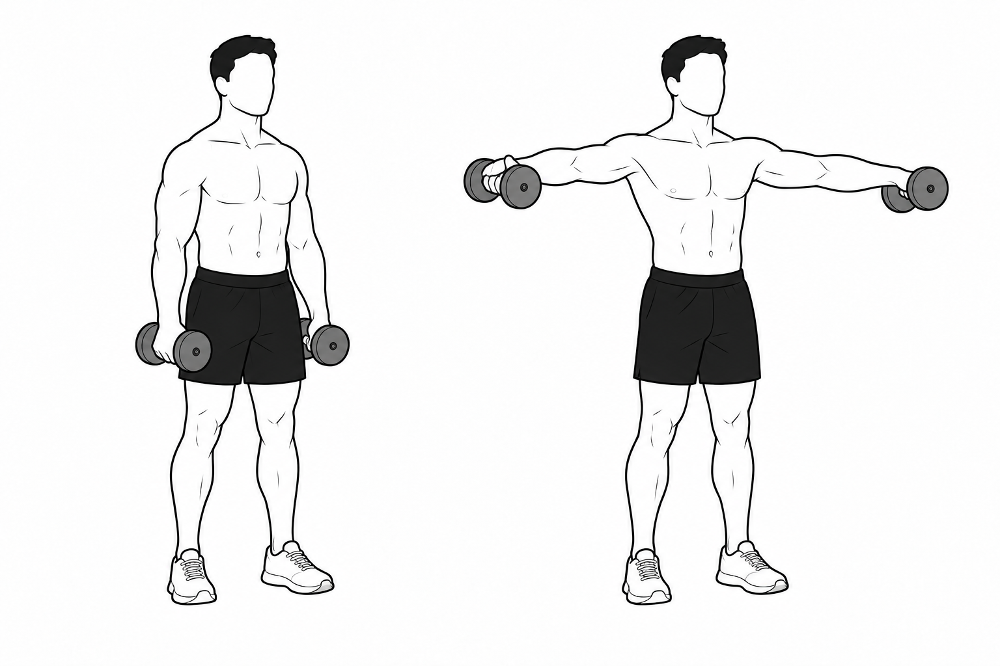

Arms lowered / Arms raised

Raise the arms out to the sides against the dumbbells' weight while keeping the torso still. The side shoulders lead the movement.

- **Danish:** Sideløft med håndvægte
- **Aliases:** Side raise, Standing dumbbell side raise
- **Primary muscles:** Lateral deltoid
- **Assisting muscles:** Supraspinatus
- **Stabilizers:** Rotator cuff, Trapezius and serratus anterior - scapular control, Abdominal wall
- **Equipment:** Two dumbbells
- **Movement:** Shoulder abduction; Bilateral
- **Grip:** Neutral at the bottom, rotating naturally as the arms rise; wrists stay straight.
- **Difficulty:** Beginner (editorial label)
- **Review:** draft; revision 1

### Setup

- Stand comfortably with a dumbbell in each hand and knees soft.
- Hold the weights beside the thighs with a small bend in the elbows.

### Execution

1. Lift the arms out and slightly forward of the body in a comfortable path.
2. Keep a similar elbow bend as elbows and upper arms rise together.
3. Stop around shoulder height, or earlier if that is your comfortable range.
4. Lower slowly without swinging the torso or dropping the weights.

### Cues

- Lead with the upper arms.
- Keep the neck relaxed.
- Control the lowering phase.

### Common mistakes

- Swinging the hips to start each repetition.
- Shrugging to finish or turning the thumbs sharply downward.

### Logging convention

Two 8 kg dumbbells: record 8 kg per dumbbell.

Keep seated, machine and cable versions as distinct variants.

### Variants and alternatives

Elbow angle and arm path distinguish this movement from an upright row or front raise.

- Cable Lateral Raise
- Machine Lateral Raise

### Review notes

- Difficulty is an editorial label, not a clinical rating.
- Trainer review of technique and illustrations pending.

### References

- [ACE - Lateral Raise](https://www.acefitness.org/resources/everyone/exercise-library/26/lateral-raise/): General lateral-raise setup and movement.

[Editable JSON](../catalog/exercises/dumbbell-lateral-raise.json)

## Dumbbell Spider Curl

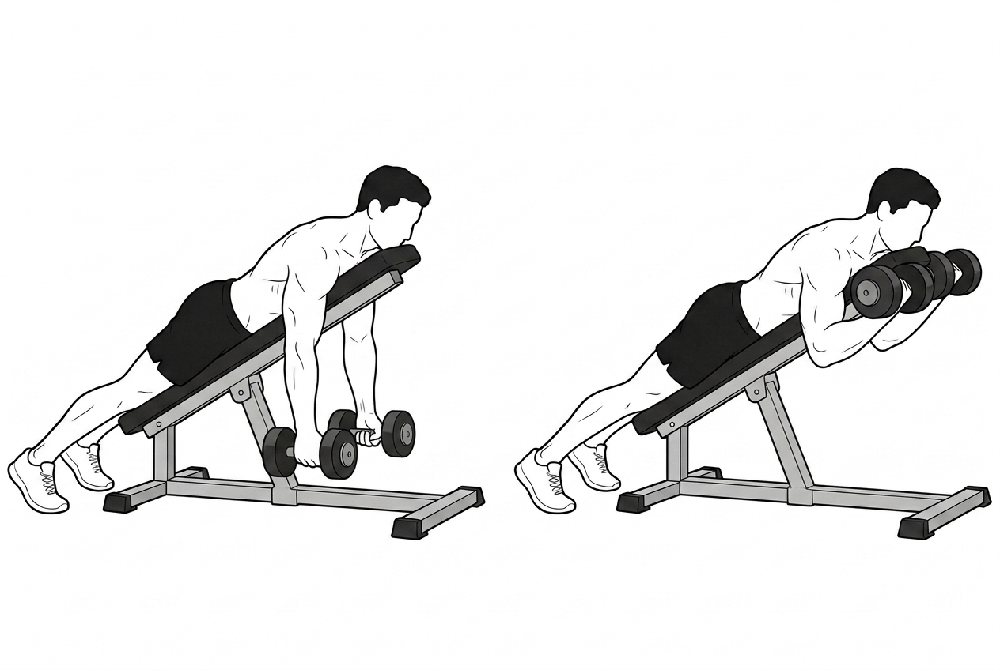

Arms hanging vertically / Dumbbells curled upward

Curl two dumbbells while lying chest-down on an incline bench with the arms hanging vertically in front of the support pad.

- **Danish:** Spider curl med håndvægte
- **Aliases:** Spider Curl, Chest-supported incline dumbbell curl, Prone incline dumbbell biceps curl
- **Primary muscles:** Biceps brachii
- **Assisting muscles:** Brachialis, Brachioradialis
- **Stabilizers:** Rotator cuff, Forearm flexors, Upper trapezius and scapular stabilizers
- **Equipment:** Two dumbbells, Adjustable incline bench
- **Movement:** Elbow flexion - prone torso, vertical upper arms; Bilateral
- **Grip:** Supinated, palms facing forward at the bottom and upward toward the shoulders as the elbows flex.
- **Difficulty:** Beginner (editorial label)
- **Review:** draft; revision 1

### Setup

- Set an adjustable bench to a moderate incline of roughly 45 degrees above horizontal.
- Lie prone with the chest and stomach supported against the backrest, upper chest near the top edge, and feet braced on the floor behind you.
- Hold a dumbbell in each hand and let both arms hang straight down toward the floor with palms facing forward.

### Execution

1. Keep the chest pressed into the pad and upper arms hanging vertically.
2. Flex both elbows to curl the dumbbells upward in an arc toward the shoulders.
3. Pause briefly near peak elbow flexion without lifting the chest off the bench or driving the elbows forward.
4. Lower the dumbbells slowly to the hanging start position under full control.

### Cues

- Keep the chest heavy on the pad.
- Let the upper arms hang straight down.
- Curl through the elbows without swinging.

### Common mistakes

- Pushing the chest up off the incline pad to create momentum.
- Pulling the elbows backward into a row or swinging the upper arms forward at the top.

### Logging convention

Two 10 kg dumbbells: record 10 kg per dumbbell.

Keep the same equipment variant and record the mass of a single dumbbell rather than the combined pair. EZ-bar or barbell spider curls use total bar mass and should be logged as a separate exercise.

### Variants and alternatives

Assumption: bilateral dumbbell spider curl lying prone on an ~45-degree incline bench rather than over the vertical side of a preacher pad or with an EZ-bar/barbell.

- Incline Dumbbell Biceps Curl
- Machine Preacher Curl
- Standing Barbell Curl

### Review notes

- Confirm whether your consumer catalog maps generic 'Spider Curl' to dumbbells on an incline bench or an EZ-bar on a vertical preacher pad.
- In the left panel, the near hand retains a slightly neutral wrist angle while the far hand shows supination; keep at draft until trainer/equipment review.

### References

- [ACE - Incline Dumbbell Curl](https://www.acefitness.org/resources/everyone/exercise-library/94/incline-dumbbell-curl/): General incline dumbbell curl reference; does not validate exact bench angle or prone chest-supported spider curl mechanics.
- [ExRx.net - Biceps Brachii Exercise Directory](https://exrx.net/Lists/ExList/ArmWt#Biceps): Anatomical classification of elbow flexors (biceps brachii, brachialis, brachioradialis); does not validate the specific incline-bench equipment setup.

[Editable JSON](../catalog/exercises/dumbbell-spider-curl.json)

## Flat Dumbbell Fly

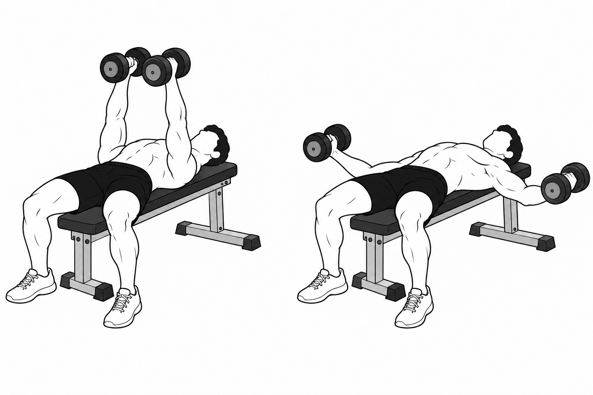

Dumbbells above chest / Arms opened

Open and close the arms in a broad arc above a flat bench while keeping a small, nearly fixed elbow bend.

- **Danish:** Flyes med håndvægte på flad bænk
- **Aliases:** Dumbbell fly, Flat dumbbell flye, Dumbbell chest fly
- **Primary muscles:** Pectoralis major
- **Assisting muscles:** Anterior deltoid
- **Stabilizers:** Rotator cuff, Biceps brachii, Triceps brachii, Abdominal wall
- **Equipment:** Two dumbbells, Flat bench
- **Movement:** Shoulder horizontal adduction; Bilateral
- **Grip:** Neutral, palms facing each other, with wrists straight throughout the arc.
- **Difficulty:** Intermediate (editorial label)
- **Review:** draft; revision 1

### Setup

- Sit with light dumbbells near the thighs and lie back with the weights controlled close to the chest.
- Plant the feet and support the head, upper back and hips on the flat bench.
- Bring the dumbbells above the chest with palms facing and elbows slightly bent.

### Execution

1. Open the arms slowly out to the sides while preserving the elbow bend.
2. Stop around torso level, or earlier if needed to keep the shoulders comfortable.
3. Bring the arms together in the same arc above the chest.
4. Keep the dumbbells separate and lower them under control when ending the set.

### Cues

- Move through the shoulders.
- Keep soft elbows.
- Use a controlled, comfortable arc.

### Common mistakes

- Changing elbow bend so the movement becomes a press.
- Lowering too far or dropping the weights quickly into the stretched position.

### Logging convention

Two 12 kg dumbbells: record 12 kg per dumbbell.

Keep the same exercise variant and record each dumbbell's mass rather than the combined pair.

### Variants and alternatives

Flat bench with a neutral grip and nearly fixed elbow bend. Incline and decline fly variations are separate.

- Cable Chest Fly
- Pec Deck Fly

### Review notes

- Dumbbell fly depth must suit the individual; the drawing is not a depth prescription.
- Trainer review of shoulder and elbow position pending.

### References

- [Muscle & Strength - Dumbbell Flys](https://www.muscleandstrength.com/exercises/dumbbell-flys.html): Flat-bench fly, neutral hand position, controlled shoulder arc and consistent elbow bend.

[Editable JSON](../catalog/exercises/flat-dumbbell-fly.json)

## Incline Dumbbell Biceps Curl

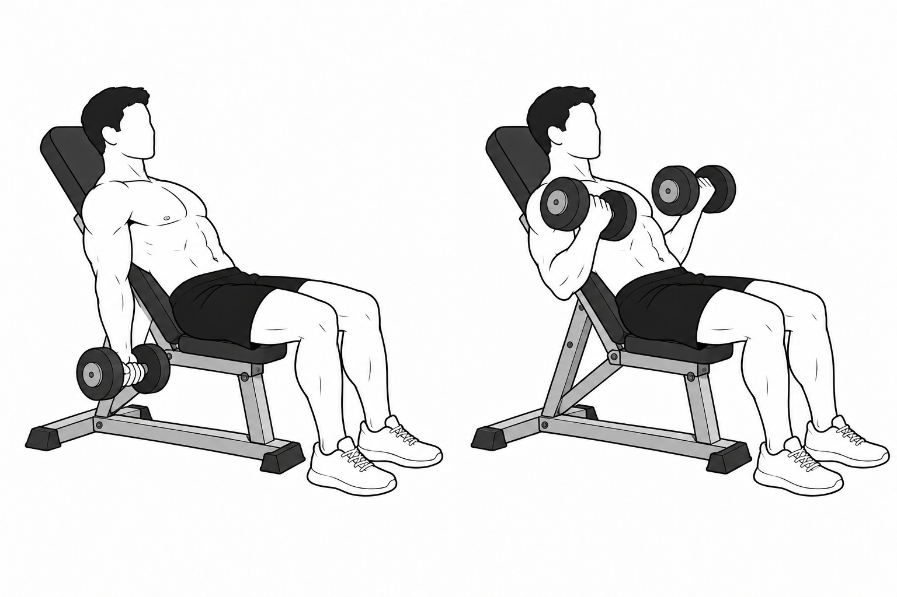

Arms hanging / Dumbbells curled

Curl two dumbbells while reclining on an incline bench, keeping the upper arms hanging beside the torso.

- **Danish:** Skrå bicepscurl med håndvægte
- **Aliases:** Dumbbell incline biceps curl, Incline dumbbell curl
- **Primary muscles:** Biceps brachii
- **Assisting muscles:** Brachialis, Brachioradialis
- **Stabilizers:** Rotator cuff, Forearm flexors
- **Equipment:** Two dumbbells, Adjustable incline bench
- **Movement:** Elbow flexion - reclined torso; Bilateral
- **Grip:** Supinated, palms facing forward at the bottom and upward as the elbows bend.
- **Difficulty:** Beginner (editorial label)
- **Review:** draft; revision 1

### Setup

- Set the backrest to a comfortable incline, approximately 45-60 degrees above horizontal.
- Sit with the back supported and feet flat, holding a dumbbell in each hand.
- Let the arms hang beside the bench with palms forward and elbows softly extended.

### Execution

1. Bend both elbows to curl the dumbbells toward the shoulders.
2. Keep the upper arms hanging rather than swinging them forward.
3. Pause before the shoulders lift from the bench.
4. Lower slowly toward the starting position without forcing elbow or shoulder extension.

### Cues

- Keep the back on the support.
- Curl through the elbows.
- Lower with control.

### Common mistakes

- Swinging the upper arms forward to finish.
- Arching away from the backrest or forcing a deep shoulder stretch.

### Logging convention

Two 12 kg dumbbells: record 12 kg per dumbbell.

Keep the same exercise variant and record each dumbbell's mass rather than the combined pair.

### Variants and alternatives

Seated incline, both arms curling together with palms supinated. The illustration uses about a 50-degree backrest; keep bench angle consistent.

- Standing Dumbbell Curl
- Machine Preacher Curl

### Review notes

- Confirm preferred bench angle and simultaneous rather than alternating execution.
- The far arm is partly occluded in the illustration's lowered pose; the written version uses two dumbbells.

### References

- [Muscle & Strength - Incline Dumbbell Curl](https://www.muscleandstrength.com/exercises/incline-dumbbell-curl.html): Incline-bench dumbbell curl, controlled elbow flexion and supported torso.

[Editable JSON](../catalog/exercises/incline-dumbbell-biceps-curl.json)

## Machine Hip Thrust

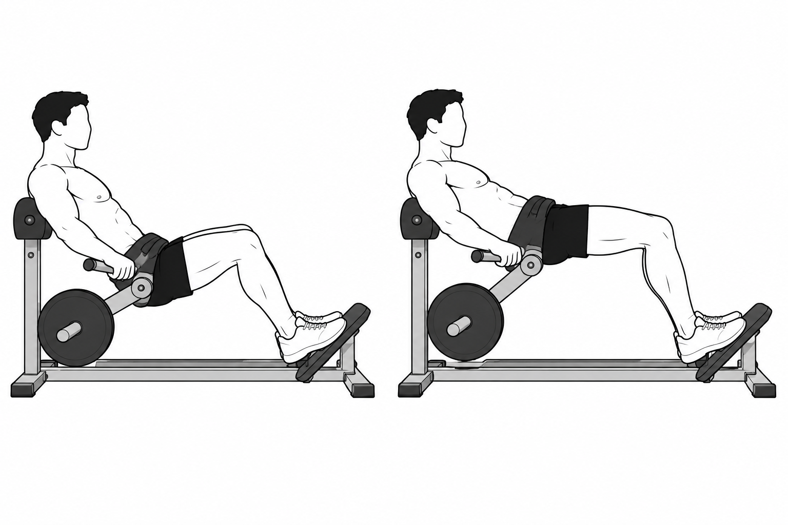

Lowered position / Hip extension

A supported hip extension against a dedicated machine's resistance. Your upper back stays supported while your hips move the padded belt or lever.

- **Danish:** Hip thrust i maskine
- **Aliases:** Glute drive, Hip thrust machine
- **Primary muscles:** Gluteus maximus
- **Assisting muscles:** Hamstrings, Adductor magnus
- **Stabilizers:** Abdominal wall
- **Equipment:** Dedicated hip-thrust machine, Weight plates for plate-loaded model
- **Movement:** Supported hip extension; Bilateral
- **Grip:** Hands steady the machine's handles; they do not lift the resistance.
- **Difficulty:** Intermediate (editorial label)
- **Review:** draft; revision 1

### Setup

- Follow the actual machine's instructions for the pad or belt, load and any safety catch.
- Place your upper back on its support and feet firmly on the platform; adjust your position for the machine.

### Execution

1. Brace the trunk and use the handles for stability.
2. Follow the machine's release sequence, then lower the hips under control.
3. Extend the hips until trunk and thighs are approximately aligned, without arching the lower back.
4. Return under control; re-engage the catch before releasing the belt or leaving.

### Cues

- Move at the hips.
- Keep ribs and pelvis controlled.
- Keep both feet planted.

### Common mistakes

- Arching the lower back to lift higher.
- Changing foot position mid-set or releasing the restraint before securing the load.

### Logging convention

Two 20 kg plates: record 40 kg added load on this machine.

Do not invent an empty-lever weight or compare loads across machines. A stack model needs a separate logging convention.

### Variants and alternatives

Illustrated as a generic belt-loaded model. Selectorized and rigid-pad machines may use a different setup and release sequence.

- Barbell Hip Thrust
- Smith Machine Hip Thrust

### Review notes

- Actual machine model, belt/pad position and catch sequence need confirmation.
- Generic schematic, not a manufacturer-specific diagram; trainer review pending.

### References

- [ACE - Understanding the Barbell Hip Thrust](https://www.acefitness.org/continuing-education/certified/november-2019/7403/understanding-the-barbell-hip-thrust/): General hip-thrust movement and muscle roles, not this exact machine.
- [Life Fitness - Plate-Loaded Glute Drive](https://shop.lifefitness.com/products/hammer-strength-plate-loaded-glute-drive): Example of dedicated machine with upper-back support, footplate and hip strap; not confirmation of the user's model.

[Editable JSON](../catalog/exercises/machine-hip-thrust.json)

## Machine Preacher Curl

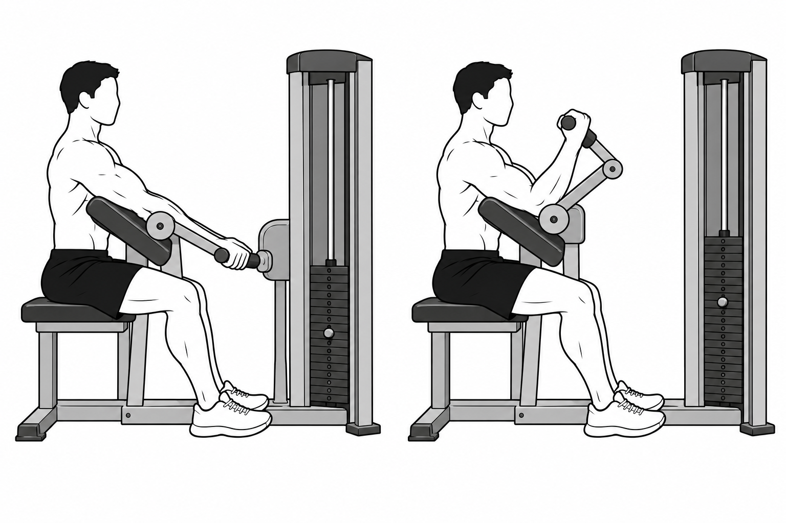

Elbows comfortably extended / Handles curled upward

Curl the handles of a preacher machine while the upper arms remain supported on its angled pad.

- **Danish:** Preachercurl i maskine
- **Aliases:** Preacher Curl, Selectorized preacher curl, Machine biceps curl
- **Primary muscles:** Biceps brachii
- **Assisting muscles:** Brachialis, Brachioradialis
- **Stabilizers:** Forearm flexors, Rotator cuff
- **Equipment:** Selectorized preacher-curl machine
- **Movement:** Elbow flexion - supported upper arms; Bilateral, shared lever
- **Grip:** Underhand or the machine's semi-supinated handles, keeping wrists aligned with the forearms.
- **Difficulty:** Beginner (editorial label)
- **Review:** draft; revision 1

### Setup

- Select a light stack setting and adjust the seat following the machine's instructions.
- Place both upper arms on the pad and align the elbows with the machine's indicated axis.
- Grasp the handles without lifting the shoulders or reaching the elbows off the pad.

### Execution

1. Bend the elbows to raise the machine handles toward the shoulders.
2. Keep the upper arms supported and the torso still.
3. Stop at the machine's comfortable range without forcing the handles closer.
4. Lower slowly without snapping the elbows straight or letting the stack drop.

### Cues

- Keep upper arms on the pad.
- Move through the elbows.
- Let the machine guide the path.

### Common mistakes

- Lifting the upper arms or chest to finish the curl.
- Using a seat setting that misaligns elbows and pivot.

### Logging convention

Machine stack selected at 20 kg: record 20 kg with the machine identified.

Record the stack setting and machine identity. Plate-loaded, independent-arm and different lever-ratio machines do not share a directly comparable load scale.

### Variants and alternatives

Machine preacher version is confirmed. Selectorized, bilateral shared lever is an equipment assumption; actual gym model, handle shape and pivot alignment need checking.

- EZ-Bar Preacher Curl
- Incline Dumbbell Biceps Curl

### Review notes

- Generic equipment schematic, not a model-specific operating diagram.
- Illustrated handle-to-lever connection and pivot geometry remain unresolved; replace or approve against the actual machine before marking reviewed.

### References

- [Life Fitness - Insignia Series Biceps Curl](https://www.lifefitness.com/en-us/catalog/strength-training/selectorized/insignia-series-biceps-curl): Manufacturer example of a supported-arm selectorized biceps machine. Does not identify the gym machine or validate this generic illustration.

[Editable JSON](../catalog/exercises/machine-preacher-curl.json)

## Overhead Rope Cable Triceps Extension

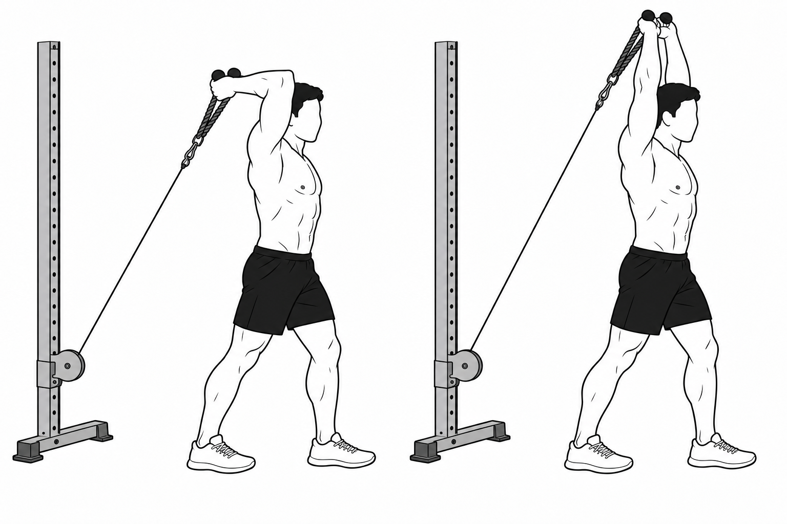

Elbows bent overhead / Elbows extended overhead

Extend both elbows with the upper arms overhead while a rope connects to a cable behind the body.

- **Danish:** Overhead tricepsextension med reb i kabel
- **Aliases:** Overhead rope extension, Cable rope triceps extension, Tricep Extension
- **Primary muscles:** Triceps brachii
- **Assisting muscles:** Anconeus
- **Stabilizers:** Rotator cuff, Abdominal wall, Forearm flexors
- **Equipment:** Low cable pulley, Rope attachment
- **Movement:** Elbow extension - arms overhead; Bilateral
- **Grip:** One rope end in each hand, palms facing each other and wrists aligned with the forearms.
- **Difficulty:** Intermediate (editorial label)
- **Review:** draft; revision 1

### Setup

- Attach the rope to a low pulley and select a manageable stack setting.
- Bring the rope behind the head and step into a stable staggered stance facing away from the stack.
- Raise the upper arms beside the head and establish cable tension without arching the back.

### Execution

1. Begin with elbows bent and hands behind the head in a comfortable position.
2. Straighten the elbows while keeping the upper arms nearly stationary.
3. Finish overhead without forcing the elbows into hyperextension.
4. Bend the elbows slowly to return; keep the cable controlled when ending the set.

### Cues

- Move at the elbows.
- Keep the ribs down.
- Let the rope ends move naturally.

### Common mistakes

- Arching the lower back to raise the hands.
- Swinging the shoulders or letting the stack pull the arms back suddenly.

### Logging convention

A single stack selected at 20 kg: record 20 kg on that machine.

Record the selected stack value, attachment and pulley setup. Pulley ratios and machine calibration make stack values unsuitable for direct comparisons across machines.

### Variants and alternatives

Overhead rope version, distinct from a pushdown. A low pulley behind the standing athlete is the illustrated assumption; a high-pulley forward-leaning version needs its own setup.

- Overhead Dumbbell Triceps Extension
- Cable Triceps Pushdown

### Review notes

- Overhead rope attachment is confirmed; exact pulley height and stance still need equipment review.
- The source's seated low-pulley setup supports the rope and elbow action, not validation of the illustrated standing adaptation.

### References

- [Muscle & Strength - Seated Cable Tricep Extension](https://www.muscleandstrength.com/node/4120): Seated low-pulley overhead rope extension; standing stance is an editorial adaptation requiring review.

[Editable JSON](../catalog/exercises/overhead-rope-cable-triceps-extension.json)

## Seated Cable Row

Arms extended / Handle at lower ribs

Pull a close-grip handle toward the lower ribs from a seated position while keeping the torso steady.

- **Danish:** Siddende kabelroning med håndtag
- **Aliases:** Seated low cable row, Close-grip cable row, Seated Cable Row with Handles
- **Primary muscles:** Latissimus dorsi, Rhomboids, Middle trapezius
- **Assisting muscles:** Posterior deltoid, Biceps brachii, Brachialis
- **Stabilizers:** Abdominal wall, Spinal erectors, Forearm flexors
- **Equipment:** Low cable pulley, Close neutral-grip row handle, Stable bench and foot supports
- **Movement:** Horizontal pull - elbows close; Bilateral, shared cable
- **Grip:** Both hands grasp the parallel grips of one close row handle, palms facing each other.
- **Difficulty:** Beginner (editorial label)
- **Review:** draft; revision 1

### Setup

- Attach a close row handle to one low cable and select the stack load.
- Sit on the bench, brace both feet on the supports and keep a small knee bend.
- Grasp the handle with both hands and sit tall at a distance that permits a controlled reach.

### Execution

1. Begin with arms extended and the shoulders allowed to reach forward without rounding the lower back.
2. Pull the elbows back close to the sides as the handle approaches the lower ribs.
3. Allow the shoulder blades to move naturally; avoid exaggerated backward leaning.
4. Extend the arms slowly to return without dropping the stack.

### Cues

- Bring elbows toward your sides.
- Keep the torso quiet.
- Control the reach.

### Common mistakes

- Rocking the whole torso to move the load.
- Shrugging or pulling the handle high toward the neck.

### Logging convention

A single stack selected at 20 kg: record 20 kg on that machine.

Record the selected stack value, attachment and pulley setup. Pulley ratios and machine calibration make stack values unsuitable for direct comparisons across machines.

### Variants and alternatives

One low cable with a hand-held close neutral-grip handle. Cuff rows and two independent cable stacks remain distinct entries.

- Seated Cable Row with Wrist Cuffs
- Bent-Over Barbell Row

### Review notes

- Close neutral handle and seated foot-supported setup are assumptions for the generic name.
- Trainer review of technique and illustrations pending.

### References

- [ACE - Cable Training, Seated Row](https://www.acefitness.org/cp/pdfs/CertifiedNews/AugSept09Cert.pdf): General seated low-cable row with close elbows; specific handle geometry is an editorial equipment assumption.

[Editable JSON](../catalog/exercises/seated-cable-row.json)

## Seated Cable Row with Wrist Cuffs

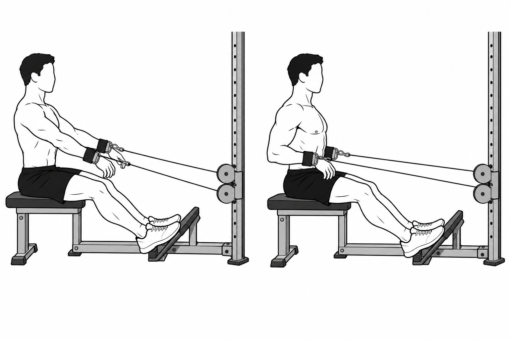

Arms extended / Elbows drawn back

A low cable row in which cuffs carry the resistance instead of hand-held handles. The elbows travel toward the sides while the torso remains steady.

- **Danish:** Siddende kabelroning med håndledscuffs
- **Aliases:** Seated Cable Row med cuffs, Cuff cable row, Wrist-cuff seated row
- **Primary muscles:** Latissimus dorsi
- **Assisting muscles:** Rhomboids, Middle trapezius, Posterior deltoid, Biceps brachii, Brachialis
- **Stabilizers:** Abdominal wall, Spinal erectors
- **Equipment:** Two low cable pulleys, Two load-rated wrist cuffs with attachment rings, Two compatible connectors, Stable bench and foot supports
- **Movement:** Horizontal pull - elbows close; Bilateral, independent cables
- **Grip:** No hand-held grip. Hands stay relaxed; resistance connects through the wrist cuffs.
- **Difficulty:** Intermediate (editorial label)
- **Review:** draft; revision 1

### Setup

- Attach one cuff to each wrist using the cuff maker's fit and attachment instructions, then connect one low cable to each cuff.
- Sit tall with feet braced, knees slightly bent and enough distance to begin with arms extended.

### Execution

1. Begin with relaxed hands and gentle cable tension; keep the torso upright.
2. Pull the elbows back toward the lower ribs without leaning backward.
3. Finish with the upper arms near the torso and shoulder blades moving naturally.
4. Extend the arms slowly and repeat without letting the cables jerk the cuffs.

### Cues

- Pull through the elbows.
- Let the cuffs carry the load.
- Keep the torso quiet.

### Common mistakes

- Swinging backward to complete the row.
- Gripping a handle or letting loose cuffs slide toward the hands.

### Logging convention

Two independent stacks each set to 15 kg: record 15 kg per side, with two stacks noted.

Keep the same cable system. A shared-stack or single-cable rig is a different setup; pulley ratios affect resistance.

### Variants and alternatives

Assumption: cuffs around the wrists, two low cables, close-elbow row. Upper-arm cuffs and a shared cable need their own variant instructions.

- Seated Cable Row with Handles
- Single-Arm Cable Row with Wrist Cuff

### Review notes

- Confirm cuff placement and whether your gym uses one cable or two.
- General rowing references do not validate this specific cuff adaptation; trainer review pending.

### References

- [ACE - Cable training, Seated Row](https://www.acefitness.org/cp/pdfs/CertifiedNews/AugSept09Cert.pdf): General low-cable seated row. Does not validate the wrist-cuff adaptation.
- [GymPin - Handles and Grips](https://gym-pin.co.uk/collections/handles-grips): Manufacturer lists cuffs for wrist and upper-arm cable training; not a cuff-row technique guide.

[Editable JSON](../catalog/exercises/seated-cable-row-wrist-cuffs.json)

## Seated Lat Pulldown Machine

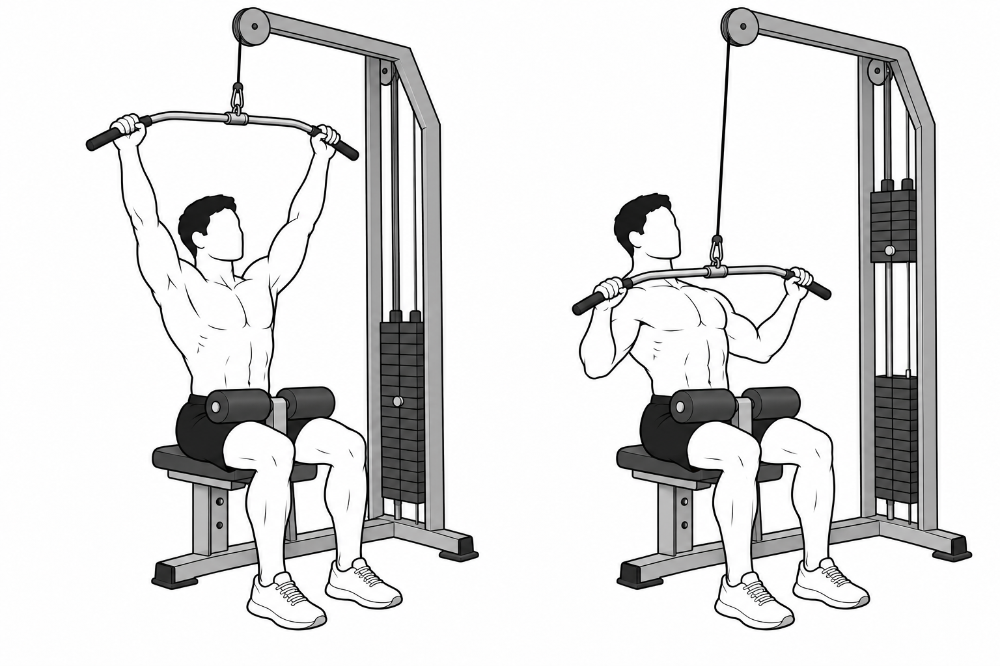

Arms overhead / Bar near upper chest

Pull a high-cable bar toward the upper chest while seated with the thighs secured under the machine pads.

- **Danish:** Siddende pulldown i maskine
- **Aliases:** Seated Lat Pull Down Machine, Wide-grip lat pulldown, Lat pulldown
- **Primary muscles:** Latissimus dorsi
- **Assisting muscles:** Teres major, Biceps brachii, Brachialis, Lower trapezius, Rhomboids
- **Stabilizers:** Rotator cuff, Abdominal wall, Forearm flexors
- **Equipment:** Selectorized lat-pulldown machine with thigh pads, Wide pulldown bar
- **Movement:** Vertical pull; Bilateral, shared cable
- **Grip:** Closed overhand grip slightly wider than shoulders, using the bar's comfortable angled sections.
- **Difficulty:** Beginner (editorial label)
- **Review:** draft; revision 1

### Setup

- Set the stack load and adjust the thigh pads to secure the legs without excessive pressure.
- Grasp the bar, sit down with feet on the floor and establish a small stable backward incline.
- Begin with arms reaching overhead and cable tension controlled.

### Execution

1. Draw the elbows down toward the sides to bring the bar toward the upper chest.
2. Keep the torso angle stable rather than rocking backward.
3. Stop within a comfortable shoulder range, with the bar in front of the head.
4. Let the arms rise slowly and allow the shoulder blades to move naturally.

### Cues

- Bring elbows toward the ribs.
- Keep the bar in front.
- Control the overhead return.

### Common mistakes

- Pulling behind the neck.
- Swinging the torso or pulling so low that the wrists and shoulders collapse.

### Logging convention

A single stack selected at 20 kg: record 20 kg on that machine.

Record the selected stack value, attachment and pulley setup. Pulley ratios and machine calibration make stack values unsuitable for direct comparisons across machines.

### Variants and alternatives

Assumes a selectorized high cable, wide overhand bar and thigh pads. A plate-loaded lever pulldown or independent handles requires a separate equipment variant.

- Neutral-Grip Lat Pulldown
- Assisted Pull-Up

### Review notes

- Exact gym machine and handle are unspecified; confirm before matching a consumer record.
- Trainer review of cable path and shoulder range pending.

### References

- [Muscle & Strength - Lat Pull Down](https://www.muscleandstrength.com/exercises/lat-pull-down.html): Seated high-cable overhand pulldown, elbow path and controlled return; exact machine geometry is unspecified.

[Editable JSON](../catalog/exercises/seated-lat-pulldown-machine.json)

## Single-Arm Rear-Delt Cable Fly

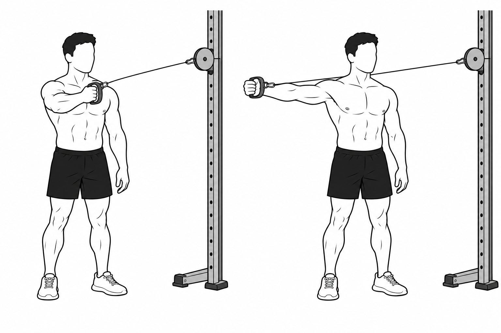

Working arm across chest / Same arm opened outward

Open one arm away from a cross-body cable reach while keeping the torso and elbow bend nearly unchanged.

- **Danish:** Enarms kabel-flyes til bagskulder
- **Aliases:** Single Arm Rear Delt Cable Fly, Single-arm cable reverse fly, One-arm rear delt fly
- **Primary muscles:** Posterior deltoid
- **Assisting muscles:** Middle trapezius, Rhomboids
- **Stabilizers:** Rotator cuff, Abdominal wall, Forearm flexors
- **Equipment:** Adjustable cable pulley, Single D-handle
- **Movement:** Shoulder horizontal abduction; Unilateral
- **Grip:** Neutral grip on one D-handle with the wrist aligned with the forearm.
- **Difficulty:** Intermediate (editorial label)
- **Review:** draft; revision 1

### Setup

- Set one pulley around shoulder height and attach a D-handle.
- Stand side-on to the stack and take the handle with the hand farther from the pulley.
- Reach that arm across the upper chest, establish a small elbow bend and take up cable tension.

### Execution

1. Sweep the working arm outward at approximately shoulder height.
2. Keep the elbow bend similar so the motion comes mainly from the shoulder.
3. Stop around the torso plane without twisting the body or pulling the elbow far behind.
4. Return slowly across the body, then repeat for the other side with the same setup.

### Cues

- Open the arm in an arc.
- Keep the chest facing forward.
- Keep the elbow bend quiet.

### Common mistakes

- Bending the elbow into a row.
- Turning the torso or shrugging to move the handle.

### Logging convention

One stack selected at 5 kg for each arm: record 5 kg per side and repetitions for each side.

Use the same pulley height and machine for both sides. Do not sum the two sides' loads; stack markings and pulley ratios differ across machines.

### Variants and alternatives

One hand-held cable, standing with a shoulder-height pulley. Cuff attachment, low-pulley bent-over and two-arm versions need separate instructions.

- Standing Cable Reverse Fly
- Reverse Pec Deck Fly

### Review notes

- Pulley height and D-handle are assumptions for the generic single-arm name.
- Source describes bilateral standing cable reverse fly; unilateral execution is an editorial adaptation requiring technique review.

### References

- [Muscle & Strength - Standing Cable Reverse Fly](https://www.muscleandstrength.com/exercises/standing-cable-flys.html): General standing reverse-fly shoulder action with a similar elbow bend. Source is bilateral; this draft adapts it to one arm and an explicitly stated pulley height.

[Editable JSON](../catalog/exercises/single-arm-rear-delt-cable-fly.json)

## Standing Barbell Curl

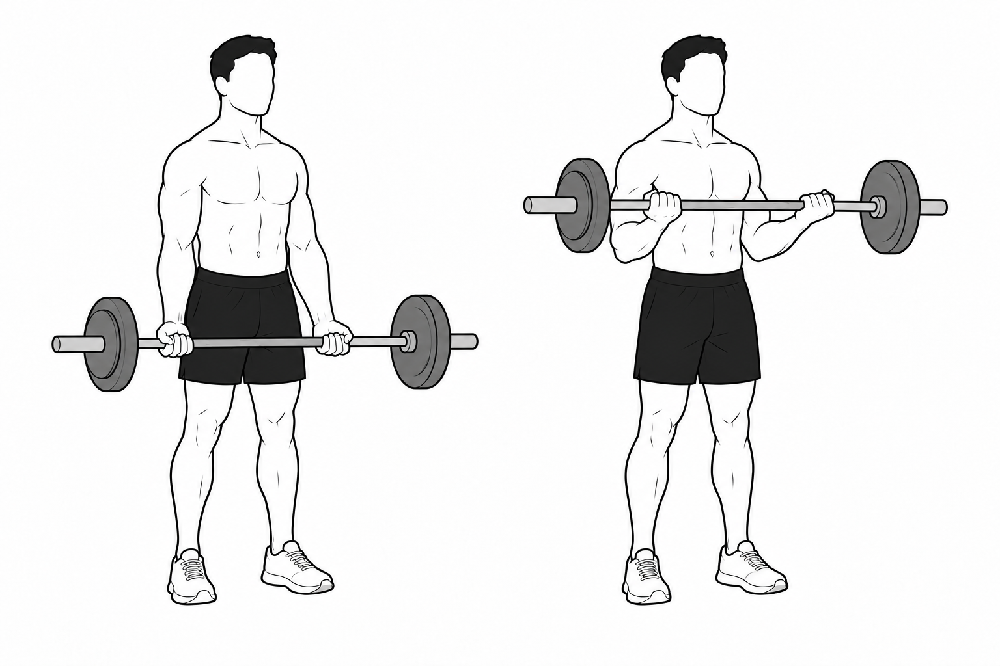

Bar at thighs / Bar curled upward

Curl a straight bar upward by bending the elbows while standing with the upper arms close to the torso.

- **Danish:** Stående bicepscurl med vægtstang
- **Aliases:** Barbell biceps curl, Straight-bar curl
- **Primary muscles:** Biceps brachii
- **Assisting muscles:** Brachialis, Brachioradialis
- **Stabilizers:** Abdominal wall, Rotator cuff, Forearm flexors
- **Equipment:** Barbell, Weight plates
- **Movement:** Elbow flexion; Bilateral
- **Grip:** Supinated underhand, approximately shoulder width, with wrists aligned with the forearms.
- **Difficulty:** Beginner (editorial label)
- **Review:** draft; revision 1

### Setup

- Hold a straight bar in front of the thighs with an underhand grip.
- Stand evenly on both feet, soften the knees and brace the torso.

### Execution

1. Bend the elbows to raise the bar without leaning backward.
2. Keep the upper arms close to the sides as the bar approaches the lower chest.
3. Stop before the shoulders roll forward or the elbows need to swing.
4. Lower slowly toward extended elbows without snapping them straight.

### Cues

- Keep the elbows quiet.
- Keep the wrists straight.
- Control both directions.

### Common mistakes

- Swinging the hips or leaning backward.
- Bending the wrists to finish the curl.

### Logging convention

A 20 kg bar plus two 15 kg plates: record 50 kg total.

Include the bar and both sides' plates; preserve the original load convention in existing logs.

### Variants and alternatives

Straight bar with a supinated grip. An EZ bar changes hand position and should retain its own equipment identity.

- EZ-Bar Curl
- Dumbbell Hammer Curl

### Review notes

- Difficulty is an editorial label; load and range remain individual.
- Trainer review of technique and illustrations pending.

### References

- [Muscle & Strength - Standing Barbell Curl](https://www.muscleandstrength.com/exercises/standing-barbell-curl.html): Standing underhand bar curl, elbow flexion and avoidance of body swing.

[Editable JSON](../catalog/exercises/standing-barbell-curl.json)

## Standing Barbell Strict Press

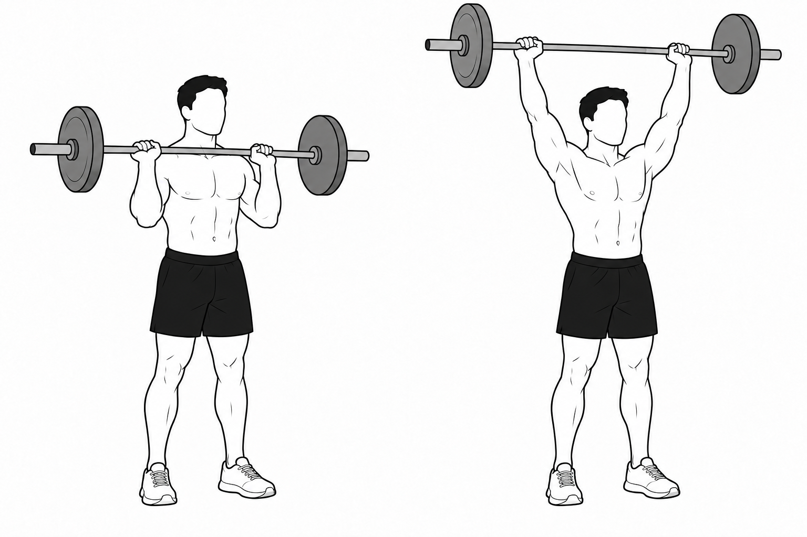

Bar at upper chest / Bar overhead

Press a barbell from the upper chest to overhead while standing with the legs still.

- **Danish:** Stående skulderpres med vægtstang
- **Aliases:** Strict Press, Military press, Barbell overhead press
- **Primary muscles:** Anterior deltoid, Lateral deltoid
- **Assisting muscles:** Triceps brachii, Serratus anterior, Trapezius
- **Stabilizers:** Rotator cuff, Abdominal wall, Gluteus maximus
- **Equipment:** Barbell, Weight plates, Rack for setup
- **Movement:** Vertical push; Bilateral
- **Grip:** Overhand, at or just outside shoulder width, with the bar supported securely in the hands.
- **Difficulty:** Intermediate (editorial label)
- **Review:** draft; revision 1

### Setup

- Set the rack just below shoulder height and take an overhand grip.
- Unrack the bar to the upper chest, step clear and establish a balanced stance.
- Brace the trunk with elbows slightly in front of the bar.

### Execution

1. Move the head just enough to let the bar pass, then press upward without knee drive.
2. Allow the shoulder blades to rotate upward as the bar rises.
3. Finish with the bar balanced over the shoulders and midfoot, head neutral.
4. Lower under control to the upper chest, keeping the torso stable.

### Cues

- Keep the bar close.
- Reach upward at the top.
- Keep the ribs over the pelvis.

### Common mistakes

- Driving with the knees or leaning far backward.
- Pressing behind the neck or letting the bar drift forward.

### Logging convention

A 20 kg bar plus two 15 kg plates: record 50 kg total.

Include the bar and both sides' plates; preserve the original load convention in existing logs.

### Variants and alternatives

Standing front-of-neck strict barbell press. The generic alias Strict Press is mapped to this barbell variant; seated, dumbbell and push presses are distinct.

- Standing Dumbbell Strict Press
- Seated Barbell Shoulder Press

### Review notes

- Standing barbell is the assumption for the generic name Strict Press.
- Trainer review of technique and illustrations pending.

### References

- [Muscle & Strength - Military Press](https://www.muscleandstrength.com/exercises/military-press.html): Standing barbell strict press, rack setup, no leg drive and overhead scapular movement.

[Editable JSON](../catalog/exercises/standing-barbell-strict-press.json)

## Standing Dumbbell Strict Press

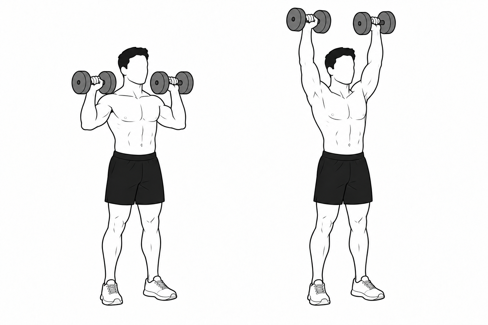

Dumbbells at shoulders / Dumbbells overhead

Press two dumbbells from shoulder height to overhead while standing without leg drive.

- **Danish:** Stående skulderpres med håndvægte
- **Aliases:** Dumbbell Strict Press, Standing dumbbell shoulder press
- **Primary muscles:** Anterior deltoid, Lateral deltoid
- **Assisting muscles:** Triceps brachii, Serratus anterior, Trapezius
- **Stabilizers:** Rotator cuff, Abdominal wall, Gluteus maximus
- **Equipment:** Two dumbbells
- **Movement:** Vertical push; Bilateral
- **Grip:** Overhand or slightly turned inward, with straight wrists and forearms beneath the dumbbells.
- **Difficulty:** Intermediate (editorial label)
- **Review:** draft; revision 1

### Setup

- Stand with feet about hip-width and bring a dumbbell to each shoulder.
- Position the elbows slightly forward of the torso, brace the trunk and balance over the whole foot.

### Execution

1. Press both dumbbells overhead without bending and driving through the knees.
2. Allow the shoulder blades to rotate upward as the arms rise.
3. Finish with the weights balanced over the shoulders and torso steady.
4. Lower to shoulder height under control.

### Cues

- Keep ribs over pelvis.
- Reach upward through both arms.
- Keep wrists over elbows.

### Common mistakes

- Leaning backward to finish the press.
- Turning the movement into a push press with leg drive.

### Logging convention

Two 12 kg dumbbells: record 12 kg per dumbbell.

Keep the same exercise variant and record each dumbbell's mass rather than the combined pair.

### Variants and alternatives

Standing, simultaneous two-dumbbell press. Seated and alternating presses are separate variants.

- Standing Barbell Strict Press
- Seated Dumbbell Shoulder Press

### Review notes

- Confirm standing rather than seated equipment setup before linking an ambiguous exercise name.
- Trainer review of technique and illustrations pending.

### References

- [Muscle & Strength - Standing Dumbbell Shoulder Press](https://www.muscleandstrength.com/exercises/standing-dumbbell-press.html): Standing two-dumbbell overhead press and general setup; muscle roles are qualitative editorial classifications.

[Editable JSON](../catalog/exercises/standing-dumbbell-strict-press.json)

## Supinated Barbell Bent-Over Row

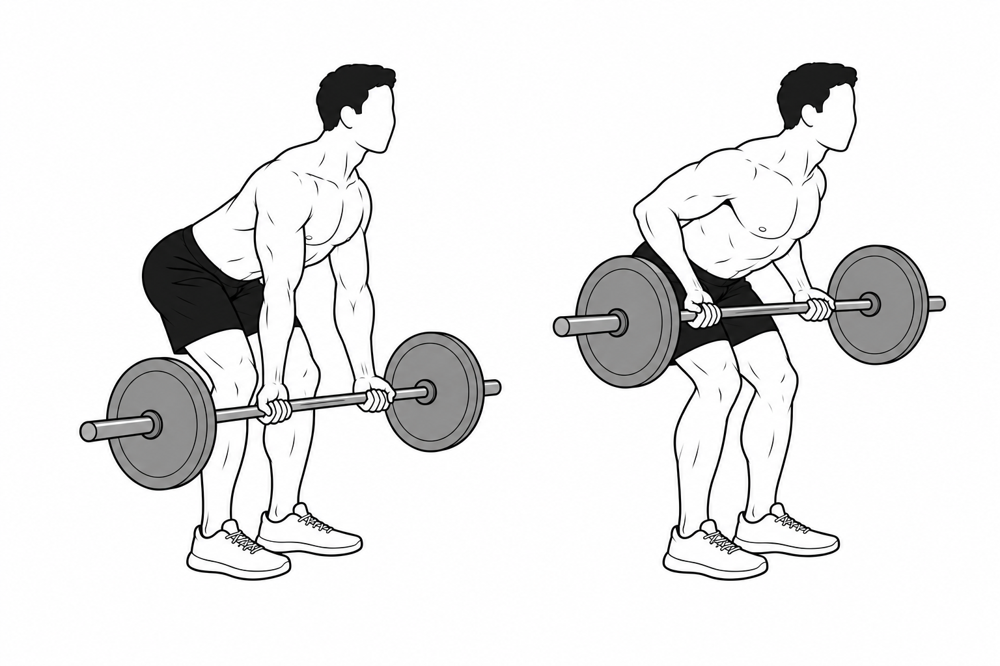

Arms extended below knees / Bar drawn toward torso

Row a barbell toward the abdomen from a hip hinge, using an underhand grip and elbows close to the sides.

- **Danish:** Foroverbøjet roning med vægtstang og underhåndsgreb
- **Aliases:** Supinated Barbell Bent Over Row, Reverse-grip bent-over row, Underhand barbell row
- **Primary muscles:** Latissimus dorsi, Rhomboids, Middle trapezius
- **Assisting muscles:** Posterior deltoid, Biceps brachii, Brachialis
- **Stabilizers:** Spinal erectors, Abdominal wall, Hamstrings, Gluteus maximus, Forearm flexors
- **Equipment:** Barbell, Weight plates
- **Movement:** Horizontal pull - unsupported hip hinge; Bilateral
- **Grip:** Supinated underhand, around shoulder width; palms face forward away from the thighs at the bottom.
- **Difficulty:** Intermediate (editorial label)
- **Review:** draft; revision 1

### Setup

- Pick up the bar with a controlled hinge, then establish a balanced stance.
- Soften the knees and hinge the hips back until the torso is inclined, keeping the back stable.

### Execution

1. Let the bar hang below the knees with the arms extended.
2. Draw the elbows back to bring the bar toward the lower ribs or upper abdomen.
3. Keep the torso angle and knee bend steady as the shoulder blades move naturally.
4. Lower under control to extended arms without dropping the bar or rounding the back.

### Cues

- Hold the hinge.
- Pull with the elbows.
- Lower without swinging.

### Common mistakes

- Standing up on each pull to move the load.
- Jerking the bar or rounding the trunk.

### Logging convention

A 20 kg bar plus two 15 kg plates: record 50 kg total.

Include the bar and both sides' plates; preserve the original load convention in existing logs.

### Variants and alternatives

Supinated grip with a stable inclined torso. This is a row, not a standing curl; more upright Yates-style setups need their own note.

- Bent-Over Barbell Row
- Seated Cable Row

### Review notes

- Torso angle and grip width may vary; keep the selected setup consistent.
- Trainer review of technique and illustrations pending.

### References

- [Muscle & Strength - Reverse Grip Bent Over Row](https://www.muscleandstrength.com/exercises/reverse-grip-bent-over-row.html): Underhand grip, hip-hinged torso and controlled row with close elbows.

[Editable JSON](../catalog/exercises/supinated-barbell-bent-over-row.json)
